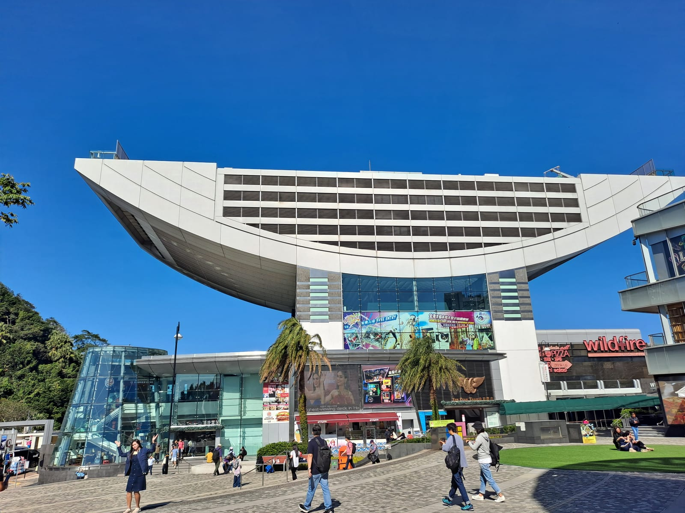
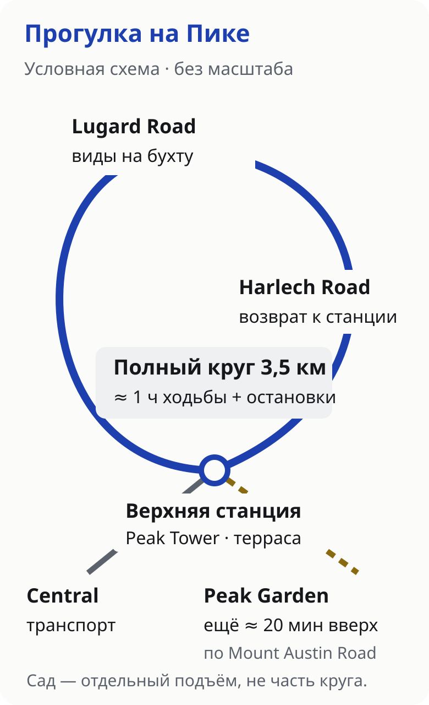
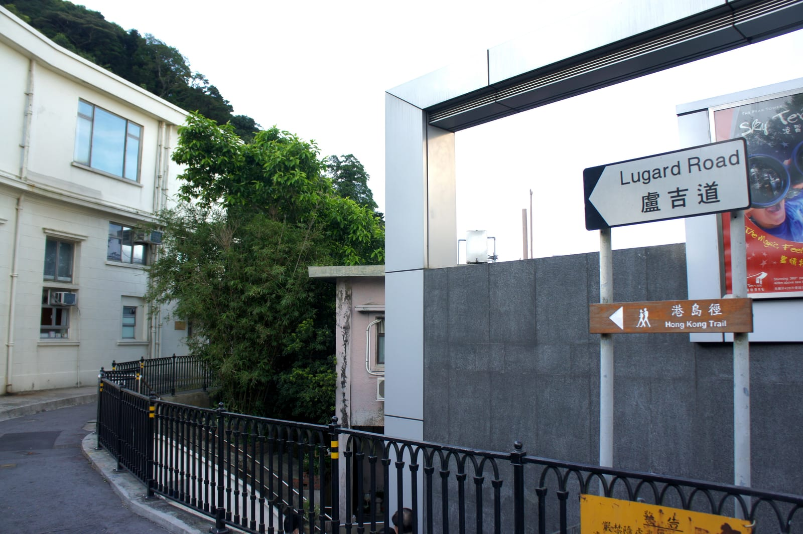
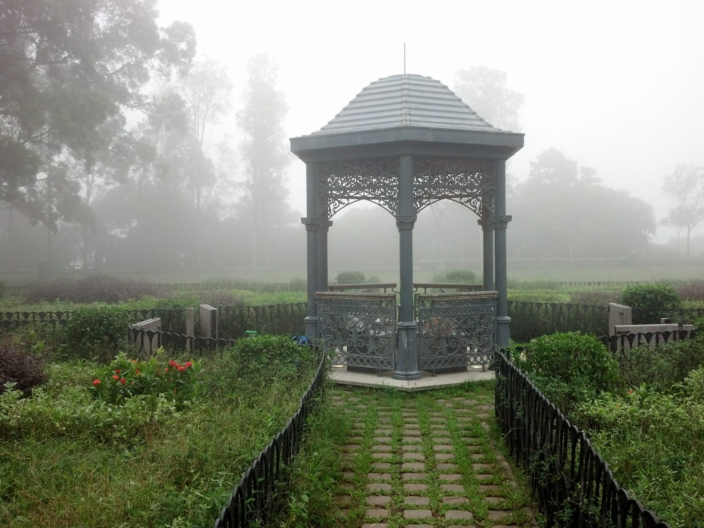

import { tpkDeep } from '../../data/affiliate.js';

## Стоит ли ехать на Пик Виктория

Пик даёт возможность рассмотреть устройство Гонконга: башни стоят тесной полосой между склонами и водой, за бухтой начинается Коулун. При хорошей видимости интересен и дальний план, и лес вокруг пешеходной дорожки. Вечером окна и дороги складываются в другую картину. Если хочется одновременно дневных деталей и огней, оставьте на вершине время до темноты.

**Платят за транспорт и отдельную террасу, а не за доступ ко всему району Пика.** Можно приехать автобусом, пройти к открытым видам и ничего не покупать наверху. Фуникулёр Peak Tram имеет смысл ради самой поездки по крутому склону. Sky Terrace 428 — ради высокой открытой площадки с круговым обзором. Это три разных решения.

| Ваша задача | Разумный вариант | Ограничение |
|---|---|---|
| Посмотреть на бухту с небольшими расходами | Автобус №15 и Lugard Road | Дольше ехать, к открытым видам нужно идти |
| Прокатиться на фуникулёре | Peak Tram и бесплатная прогулка | Обычный онлайн-билет не убирает очередь на посадку |
| Терраса и фуникулёр в обе стороны | Special Combo Return | Датированный билет, плохая видимость не даёт возврата |
| Прогулка среди зелени | Круг Lugard Road — Harlech Road | Полный круг требует времени и подходящей погоды |
| Совсем мало времени или вершина в облаке | Оставить Пик на другой день | Подъём не гарантирует панорамы |

План на два-три часа удобнее считать **от прибытия наверх**, оставляя дорогу и ожидание отдельно. Если свободно всего полтора часа между встречами, обещание «фуникулёр едет несколько минут» не делает визит коротким: ещё будут путь к станции, посадка и возвращение.

## Самостоятельно или с гидом

Для фуникулёра, террасы и прогулки по указателям гид не обязателен. Самостоятельный визит позволяет подстроиться под просвет в облаках и провести у вида столько времени, сколько хочется. Для первого знакомства с кварталами Central и историей города полезнее отдельная городская прогулка, после которой можно оставить Пик на ясный отрезок дня.

У Sputnik есть <a href={tpkDeep('sputnik8', 'https://www.sputnik8.com/ru/hongkong/activities/82522-individualnaya-ekskursiya-po-gonkongu-s-mestnym-zhitelem', 'tt_blog_pik-viktoriya_city')} rel="sponsored noopener" target="_blank">индивидуальная прогулка по Гонконгу с местным жителем</a>: два часа, маршрут согласуется заранее. Для одного человека указано $105 — около 8460 ₽; для двоих $116,50 — около 9380 ₽ за прогулку. Цена зависит от состава группы. Доступны английский, итальянский, испанский и французский; русский в карточке не заявлен.

**Это не билет на Пик и не обещание включённого подъёма.** Входные билеты оплачиваются отдельно, посещение Пика необходимо согласовать до покупки. Если цель — только вид и короткая прогулка, самостоятельный вариант проще и дешевле. Перед покупкой проверьте конкретную дату, язык и место встречи.

## Как добраться: фуникулёр, автобус или пешком

### Peak Tram от Garden Road

Нижняя станция находится по адресу **33 Garden Road**, на острове Гонконг. От метро Central можно идти по указателям к Peak Tram; это подъём по городским улицам, поэтому время до станции не стоит приравнивать к расстоянию по прямой. Из Коулуна сначала нужно пересечь бухту, а не искать нижнюю станцию на своей набережной.

Peak Tram работает ежедневно **07:30–23:00**. Обычные уличные двухэтажные трамваи на острове относятся к другой системе: их билет не довезёт до верхней станции Пика. Внутри фуникулёра посадка и наклон вагона — часть впечатления; поездка не заменяет прогулку наверху.

Электронный билет избавляет от покупки в кассе, но **не предоставляет приоритетной посадки**. Для билета со временем нужно прийти в указанный интервал. Не обещайте себе ни конкретное число минут ожидания, ни пустую очередь на спуск: они зависят от дня и потока посетителей. Оператор рекомендует приезжать до 15:00 вне пиковых часов, однако это рекомендация, а не гарантия.

### Автобус №15

Маршрут №15 связывает Central и The Peak. Полный взрослый тариф в таблице Citybus — **13 HKD, около 130 ₽ в одну сторону**. У маршрута есть варианты движения и отправления, поэтому перед выходом откройте [схему Citybus и прибытие автобусов](https://mobile.citybus.com.hk/nwp3/?ds=15--The_Peak&f=1&l=1) и выберите свою остановку. Старый совет «всегда идти к одному определённому пирсу» может привести не к нужному отправлению.

Автобус удобен для экономного визита и спуска после прогулки. Дорога извилистая; если укачивает, выбор транспорта стоит обдумать заранее. Время в пути зависит от пробок, а вечером очередь возможна и на автобус. Билет на обратный фуникулёр не превращается в автобусный: при смене решения автобус оплачивается отдельно.

### Подъём пешком

Old Peak Road — вариант для тех, кто хочет именно подъём с нагрузкой. Его не стоит выбирать только потому, что очередь у фуникулёра выглядит длинной. Перепад высоты, жара и влажная поверхность меняют усилие сильнее, чем короткая линия в навигаторе. В кроссовках без цепкой подошвы, с чемоданом или перед вылетом разумнее транспорт.

**Подняться из Central пешком и пройти круг наверху — разные прогулки.** Для спокойного первого визита можно сохранить силы: приехать наверх, а затем пройти Lugard Road. Обратный пеший спуск тоже нагружает ноги и требует отдельного времени; он не обязателен ради экономии второго билета.

## Какие билеты нужны и сколько стоит посещение

[Официальная касса Peak Tram](https://webstore.thepeak.com.hk/?lang=en_us) продаёт проезд, отдельный вход на террасу и комбинации. Sky Terrace 428 работает **08:30–22:00**; поздний фуникулёр не означает, что терраса ещё открыта. Сверяйте выбранную дату и продукт: у специальных утренних или вечерних предложений могут быть собственные условия.

| Билет | Взрослый | Ребёнок 3–11 лет / посетитель 65+ |
|---|---|---|
| Peak Tram в одну сторону | 82 HKD ≈ 840 ₽ | 52 HKD ≈ 530 ₽ |
| Peak Tram туда-обратно | 116 HKD ≈ 1190 ₽ | 75 HKD ≈ 770 ₽ |
| Sky Terrace 428 отдельно | 80 HKD ≈ 820 ₽ | 50 HKD ≈ 510 ₽ |
| Special Combo с подъёмом в одну сторону | 146 HKD ≈ 1500 ₽ | 95 HKD ≈ 980 ₽ |
| Special Combo с фуникулёром туда-обратно | 182 HKD ≈ 1870 ₽ | 118 HKD ≈ 1210 ₽ |

Рублёвые суммы округлены; списание по карте может отличаться. Для ребёнка младше трёх лет перед оплатой проверьте правила выбранного продукта; не добавляйте взрослый билет автоматически.

**Обычный combo не нужно дополнять вторым билетом на ту же террасу.** Раздельно взрослые проезд туда-обратно и терраса стоят 116 + 80 = 196 HKD, combo — 182 HKD: разница **14 HKD, около 140 ₽**. Если едете наверх автобусом, отдельная терраса имеет смысл; два автобуса и вход составят 13 + 13 + 80 = **106 HKD, около 1090 ₽**. Это другой набор впечатлений: поездки в фуникулёре в нём нет.

Для семьи из двух взрослых и двух детей 3–11 лет четыре comboReturn — **600 HKD, около 6160 ₽**. Это только фуникулёр и терраса: метро до Central, еда, музеи и другие покупки не входят. Такой расчёт помогает заранее решить, насколько семье нужна именно платная площадка.

У обычной официальной покупки дата и интервал фиксируются. Передумать из-за облаков и получить деньги назад нельзя; при остановке сервиса действуют отдельные правила оператора. Octopus принимают для покупки в кассе, **приложить её к турникету вместо билета нельзя**. После онлайн-оплаты дождитесь выпущенного электронного билета с QR. Банковское уведомление его не заменяет.

*Peak Tower у верхней станции. Фотография декабря 2023 года; Sky Terrace находится наверху здания.*

## Что посмотреть наверху и в каком порядке

Для первого визита удобна последовательность **верхняя станция → выбранная смотровая → Lugard Road → Harlech Road → возвращение к транспорту**. Сад Victoria Peak Garden оставьте отдельным дополнением. Попытка уместить в один короткий визит круг, сад, террасу и музей превращает прогулку в переходы между обязательствами.

*Схема показывает развилки, не масштаб и не навигационный трек. На месте следуйте указателям и ограничениям доступа.*

### Sky Terrace 428 или бесплатный вид

Sky Terrace — открытая площадка над Peak Tower. Её выбирают ради кругового обзора и удобства одного места наблюдения. Число **428 — высота над морем**, а не высота здания. Терраса не является высшей точкой всего острова и не нужна для начала прогулки по Пику.

Бесплатные точки есть у Peak Galleria и вдоль Lugard Road. Это другие ракурсы: деревья и повороты дороги то закрывают город, то открывают его заново. Бесплатная прогулка подходит для смены ракурсов и пауз среди зелени. Она всё равно требует хорошей видимости; слово «бесплатно» не делает туман прозрачнее.

### Круг по Lugard Road и Harlech Road

От зоны верхней станции выходите на Lugard Road. В начале ищите дорожный указатель, а не автомобильную дорогу вниз. Первые метры под деревьями не означают, что панорамы кончились: вид раскрывается дальше по склону. У ограждений оставляйте место для прохода, особенно когда люди останавливаются снимать.

Полный **Peak Circle Walk — примерно 3,5 км**. Hong Kong Tourism Board даёт ориентир около часа ходьбы; с остановками для фотографий и отдыха разумно оставить **полтора-два часа**. Это планировочный запас, не измеренное время автора. Круг возвращает в район торговых центров через Harlech Road: его удобно пройти без отдельного поиска транспорта на другом конце.

Если устали или времени мало, не нужно завершать круг ради отметки. Можно пройти по Lugard Road до понравившегося открытого вида и вернуться тем же путём. Следите за оставшимся временем на спуск; короткий участок с фотографиями лучше, чем полный круг в спешке после темноты.

*Начало Lugard Road, архивный кадр июля 2011 года. Современные перекрытия и направление прохода проверяйте на месте.*

### Victoria Peak Garden — отдельное дополнение

К саду ведёт **Mount Austin Road**, ещё выше от района станции. Ориентир туристического бюро — около 20 минут подъёма; обратный путь и время внутри добавляются отдельно. В саду другие впечатления: газоны, беседки, деревья и виды к южной части острова. Это хороший выбор, если кроме городской панорамы хочется увидеть сад.

Сад не стоит включать автоматически после длинного круга с маленьким ребёнком. Выберите одно: неспешный круг или дополнительный подъём. По запросу «вершина Пика» навигатор может повести выше туристических площадок; для посещения используйте названия конкретных доступных точек, не пытайтесь пройти через закрытые ворота.

*Victoria Peak Garden в августе 2013 года: пример того, как облако меняет вид на горе, а не прогноз на вашу поездку.*

## Когда ехать и что делать при облачности

Для городских панорам осень и начало зимы обычно удобнее влажного весеннего периода, но сезон не гарантирует вид. Перед выходом проверьте [камеру Гонконгской обсерватории на Пике](https://www.hko.gov.hk/en/wxinfo/ts/webcam/VPB_photo.htm): виден ли противоположный берег, различимы ли башни, нет ли белой стены прямо перед объективом. Посмотрите время кадра — архивное изображение не показывает текущую погоду.

Для заката сначала узнайте местное время захода солнца на свою дату. Доберитесь наверх заранее, оставив запас на очередь, а не покупайте билет в расчёте на последний возможный вагон. Короткий зимний день и летний вечер требуют разных планов. Если важны фотографии в светлое время, начните прогулку раньше, а террасу или короткий вид у станции можно оставить на огни.

При низких облаках есть два честных варианта: перенести визит или идти ради лесной прогулки, понимая, что бухты может не быть видно. При грозе, сильном ветре, ливне и официальных ограничениях прогулку по открытым участкам откладывают. Оператор может остановить фуникулёр и террасу при неблагоприятной погоде, в том числе при сигнале тайфуна №8 и выше; наличие купленного билета не отменяет закрытие.

## С детьми, коляской и багажом

С ребёнком проще выбрать одну главную цель: фуникулёр, вид или короткий участок прогулки. В торговых центрах есть еда и возможность передохнуть; покупка нескольких развлечений подряд оставляет меньше времени на сам Пик. Воду и лёгкую верхнюю одежду удобнее взять до подъёма: в городе может быть тепло, а у открытого вида ветер меняет ощущения.

В Peak Tram коляску нужно **сложить**, ширина после складывания — не больше **66 см**. Продумайте посадку заранее, если один взрослый едет с ребёнком и вещами. Доступность фуникулёра не означает одинаково удобный проход по любому ответвлению прогулки; для кресла-коляски маршрут и помощь лучше уточнить у оператора отдельно.

**В станциях Peak Tram и в Peak Tower нет хранения багажа.** С чемоданом после выселения из отеля сначала решите, где его оставить, затем планируйте подъём. Перед поездкой в аэропорт оставьте запас на очередь и дорогу.

Пик удобнее соединять с Central. Для остальных дней пригодится [маршрут по Гонконгу на три дня](/blog/chto-posmotret-v-gonkonge/), а для сезона, транспорта и соседних районов — [гайд по Гонконгу](/hong-kong/).

## Что пишут те, кто был

Для сравнения прочитаны **два авторских отчёта** — Life-trip и OlgaTravel, страницы обновлены 23 мая и 24 августа 2026 года. Даты обновления не являются датами поездок; точный период посещений в этой выборке не установлен. Выборка мала, представительной её считать нельзя.

В дневном отчёте Life-trip поездка превращается в пешую прогулку, а облачность скрывает часть панорамы. В вечернем отчёте OlgaTravel важны ожидание огней, ветер и обратный автобус. Эти рассказы помогают выбрать ритм, но не обещают такую же очередь или погоду. Практический вывод для планирования: оставить свободное время наверху и заранее выбрать запасной способ спуска.

## Частые вопросы

### Можно ли увидеть Гонконг с Пика бесплатно?

Да: отдельный вход на Sky Terrace 428 не нужен для Lugard Road и других открытых видов. Транспорт до Пика оплачивается отдельно, если не подниматься пешком. Бесплатные точки имеют свои ракурсы и не повторяют платную террасу полностью.

### Можно подняться на автобусе, а спуститься на Peak Tram?

Да, это разные самостоятельные поездки. Нужен билет Peak Tram в одну сторону для спуска, а не билет на террасу. Перед покупкой проверьте условия конкретного продукта и часы работы; очередь вниз всё равно возможна.

### Онлайн-билет позволяет пройти без очереди?

Обычный датированный билет Peak Tram не даёт приоритетной посадки. Он позволяет заранее купить проезд. Приоритетный продукт, если он предлагается на вашу дату, должен прямо содержать соответствующее условие; слово «онлайн» его не заменяет.

### Хватит ли двух часов наверху?

Для одного вида и короткой прогулки — обычно подходящий запас. Полный круг с остановками, терраса и дополнительный сад в эти два часа могут не поместиться. Дорогу из Central, ожидание транспорта и возвращение считайте отдельно.
