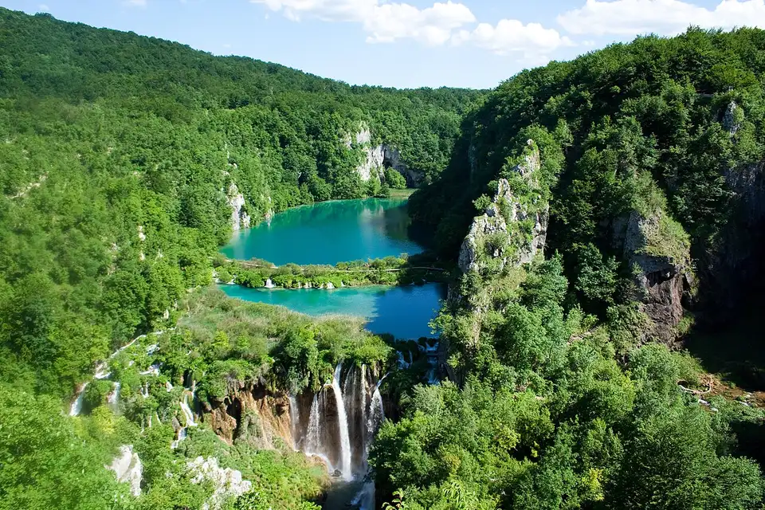
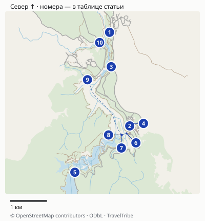
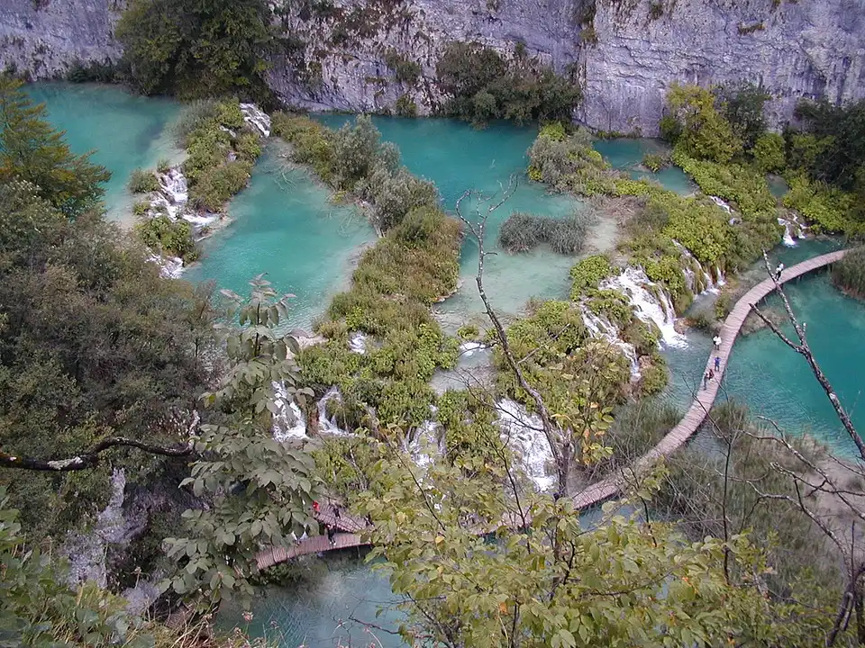
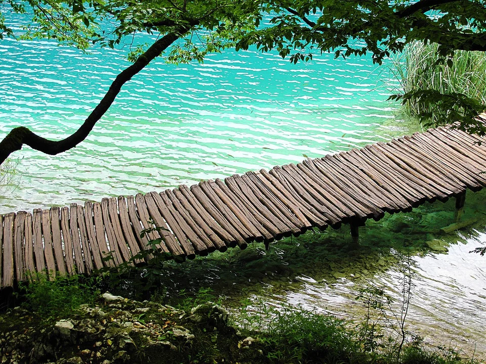

## Какой маршрут выбрать

Национальный парк предлагает восемь программ. Перебирать все перед первым визитом необязательно: сначала решите, хотите ли вы увидеть обе группы озёр и сколько времени действительно проведёте внутри. Дорога от отеля или с побережья в это время не входит.

| Ваш день | Программа и вход | Пешая часть и время парка | Что получите |
|---|---|---|---|
| Три–четыре часа на месте | B, вход 1 | 4 км, 3–4 часа | Нижние озёра, Большой водопад, Козьяк, кораблик и панорамный транспорт |
| Полный день, хотите сначала увидеть каньон | C, вход 1 | 8 км, 4–5 часов | Нижние и Верхние озёра, кораблик, возвращение преимущественно на панорамном транспорте |
| Полный день, удобнее приехать ко входу 2 | H, вход 2 | 8,9 км, 4–6 часов | Сначала транспорт к Верхним озёрам, затем прогулка, переправа через Козьяк и Нижние озёра |
| Короткая прогулка без переправы | A, вход 1 | 3,5 км, 2–3 часа | Нижние озёра и Большой водопад; Верхние озёра останутся на другой раз |

Это расстояния и продолжительность из [официальных программ парка](https://np-plitvicka-jezera.hr/en/plan-your-visit/istrazite-jezera/activities/lake-tour-programmes/). Для C или H удобнее оставить почти весь световой день: добавьте обед, фотографии и ожидание транспорта. Не обещайте себе пройти C за четыре часа и сразу попасть на единственный обратный автобус.

**Цвет не означает сложность.** Зелёным обозначены программы от входа 1, оранжевым — от входа 2. Короткая оранжевая программа может быть легче длинной зелёной. Оценивайте километры, лестницы и самочувствие, а не цвет указателя.

Если вы едете из Загреба и хотите поручить дорогу организатору, у Tiqets есть [однодневная поездка с посещением Плитвицких озёр](https://www.tiqets.com/en/plitvicka-jezera-attractions-c261368/tickets-for-plitvice-lakes-day-tour-from-zagreb-p988829/). В описании указаны трансфер туда и обратно, вход в парк и англоязычный гид; еда оплачивается отдельно. Это программа группы, поэтому самостоятельно выбрать вход, темп и все остановки, как в этом гайде, не получится. Для самостоятельной прогулки нужен обычный билет парка.

## Вход 1 или вход 2

**Вход 1 выбирайте ради Нижних озёр и Большого водопада в первой части дня.** Он подходит для B и C. Сначала вы смотрите на каньон сверху, затем спускаетесь к воде. Если запас сил или погода окажутся хуже ожидаемого, короткий формат даст главное впечатление от Нижних озёр.

**Вход 2 удобен для H и начала с Верхних озёр.** Сначала программа использует панорамный транспорт, затем ведёт пешком вдоль озёр к переправе. Это не прогулка всё время под уклон: подъёмы, лестницы и переход к выходу остаются.

Не покупайте билет на вход 1 только потому, что там нашлось удобное время, если автобус высаживает у входа 2. Сопоставьте остановку, место ночёвки, парковку и программу. В билете фиксируются официальный вход и период посещения; электронный билет необходимо активировать на выбранном входе в своё время. Сохраните его офлайн и держите до выхода — он нужен и для паркового транспорта. [Условия билета](https://np-plitvicka-jezera.hr/en/plan-your-visit/istrazite-jezera/price-list/).

Верхние и Нижние озёра соединены системой дорожек и переправ. Красивый вид с обзорной площадки не означает, что к воде можно спуститься по любой тропе.

## Карта и точная логистика

[Открыть подробную карту: масштаб, все точки и навигация](/maps/plitvitskie-ozyora/). Север вверху; нумерация указана ниже. На обзорной картинке дальние пересадки могут не помещаться — они доступны в подробной карте через «Все точки».

| № | Точка | Ориентир и ограничение |
|---|---|---|
| 1 | [Вход 1](https://www.google.com/maps/search/?api=1&query=44.9050436,15.6113221) | Нижние озёра; программы B/C. Не путать с автобусной остановкой и парковкой. |
| 2 | [Вход 2](https://www.google.com/maps/search/?api=1&query=44.8822163,15.618284) | Контрольный вход у ST2; программа H начинается с этой стороны. |
| 3 | [ST1](https://www.google.com/maps/search/?api=1&query=44.8966478,15.6119084) | Станция панорамного транспорта у Нижних озёр. |
| 4 | [ST2](https://www.google.com/maps/search/?api=1&query=44.8828178,15.6184351) | Станция пересадки у входа 2. |
| 5 | [ST3](https://www.google.com/maps/search/?api=1&query=44.8709096,15.5993428) | Выход к верхней части программыH. |
| 6 | [P1](https://www.google.com/maps/search/?api=1&query=44.8803863,15.6171703) | Восточный берег Козьяка: короткая переправа к P2. |
| 7 | [P2→P3](https://www.google.com/maps/search/?api=1&query=44.8800864,15.6154064) | Причал длинной линии по Козьяку. |
| 8 | [P2→P1](https://www.google.com/maps/search/?api=1&query=44.8800147,15.6155754) | Соседний причал короткой переправы; выбирайте нужное направление. |
| 9 | [P3](https://www.google.com/maps/search/?api=1&query=44.8934662,15.6037073) | Причал у Нижних озёр; отсюда продолжение H к каньону. |
| 10 | [Большой водопад](https://www.google.com/maps/search/?api=1&query=44.9025429,15.6079002) | Ответвление Нижних озёр; после него нужен подъём к ST1/входу1. |

### Где пересесть и когда закончить маршрут H

У входов **1 и 2 разные парковки и контроль**, а ST — остановки паркового транспорта, не междугородних автобусов. От отмеченного контроля входа 2 до ST2 около **100 м** по картографическому маршруту. От дорожной остановки или парковки подход будет длиннее: не считайте точку контроля местом высадки автобуса. По [FAQ парка](https://np-plitvicka-jezera.hr/en/faq/) остановки междугородних автобусов находятся у обоих входов на дороге D1; сторону дороги выбирают по направлению, например Загреб или Задар.

В H держите последовательность: **вход 2 → ST2 → ST3 транспортом → Верхние озёра пешком → P2–P3 корабликом → Нижние озёра и Veliki Slap → ST1 → ST2 транспортом → вход 2**. На P2 два близких причала: короткая линия уходит к P1, длинная — к P3. Номер 7 на нашей карте относится к длинной линии, номер 8 — к короткой. Кратчайший пешеходный путь навигатора не является официальным маршрутом H длиной 8,9 км.

[Сезонное расписание парка](https://np-plitvicka-jezera.hr/planirajte-posjet/istrazite-jezera/radno-vrijeme/) показывает входы 07:00–18:00, продажу билетов до 15:00 и парковки до 19:00. Последний P2→P3 указан в **16:30**, P3→P2 — в 17:00; ST1→ST2 — в **18:00**, ST3→ST2 — в 17:30. Длинная лодочная линия и панорамный транспорт заявлены каждые 30 минут. Это сезонное расписание, перед поездкой откройте его снова. Для H выбирайте утренний вход, приходите на нужный причал раньше последнего отправления; поздний билет не даёт 4–6 часов до закрытия. При закрытии Верхних озёр или отмене лодки H перестаёт быть исходным планом: выберите разрешённую короткую программу у сотрудника парка.

Расстояния округлены, время в пути зависит от пробок, погоды и открытых проходов. Метка территории может отличаться от входа: последние метры сверяйте с указателями. [Картографические данные © OpenStreetMap contributors](https://www.openstreetmap.org/copyright), ODbL.

## Как выглядит полный день по H

Ниже — последовательность официальной программы H. Следуйте её указателям и действующей схеме у входа; обозначения ST относятся к остановкам панорамного транспорта, P — к причалам. При временных перекрытиях схема на месте важнее сохранённого скриншота.

1. **Вход 2 → панорамный транспорт → Верхние озёра.** Сначала уточните у информационной стойки, открыта ли программа целиком. Не тратьте ранний прохладный час на поиск обеда и сувениров.
2. **Пешком вдоль Верхних озёр к Козьяку.** Здесь смысл прогулки — чередование воды, леса и каскадов. Не пытайтесь сразу определить «самый главный» водопад: на остановки и фотографии нужен запас.
3. **Переправа через Козьяк.** Кораблик входит в билет в рамках выбранной программы. Электронная покупка убирает покупку в кассе, но не очередь на посадку. Пообедать и воспользоваться туалетом удобнее у транспортных узлов, когда такая возможность есть.
4. **Нижние озёра → Большой водопад.** Оставьте силы на эту часть: людей на узких настилах может быть много, а обгонять и останавливаться поперёк прохода неудобно.
5. **Верхняя кромка каньона → панорамный транспорт → вход 2.** Не считайте маршрут законченным у водопада. До вашего выхода ещё нужно дойти и, по программе, доехать.

У C порядок знакомства другой: от входа 1 сначала Нижние озёра, затем Верхние. Если вы выбрали C, не перестраивайте его по чужому рассказу о H посреди прогулки: легче следовать одной проверенной программе.

**Практический запас.** Для H с фотографиями и обедом оставьте примерно шесть–семь часов на территории. Это редакционная рекомендация с запасом относительно официальных 4–6 часов. Последний транспорт проверяйте утром: закрытие входа, отправление кораблика и время выхода из парка — разные ограничения.

На настилах важны удобная обувь и спокойный темп: красивый короткий участок тоже может включать лестницы и мокрые доски.

## Билеты: сколько стоит день и что включено

В [официальном прайсе на 2026 год](https://np-plitvicka-jezera.hr/en/plan-your-visit/istrazite-jezera/price-list/) взрослый однодневный билет стоит:

| Период | Взрослый билет |
|---|---:|
| Январь–март, ноябрь–декабрь | 10 € (≈932 ₽) |
| Апрель–май, октябрь | 23 € (≈2144 ₽) |
| Июнь–сентябрь, основной дневной тариф | 40 € (≈3729 ₽) |
| Июнь–август после 16:00; сентябрь после 15:00 | 25 € (≈2331 ₽) |

Детские, студенческие и льготные категории проверяйте отдельно в прайсе. Не выбирайте студенческий тариф без документа, подтверждающего право на него.

**Вечерний билет дешевле, но для полного H или C это плохая отправная точка.** После позднего входа остаётся меньше времени на тропы и транспорт. Скидка имеет смысл, если вы сознательно выбираете короткую доступную программу и её подтверждает персонал.

Входной билет включает кораблик и панорамный транспорт в рамках программы, НДС и страхование посетителя. Парковку, еду, дорогу к парку и услуги гида не считайте автоматически включёнными. Покупайте обычный вход через [официальную билетную систему](https://ticketing.np-plitvicka-jezera.hr/): выберите дату, вход, доступное время и категорию, затем проверьте всё перед оплатой.

## Если дождь, закрыта часть парка или вы устали

**Закрыты Верхние озёра или нужный транспорт.** Не пытайтесь пройти H по старому отчёту. Уточните доступную программу у входа и перестройте день вокруг открытой части. B или A могут быть подходящей альтернативой для Нижних озёр, но их доступность тоже нужно подтвердить. Зимой сокращённый день и перекрытия особенно важны.

**Начался дождь.** Дождевик и обувь с цепкой подошвой полезнее попытки пройти мокрые настилы быстрее. При сильном дожде, подтоплении или распоряжении персонала возвращайтесь по разрешённому пути. На красивые ответвления, закрытые лентой, не заходите.

**Тяжело идти.** Скажите сотруднику, где вы находитесь и к какому входу вам нужно вернуться. Не рассчитывайте, что из любой точки есть короткий проход к парковке. На следующий визит лучше заранее выбрать короткую программу, чем рассчитывать на импровизированное сокращение длинной.

С коляской или ограниченной подвижностью не обещайте себе беспрепятственный H: лестницы, уклоны и настилы требуют отдельного выбора доступного участка. Проверьте его с парком до покупки. Название «панорамный транспорт» не означает, что между остановками не придётся ходить.

Низкий деревянный настил у воды: на мокрых досках и при встречном потоке людей лучше убрать телефон и смотреть под ноги.

## Дорога, ночёвка и обратный автобус

[Парк указывает](https://np-plitvicka-jezera.hr/en/plan-your-visit/istrazite-jezera/how-to-get-here/) автобусные остановки рядом с обоими главными входами и рекомендует проверять рейсы через [автовокзал Загреба](https://www.akz.hr/) либо [Likaline](https://likaline.hr/). Входы находятся примерно в трёх километрах друг от друга. Поэтому до покупки входного слота проверьте **остановку вашего рейса, нужный вход и обратное отправление**. Не планируйте незнакомую дорогу между входами как короткий запасной переход.

Из Загреба или с побережья учитывайте не только рейс туда: на обратный автобус нужно закончить программу, дождаться паркового транспорта и дойти к правильной стороне дороги. Оставьте этот запас поверх времени осмотра. Если после прибытия до обратного рейса остаются четыре часа, выбирайте короткую открытую программу, а не H с надеждой пройти быстрее официальной оценки.

Ночёвка рядом с нужным входом помогает начать без ранней дальней дороги. Перед бронированием уточните реальный пешеходный подход или трансфер: название Plitvice в адресе не означает близость к кассе. Для машины парковка у входов платная; уточняйте действующий тариф и сохраняйте точку стоянки.

Возьмите воду и еду, которую можно съесть в разрешённой зоне отдыха; не рассчитывайте купить полноценный обед у каждого каскада. Если важен ресторан на территории, проверьте его работу по сезону. К остановке на еду добавьте время в программе, не перекусывая на узком настиле, где нужно пропускать людей.

## Как вписать Плитвице в поездку по Хорватии

Для раннего старта удобна ночь рядом с нужным входом. Сравнивайте расстояние **по пешеходной дороге**, а не по прямой: апартаменты «рядом с парком» могут оказаться неудобными без машины. До бронирования уточните у хозяина, как именно дойти до входа и можно ли оставить багаж после выезда.

Если едете на междугороднем автобусе, сначала выберите обратный рейс и остановку, затем программу. Оставьте отдельное время на выход из парка и переход к остановке; не ставьте последнюю посадку на кораблик вплотную к автобусу. На автомобиле запомните, на какой парковке оставили машину: красивый выход у другого входа не возвращает вас к ней.

В более длинном маршруте Плитвице удобно планировать отдельным природным днём, а не добавкой к нескольким городам. Сопоставьте его с [маршрутом по Хорватии](/croatia/): если вы отдыхаете на побережье и не хотите длинного переезда, сравните Плитвице с Кркой по дороге и оставшемуся времени, а не только по фотографиям воды.

## Перед выходом из отеля

Проверьте открытые программы и погоду, выбранный вход и время билета, обратный транспорт. Возьмите воду, перекус, дождевик и удобную обувь; сохраните билет и официальную схему на телефоне. В озёрах нельзя купаться, а собаки допускаются на поводке, в том числе на кораблике и панорамном транспорте. Держитесь размеченных дорожек и следуйте ограничениям парка.

Для первого визита важнее спокойно пройти подходящую программу, чем собрать все буквы маршрутов. При полном дне C и H дают обе группы озёр; при коротком визите B позволяет увидеть Нижние озёра без обещания успеть весь парк.

