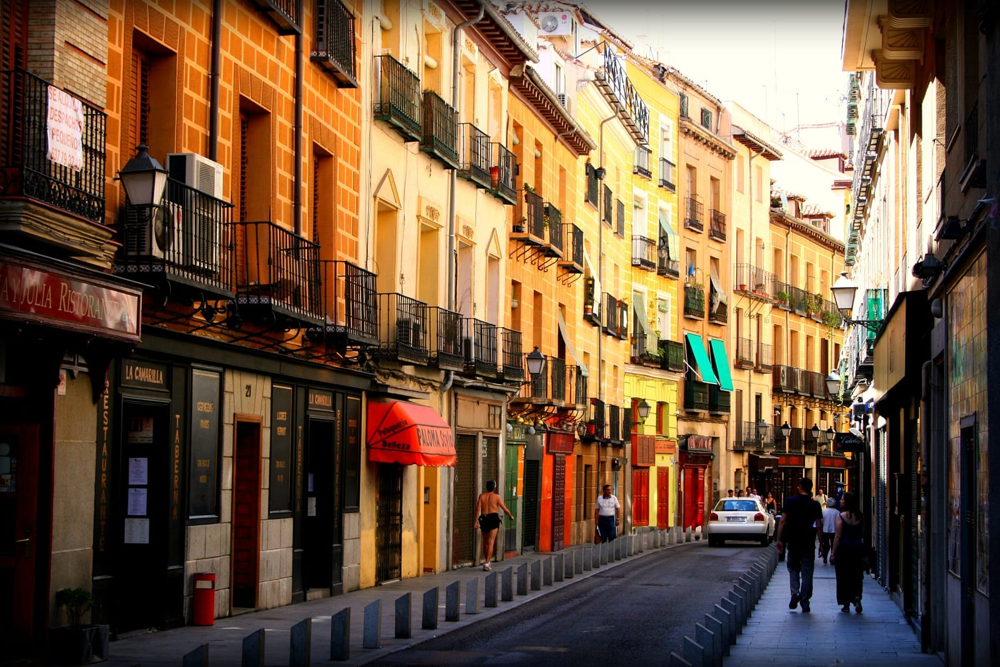
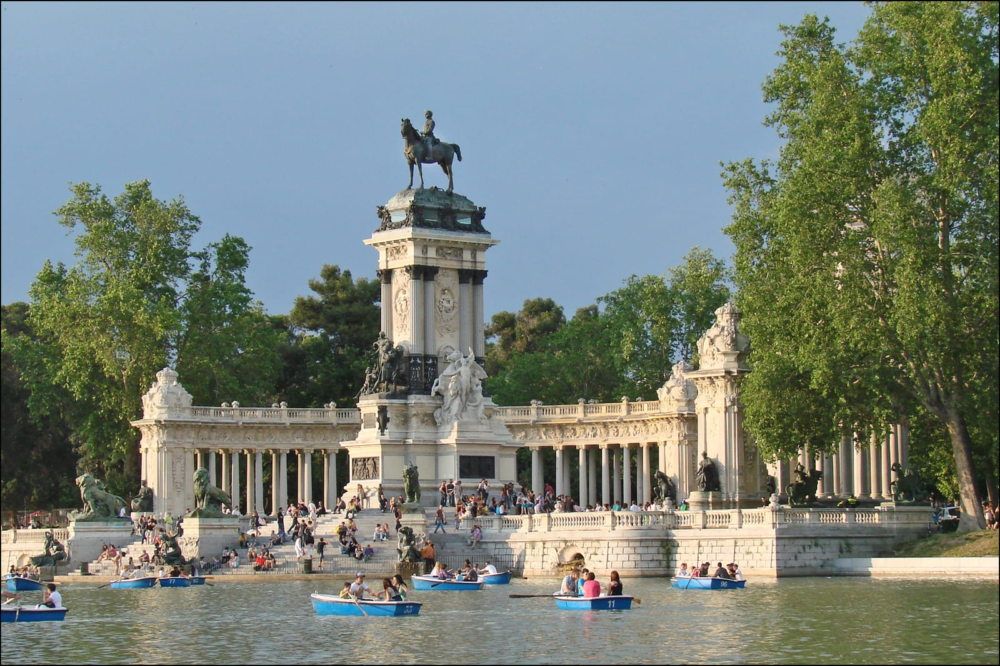
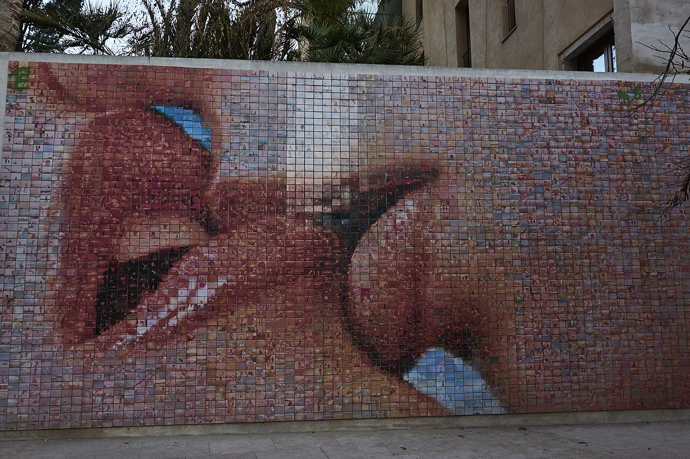

## Один жест — разные отношения

Словом «поцелуй» легко назвать сразу несколько вещей: приветствие знакомых, семейную нежность и романтическую близость. В поездке их полезнее разделять. Если человек после представления касается вашей щеки своей, это ещё не приглашение на свидание.

В испанском неформальном общении распространены **dos besos**, два приветственных поцелуя. Часто губы вообще не касаются кожи: люди сближают щёки и обозначают поцелуй звуком. Такое приветствие встречается между женщинами, между мужчиной и женщиной, а в близком кругу бывает и между мужчинами. Это описание привычки, а не инструкция для каждого жителя страны.

Между друзьями возможны объятия, прикосновение к плечу, рукопожатие. При официальном знакомстве уместно начать со слов или протянутой руки. Пол, возраст и регион влияют на манеру общения, но по ним нельзя заранее решить, какого контакта хочет конкретный человек.

Тему публичных поцелуев разбирала Люси Ловелл в материале BBC Travel. Здесь важна её отправная точка: то, что приезжему кажется интимным, в другой среде может быть обычным способом общения. Но приветствие и отношения пары всё равно остаются разными ситуациями.

*Вечер на площади Санта-Ана в Мадриде. Городская сцена, а не иллюстрация поведения всех испанцев.*

## Почему на улице заметно столько близости

Уличное кафе, площадь и парк делают общение видимым. Если люди встречаются вне дома, наблюдатель чаще замечает и объятия, и прощание, и романтические жесты. Это разумное объяснение впечатления путешественника, но само по себе оно не доказывает, что испанцы целуются чаще жителей других стран.

Есть и бытовая деталь: в 2024 году **65% жителей Испании жили в квартирах**, согласно Eurostat. Однако из типа жилья нельзя вывести нехватку личного пространства у каждой семьи или причину конкретного поцелуя. Квартира может быть просторной, дом — тесным, а выбор места встречи зависит ещё от привычек, погоды и компании.

Поэтому формула «маленькие квартиры заставляют всех целоваться на улице» слишком удобна, чтобы быть точной. Полезнее смотреть на саму городскую жизнь: где люди проводят вечер, как здороваются, кто давно знаком. Это помогает понять увиденное без ярлыка про «самую страстную нацию».

*Кава-Баха в Мадриде. Прогулки и встречи здесь происходят в обычной жилой городской среде.*

## Что наука говорит о личном пространстве

В международном исследовании 2017 года участвовали **8 943 человека из 42 стран**. Участники указывали предпочитаемую дистанцию в общении с разными людьми. Исследование помогает обсуждать различия в личном пространстве; оно не подсчитывало поцелуи прохожих и не составляет рейтинг романтичности стран.

Для путешественника главный вывод скромнее: комфортное расстояние не универсально. Человек может стоять ближе, чем вы привыкли, и не вкладывать в это особого смысла. Но среднее по стране не описывает каждого собеседника. На дистанцию влияют отношения, ситуация и индивидуальные предпочтения.

Если вам неудобно, не нужно терпеть контакт ради культурной адаптации. Отступить на комфортное расстояние, первым предложить руку или сказать, что предпочитаете приветствие без поцелуев, — нормальное решение. Улыбка и спокойный тон помогают отделить личную границу от отказа общаться.

## Как поздороваться без неловкости

Начните с **hola** и дайте собеседнику время ответить. Не тянитесь обнимать незнакомого человека только потому, что находитесь в Испании. Приветствие с продавцом, сотрудником отеля или человеком на деловой встрече не требует поцелуев.

| Ситуация | Удобная отправная точка | Чего не стоит предполагать |
|---|---|---|
| Официальное знакомство | Словесное приветствие, при взаимном желании рукопожатие | Что местный обычай требует близкого контакта |
| Вас представляют друзьям | Поздороваться и посмотреть, какой жест предлагает человек | Что два поцелуя обязательно означают симпатию |
| Встреча с близкими | Привычный для ваших отношений способ | Что все члены семьи предпочитают один жест |
| Контакт вам неприятен | Заранее предложить руку или обозначить границу словами | Что неудобство нужно скрывать ради вежливости |

Если оба выбрали dos besos, движения обычно короткие и лёгкие. Не нужно удерживать человека за лицо или превращать приветствие в настоящий поцелуй в губы. С какой стороны начать, проще понять по движению партнёра; в описаниях привычки «левая» и «правая» нередко относятся к разным точкам зрения.

Для отказа пригодится простая фраза: **Prefiero saludar sin besos** — «Предпочитаю здороваться без поцелуев». А **¿Te doy dos besos?** означает «Можно поприветствовать тебя двумя поцелуями?». Сам вопрос полезнее попытки угадать чужое желание по национальности.

*Пруд в парке Ретиро. Хорошее место для прогулки; личные сцены прохожих не превращайте в туристический аттракцион.*

## Где в Барселоне увидеть знаменитый поцелуй

У темы есть вполне конкретный адрес: **площадь Исидре Нонель — Plaça d’Isidre Nonell** в Барселоне. Там находится работа Жоана Фонткуберты и Ceràmica Cumella **El món neix en cada besada**, «Мир рождается с каждым поцелуем».

Издалека это крупный план двух целующихся лиц. Вблизи изображение распадается на **4 000 фотоплиток**. Имеет смысл сначала отойти на несколько шагов, а потом рассмотреть отдельные фотографии: иначе видишь либо общий сюжет, либо детали и упускаешь вторую половину работы.

Мозаика находится в публичном пространстве, отдельный музейный билет для её осмотра не нужен. Культурный портал Барселоны указывает ближайшую станцию метро **Jaume I, линия L4** и рекомендует утро для более спокойного посещения. Свободная площадь для фотографии всё равно не гарантирована. Не перекрывайте проход и не просите посторонних разыгрывать близость ради кадра.

Если продолжаете поездку по стране, начните с [раздела об Испании](/spain/), а для мадридской части маршрута пригодятся [выбор района для проживания](/blog/madrid-gde-ostanovitsya/) и [прогулка по парку Ретиро](/blog/park-retiro-madrid/).

*«Мир рождается с каждым поцелуем» в Барселоне. Издали виден поцелуй, вблизи — отдельные фотоплитки.*

## Частые вопросы о приветствиях

### Два поцелуя означают флирт?

**Нет, сами по себе не означают.** В неформальном кругу это может быть обычное приветствие. Отношение человека нельзя определить по одному жесту.

### Нужно ли целоваться со всеми при знакомстве?

**Нет.** Обстановка и личное желание важнее усреднённого описания традиции. Начните со словесного приветствия.

### Можно ли ограничиться рукопожатием?

**Да, если оно комфортно обоим.** На официальной встрече это привычная отправная точка; в дружеской компании можно сразу предложить такой вариант.

### Поцелуй в губы — тоже обычное приветствие?

**Нет, не считайте его стандартным приветствием незнакомых людей.** Наблюдение за парами на улице не даёт права переносить их жесты в своё знакомство.

### Все испанцы общаются одинаково?

**Нет.** Различаются люди, поколения, семьи и ситуации. Любая культурная памятка описывает тенденцию, а не обязанность.

### Где посмотреть мозаику с поцелуем?

**На площади Исидре Нонель в Барселоне.** Осмотр с публичной площади бесплатный; ближайшее метро — Jaume I на L4.

В поездке полезнее освоить один навык: замечать, какой контакт удобен вам обоим. Это помогает общаться тепло и не угадывать чужие намерения по двум поцелуям.
