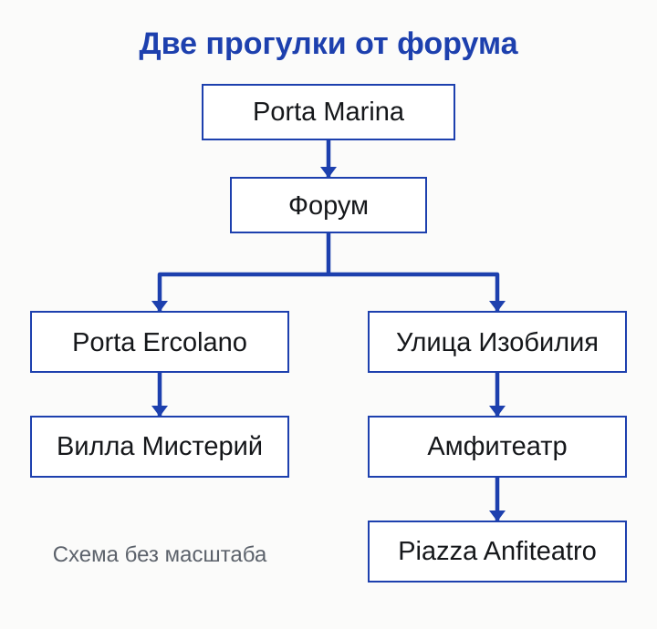
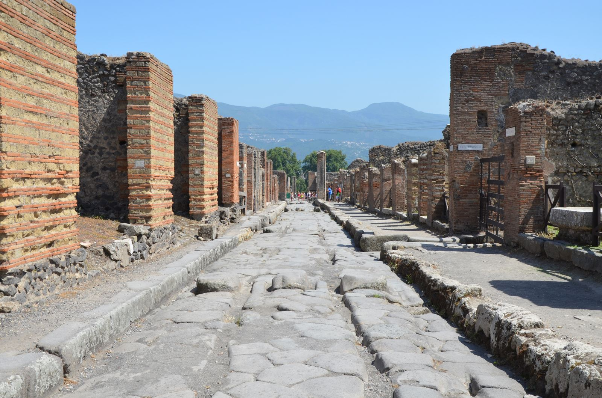
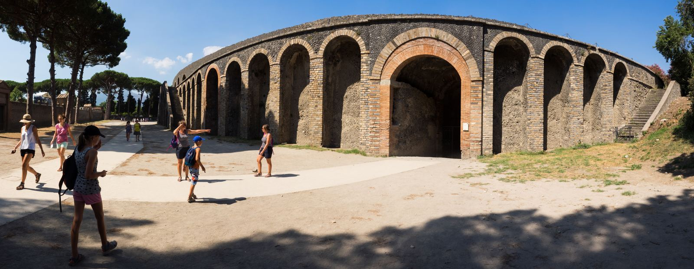
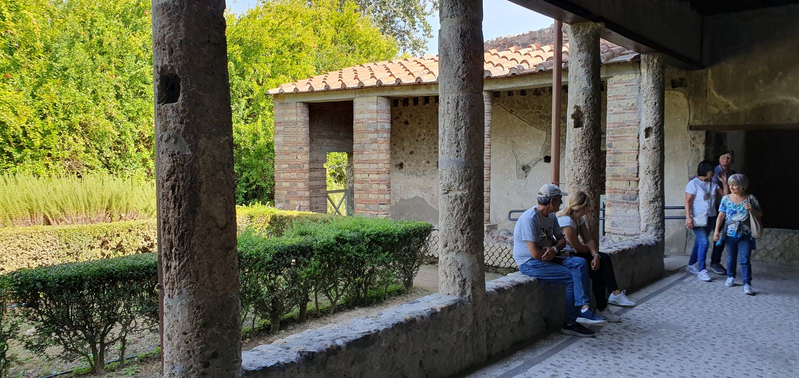

import { tpkDeep } from '../../data/affiliate.js';
export const villaTicket = tpkDeep('tiqets', 'https://www.tiqets.com/en/pompei-attractions-c71657/tickets-for-pompeii-reserved-entry-p1120452/', 'tt_pompei_iz_neapolya');

Для первой поездки из Неаполя садитесь на линию Circumvesuviana в сторону Сорренто. Выходите на станции **Pompei Scavi – Villa dei Misteri**, если хотите начать от Porta Marina и быстро дойти до форума. На древний город оставьте хотя бы два часа. На прогулку с амфитеатром или Виллой Мистерий лучше выделить полдня.

До конца декабря 2026 года за вход в древний город просят **20 € (около 1 800 ₽)**. Билет с Виллой Мистерий стоит **25 € (около 2 250 ₽)**. С 1 января парк объявил единый билет за **26 € (около 2 330 ₽)**. Если вам нужны виллы в декабре, сравните [календарь парка](https://pompeiisites.org/en/buy-tickets/) и <a href={villaTicket} target="_blank" rel="sponsored noopener">билет Tiqets с Виллой Мистерий</a>. У второго есть отдельный шаг: ваучер нужно обменять у продавца в городе. Учитывайте этот крюк до выбора поезда.

## От какой станции удобнее заходить в Помпеи

В Неаполе рядом находятся платформы поездов двух разных компаний. Если вы пришли на главный вокзал Napoli Centrale, для поезда EAV спуститесь к **Napoli Garibaldi** и ищите указатели Circumvesuviana. В [расписании EAV](https://www.eavsrl.it/orari-linee-ferroviarie/) для западных ворот нужна линия Napoli–Sorrento. Поезда на этой линии также отправляются с Porta Nolana. Выбирайте станцию отправления по тому, где вы ночуете, и проверяйте остановки конкретного рейса.

| Станция в Помпеях | Как ехать | Подходящий вход |
|---|---|---|
| Pompei Scavi – Villa dei Misteri | EAV, линия Неаполь — Сорренто | Porta Marina или Piazza Esedra. Подходят для форума и западной части древнего города |
| Pompei Santuario | EAV, линия Неаполь — Поджомарино | Piazza Anfiteatro. Удобно начать с восточной части или по доступному маршруту |
| Pompei | Поезд по линии Неаполь — Салерно | Станция в современном городе. До парка можно доехать на Pompei Link или идти к Piazza Anfiteatro |

Сохраните в телефоне **название станции и ворот одной строкой**. В билетном поиске «Pompei» и «Pompei Scavi» ведут к разным маршрутам. Если в ваучере продавца первая точка стоит на Via Roma, сначала отметьте её на карте. Даже поезд, который подвозит к воротам, не заменяет получение билета по условиям продавца.

Рейс можно выбрать после слота входа, оставив запас на пересадку внутри вокзала, путь от станции и получение билета. Если запаса нет, возьмите более поздний слот или ранний поезд. Для обратной дороги проверьте отправления с той станции, у которой хотите закончить прогулку. Войти у форума и уйти от амфитеатра иногда удобнее, чем возвращаться через весь город к первоначальным воротам. [Схема проезда парка](https://pompeiisites.org/en/visiting-info/how-to-get-there/).

Например, для входа в 10:00 через Porta Marina в [таблице EAV](https://www.eavsrl.it/orari-linee-ferroviarie/) есть отправление из Napoli Garibaldi в 8:33 с прибытием в Pompei Scavi в 9:09. В поезде 36 минут, после прибытия до слота остаётся 51 минута. Поезд в 9:33 приходит в 10:09 и для этого слота опаздывает. Это пример по расписанию линии, действующему с 17 октября. Проверьте свой день перед покупкой, особенно если нужно забрать билет у продавца.

## Сколько стоит билет в декабре и после Нового года

До 31 декабря выбирайте тариф по одному вопросу: будете ли выходить за стены древнего города к пригородным виллам. Официальный **Pompeii Express** даёт одну прогулку внутри стен. **Pompeii+** добавляет Виллу Мистерий и Виллу Диомеда, а также Виллу Регину и Антиквариум в Боскореале. Для поездки на один день вам не обязательно использовать весь набор. Выберите дальнюю остановку, ради которой готовы доплатить.

| Когда и что хотите увидеть | Тариф парка | Что учесть |
|---|---|---|
| До 31 декабря 2026, форум, дома и амфитеатр | Pompeii Express, 20 € | Пригородные виллы за пределами древнего города оплачиваются отдельно |
| До 31 декабря 2026, древний город и Вилла Мистерий | Pompeii+, 25 € | У виллы свои часы и время последнего прохода через Porta Ercolano |
| С 1 января 2027, древний город и объекты парка | Единый билет, 26 € | Парк объявил 30 дней действия и по одному посещению каждого объекта |

Если купили Express и внутри решили добавить виллы, парк разрешает доплатить **8 € (около 720 ₽)** у начала маршрута через Porta Ercolano. На этой точке оплата только картой. Получается 28 € против 25 € при покупке Pompeii+ заранее, без возможных сборов продавцов. Если вилла — одна из причин поездки, экономнее сразу взять подходящий тариф и прийти к воротам вовремя.

С января у Ольплонтиса, Боскореале и музея Стабий сохраняются отдельные билеты по 8 €. Это пригодится, если вы побывали в древнем городе и едете только в один из этих филиалов. Единый билет на 30 дней допускает **один вход в каждый объект**. Повторную прогулку по самому городу по тому же билету не закладывайте. [Декабрьская сетка тарифов и зимние часы](https://pompeiisites.org/en/visiting-info/timetables-and-tickets/), [условия с 1 января](https://pompeiisites.org/comunicati/nuovo-sistema-tariffario-in-vigore-dal-1-gennaio-2027/).

Билеты именные. Введите имя как в документе, который возьмёте с собой. Парк указывает предел 20 000 посещений древнего города за день и запрашивает документ на входе. Разбивку на утренние и дневные квоты парк отдельно публикует для периода с 16 марта по 14 октября. Для зимнего дня ориентируйтесь на доступные часы у продавца и официальное время последнего входа.

## Что посмотреть за два часа и за полдня

**Два часа от Porta Marina.** Сначала идите на форум. Здесь легко понять, как выглядел центр города: откройте план парка и найдите, где стояли базилика, храмы и рынок. Затем выберите один дом неподалёку из [списка открытых домов](https://pompeiisites.org/en/houses/) и выйдите к одной из главных улиц. Если дом закрыт или у него очередь, берите ближайший открытый. Сохраняйте полчаса на возвращение к воротам и подход к станции, если у вас жёсткий обратный поезд.

**Полдня от форума до амфитеатра.** От западных ворот пройдите форум, затем сверните к улице Изобилия и двигайтесь к восточному краю. По пути удобно чередовать дома с открытыми улицами. В доме видны фрески и устройство комнат, снаружи — каменные мостовые, тротуары и проёмы лавок. После амфитеатра выходите у Piazza Anfiteatro. Если хочется сократить прогулку, начните с этих ворот и оставьте дальние дома на другой раз.

На Via Stabiana видно, почему расстояние на карте обманывает. На неровной мостовой вы идёте медленнее, чем по тротуару современного города. Прибавляйте время на переходы между домами, особенно после дождя. Если мостовая скользит с первых шагов, сократите число остановок и оставьте время дойти до выбранных ворот в спокойном темпе.

### Если хотите увидеть Виллу Мистерий

Зимой древний город открыт с 9:00 до 17:00, общий последний вход в 15:30. 25 декабря и 1 января парк закрыт, если отдельным объявлением не назначат специальное открытие. Для праздничной даты сначала проверьте [объявления парка](https://pompeiisites.org/en/). Для виллы действуют две отсечки. **Через Porta Ercolano нужно пройти до 15:30**, а на саму виллу пускают до 16:15. Она закрывается в 16:30. Время проверяйте в [списке открытых домов](https://pompeiisites.org/en/houses/).

Если приехали к обеду и фрески виллы для вас важнее амфитеатра, идите к вилле первой. Оставить её на последний час прогулки — риск упереться в закрытые ворота по пути. При раннем входе можно посмотреть форум и северо-западную часть города, затем идти к вилле. Оценку времени внутри выбирайте по собственному темпу и оставляйте запас перед отсечкой.

### Коляска, кресло и поездка с детьми

Официальный [маршрут Pompeii for All](https://pompeiisites.org/en/visiting-info/pompeii-for-all/) начинается у Piazza Anfiteatro. Парк предупреждает о неровной мостовой, перепадах высоты и уклонах, которые местами превышают 8%. Если нужна доступная прогулка, берите за основу именно карту этого маршрута. Привычный путь от станции Pompei Scavi через Porta Marina может добавить подъём и неудобные участки. Для посадки или высадки на платформе у здания Pompei Santuario перевозчик просит предупредить станцию минимум за 20 минут до начала поездки. Телефон и условия указаны на [странице станции EAV](https://www.eavsrl.it/impianto/pompei-santuario/).

С маленьким ребёнком поездка легче, если у вас есть одна цель на каждую половину прогулки. Например, сначала амфитеатр, затем один дом или короткий отрезок улицы. Сверьте бесплатную категорию ребёнка и способ получения его билета по [правилам парка](https://pompeiisites.org/en/visiting-info/timetables-and-tickets/). Оформите его отдельно, если этого требует касса. Ранний слот лучше подходит для длинного маршрута. Поздний оставляет меньше времени на дома и остановки.

## Где покупать билет и когда имеет смысл экскурсия

У парка бронирование начинается со страницы [официальных билетов](https://pompeiisites.org/en/buy-tickets/). Это удобная отправная точка, если вы сами выбираете поезд и хотите пройти к воротам без встречи с посредником. Уточните сбор на этапе покупки, доступность оплаты вашей картой и условия изменения даты. Если онлайн-платёж не проходит, проверьте кассу парка и остаток билетов на нужный день. Лимит посещений действует и при покупке на месте.

На 1 декабря в <a href={villaTicket} target="_blank" rel="sponsored noopener">карточке Tiqets с Виллой Мистерий</a> показывались слоты от **29 € (около 2 600 ₽)**. Вариант включает вход в древний город и указанные виллы. Трансфера из Неаполя в составе нет. Продавец Around Vesuvio просит предъявить ваучер в точке встречи для обмена на билет. В карточке адрес встречи указан как **Via Roma, 123**. Перед выездом сверьте адрес в подтверждении. Срок отмены проверьте для выбранной даты в корзине до оплаты.

Экскурсия пригодится, если хочется понять, как читать руины: по следам от дверей, внутренним дворам и расположению мастерских. Перед покупкой проверьте язык, длину маршрута и включён ли вход. Если в программе нужна Вилла Мистерий, ищите её название в перечне остановок. Для поездки с детьми или короткого визита самостоятельный маршрут проще сократить по пути. В группе разумнее заранее выбрать длительность, которую выдержат все.

Если Помпеи — часть поездки через Рим и Неаполь, соединить остановки поможет [маршрут по центру и югу Италии](/italy-south/). Для ещё одного археологического дня в Риме пригодится [разбор билетов и входов в Колизей](/blog/kolizey-rim/).
