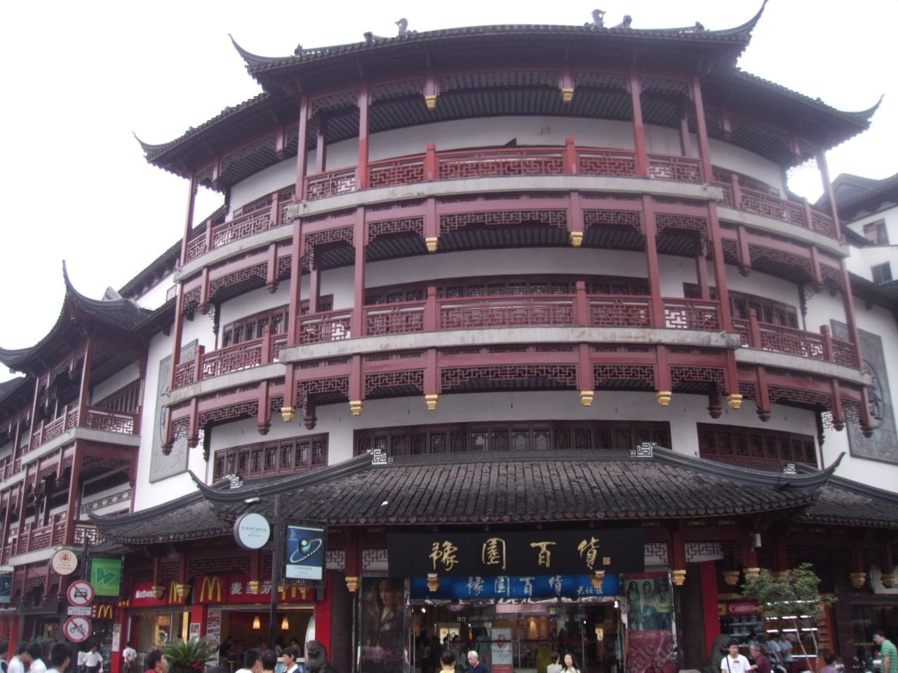
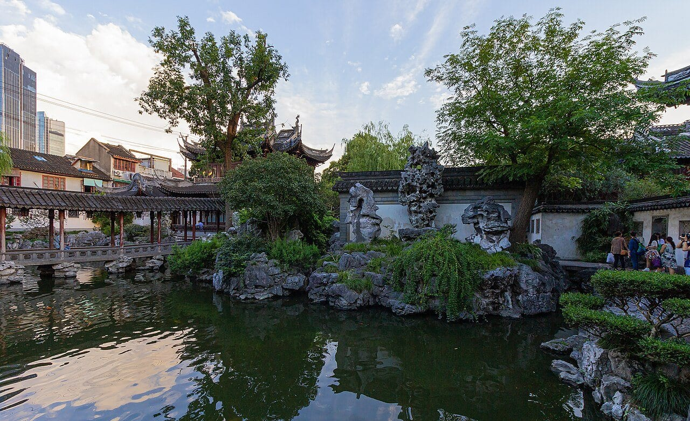
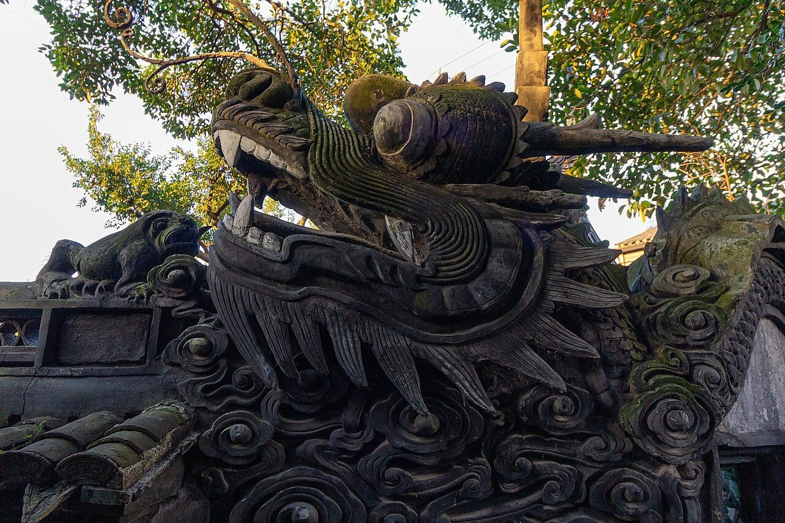

Вечерние фотографии Юйюаня могут обмануть ожидания. На них часто виден ярко освещённый торговый квартал, тогда как сам исторический сад закрыт. Чтобы посмотреть пруды, каменные композиции и павильоны, **сначала планируйте дневной вход в сад, а магазины и ужин оставляйте после**.

Обычный режим Юйюаня — **09:00–16:30, последний вход в 16:00**. По понедельникам сад закрыт, кроме национальных праздников; специальные объявления могут менять календарь. Взрослый билет стоит **30 или 40 юаней в зависимости от месяца — ориентировочно 370–490 ₽**. На сад разумно выделить полтора–два часа, на него вместе с соседним кварталом — полдня.

Если хочется разобраться в символах и религиозной жизни города, можно посмотреть <a href="https://tripster.tpk.mx/cicJCuPT?erid=2VtzqxMZpjc&amp;sub_id=tt_yuyuan_tour&amp;u=https%3A%2F%2Fexperience.tripster.ru%2Fexperience%2F129195%2F" target="_blank" rel="sponsored noopener">русскоязычную экскурсию с Юйюанем и двумя храмами</a>. В её цену не входят билеты в сад, в том числе билет гида. Для самостоятельной прогулки нужен отдельный входной билет.

## Почему Юйюань стоит увидеть среди небоскрёбов Шанхая

Здесь интересно наблюдать, как пространство раскрывается постепенно. Через проём виден один двор, за поворотом — пруд, дальше — галерея и каменная композиция. Вместо одной большой панорамы получается последовательность небольших видов. Это хорошая смена масштаба после высоток и широких набережных.

История сада начинается в **1559 году**: чиновник Пань Юньдуань создавал его для своего отца Пань Эня. Позднее участок переживал упадок, ремонты и повреждения во время конфликтов. Большое восстановление проходило в 1956–1961 годах, а в сентябре 1961 года сад открыли для публики. Поэтому современный Юйюань неверно представлять как полностью нетронутую усадьбу XVI века.

В саду стоит смотреть не только на отдельные здания. Обратите внимание на то, что обрамляет вид: край крыши, фигурное окно, отражение или линия стены. Можно пройти одну галерею дважды в разных направлениях и заметить совершенно разные композиции. Для такого посещения не требуется заранее выучить названия всех павильонов.

## Сад, базар и храм: три разных пункта маршрута

**Yu Garden / Yuyuan Garden / 豫园** — исторический сад с входным билетом и собственным расписанием. Именно сюда идут ради прудов, скал, галерей и внутренней архитектуры.

**Yuyuan Bazaar** — окружающий торговый квартал с магазинами и заведениями. Название сада часто используют и для этой территории. Прогулка по торговым улицам не означает, что вы посетили платный сад; билет в сад, в свою очередь, не оплачивает еду, покупки и специальные мероприятия с отдельным входом.

**Храм городского божества, Chenghuang Miao**, — самостоятельный религиозный объект рядом. Если хотите зайти, уточняйте его условия отдельно. Не стоит покупать неизвестный «комбинированный билет» только потому, что в названии присутствует Юйюань: сначала прочитайте, какие именно места в него входят.

Главное следствие для маршрута: приезжать на весь район можно и вечером, но **обычный дневной билет не обещает вечернего посещения сада**. Специальные ночные программы проводились, однако их нужно проверять по отдельной афише на нужную дату. Фотография фонарей прошлого фестиваля не подтверждает нынешнюю программу.

## Как добраться и найти нужные ворота

Ближайший понятный ориентир общественного транспорта — станция **Yuyuan Garden на линиях метро 10 и 14**. От неё нужно пройти к входу в сад. Сохраните китайское название и адрес ворот: точка с подписью Yuyuan может привести в торговый квартал, а не непосредственно к кассе.

У сада два входа для самостоятельных посетителей. **Северный — 168 Fuyou Road, 福佑路168号. Южный — 279 Yuyuan Old Street, 豫园老街279号**, у конца зигзагообразного моста Nine-Turn Bridge. Оба адреса опубликованы самим садом. Северный вход также обслуживает группы; южный обозначен для индивидуальных посетителей.

Если такси привозит с другой стороны квартала, не пытайтесь непременно вернуться к первой найденной метке на карте. Сопоставьте своё положение с двумя официальными воротами. У оператора не заявлена собственная парковка для посетителей, поэтому поездка на машине не устраняет финальный пеший подход.

При поездке из аэропорта учитывайте весь путь: пограничные процедуры, багаж, дорогу до города и возвращение. Юйюань не стоит обещать себе как обязательную прогулку при любой пересадке. Отдельный [маршрут пересадки в Шанхае](/blog/peresadka-v-shankhae/) поможет сначала оценить возможность выйти в город, а затем выбирать достопримечательность.

## Билеты, понедельник и последний вход

На [официальной странице посещения Юйюаня](https://www.yugarden.com.cn/page/articleview/message.html) указаны два сезонных тарифа. В **апреле–июне и сентябре–ноябре —40 юаней**, в **декабре–марте и июле–августе —30 юаней**. Это взрослый входной билет; праздничные дополнительные события могут иметь другие условия.

Билет можно купить в кассах у входов или через официальную мини-программу **上海豫园**. Если вы впервые пользуетесь китайскими приложениями и не уверены в оплате, не оставляйте регистрацию и проверку платёжного средства на последние минуты перед закрытием. Касса остаётся понятной альтернативой, но очередь и доступность билетов на нужный день стоит учитывать заранее.

У сада есть возрастные и другие льготы с документальными условиями. Например, бесплатный проход предусмотрен для детей не старше шести лет либо ростом не выше 1,3 м в сопровождении взрослого. Один взрослый может сопровождать так до трёх детей вне организованной группы. Для ребёнка старше этого возраста не рассчитывайте на бесплатный вход автоматически: проверьте подходящую категорию и документы.

**Последний вход в 16:00 — не удобное время начала полноценного осмотра.** До закрытия останется полчаса. Для спокойной прогулки приходите утром либо выделяйте на осмотр полтора–два часа днём. В понедельник меняйте план на торговый квартал и другие места города, если оператор не объявил праздничное открытие. Старые расписания в путеводителях не должны перевешивать объявление самого сада.

## Что смотреть: маршрут без гонки за всеми павильонами

После входа найдите схему и выберите последовательность по открытым проходам. У северных и южных ворот начало будет разным; важнее не геометрически идеальная линия, а возможность спокойно осмотреть несколько типов пространства. Порядок ниже — ориентир для прогулки, который можно развернуть в зависимости от входа.

**Начните с первого двора и окружающих его построек.** Посмотрите на форму крыши, дерево и камень, затем найдите следующий вид через дверной проём. Такой способ помогает замечать устройство сада вместо постоянной проверки списка названий.

**У пруда задержитесь у галереи.** Рассмотрите один павильон с берега, затем из-под крыши и в отражении. Длинный коридор становится частью композиции и помогает рассмотреть пространство между «главными» объектами. Если проход узкий, снимайте быстро и пропускайте других посетителей.

**У каменных композиций ищите форму и просветы.** Не нужно забираться на скалы ради лучшего кадра: держитесь разрешённых дорожек и обозначенных смотровых мест. Неровности, пороги и мокрое покрытие важнее, чем короткое расстояние на плане.

**Найдите стену с драконом.** Это удачная деталь для смены масштаба после общих видов: можно рассмотреть голову, фактуру черепицы и линию стены. Для ребёнка полезнее предложить поиск такого элемента, чем требовать запомнить историю каждого зала.

На завершение оставьте немного времени без обязательной точки. Вернитесь к понравившемуся виду, если путь открыт, или посидите там, где разрешено. Сад лучше работает как последовательность наблюдений, чем как забег по максимальному числу объектов.

## Утро, дождь и вечер: какой сценарий выбрать

| Ваш план | Как распределить время | Ограничение |
|---|---|---|
| Главное — сад и фотографии | Прийти к открытию, квартал посмотреть после | Пустые дорожки не гарантированы |
| Нужны сад и вечерний город | Посетить сад заранее днём, после закрытия остаться в районе | Не приходить впервые к последнему входу |
| Есть только вечер | Гулять по торговому кварталу, проверить отдельные события | Обычный вход в сад закрыт |
| Поездка выпала на понедельник | Сверить праздничные исключения, подготовить другой маршрут | Торговые улицы не заменяют посещение сада |

В дождь крытые галереи дают укрытие на части пути, но не превращают всю прогулку в помещение. Возьмите компактный зонт, обувь с нескользящей подошвой и уберите запасные вещи в закрытый пакет. Для фотографий пасмурный свет может быть удобен, однако это не причина игнорировать сильный дождь или предупреждения о погоде.

В жаркий день сокращайте непрерывное время на ногах и оставляйте паузу на воду. Зимой выбирайте одежду для долгого пребывания на улице: сад — не отапливаемый музей. При ограниченной подвижности уточните у администрации доступный вход и проходимый маршрут; наличие близкой станции метро само по себе не доказывает безбарьерность всех дворов.

## Сколько стоит самостоятельная прогулка и экскурсия

Для **двух взрослых** самостоятельный вход стоит **60 или 80 юаней — ориентировочно 740 или 990 ₽**. Отдельно оплачиваются транспорт, еда и покупки. Это полезная нижняя граница расходов на сам объект, а не полный бюджет дня в Шанхае.

<a href="https://tripster.tpk.mx/cicJCuPT?erid=2VtzqxMZpjc&amp;sub_id=tt_yuyuan_tour&amp;u=https%3A%2F%2Fexperience.tripster.ru%2Fexperience%2F129195%2F" target="_blank" rel="sponsored noopener">Программа «Где живут боги Шанхая: сад Юйюань и два храма»</a> занимает четыре часа и стоит **185 долларов за группу до шести человек — ориентировочно 15 200 ₽**. Это индивидуальная русскоязычная экскурсия по нескольким объектам, а не ускоренный вход только в сад.

Входные билеты в Юйюань, **включая билет гида**, оплачиваются отдельно. Такси при выборе этого способа передвижения, еда и напитки также не включены. Поэтому для двух взрослых в ноябре расчёт выглядит так: **185 долларов + три билета по 40 юаней = ориентировочно 16 680 ₽**, ещё без такси и еды. Третий билет — для сопровождающего, его легко забыть при самостоятельном подсчёте.

На дату проверки продавец указывает предоплату 26% и бесплатную отмену за 48 часов. До оплаты проверьте свободную дату, способ передвижения, необходимость паспорта и порядок расчёта остатка. Если вы выбираете понедельник, отдельно уточните программу: наличие даты в календаре экскурсии ещё не означает открытого сада.

Рублёвые суммы ориентировочные и округлены. Реальное списание зависит от курса и способа оплаты. Самостоятельный билет выгоден тем, кому нужна неспешная прогулка; сопровождение имеет смысл, если интересны объяснения и остальные места программы.

## Как продолжить день и кому Юйюань не подойдёт

После сада удобно поесть в соседнем квартале и только затем решить, продолжать ли прогулку к набережной Вайтань. Не назначайте плотный обед, покупку сувениров и следующую экскурсию на один короткий промежуток: очереди в заведениях и оживлённые улицы делают такой план хрупким.

Для первого визита подойдёт план из трёх частей: сад, еда, одна следующая точка. Если в Шанхае несколько дней, распределите высотную смотровую, музеи и старый город, опираясь на [путеводитель по Китаю](/blog/china-guide-2026/). Сезон и продолжение поездки можно сравнить на [странице Китая](/china/).

Юйюань может разочаровать, если вы ищете большой пустой парк для бега, гарантированное уединение или только вечернее световое шоу. Семье с уставшим ребёнком лучше сократить программу до нескольких дворов, чем делать обязательными все павильоны и два соседних храма. Любителям архитектурных деталей, напротив, полезно оставить больше свободного времени внутри.

Перед покупкой определите дату, проверьте понедельник, сохраните адрес подходящих ворот и отделите вход в сад от остальных расходов. Самый полезный выбор здесь — заранее решить, какой именно Юйюань вы хотите увидеть: исторический сад днём, торговый квартал вечером или оба места за одну спокойную поездку.
