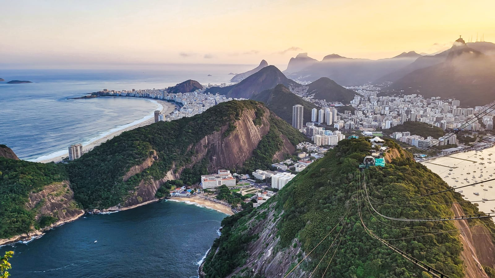
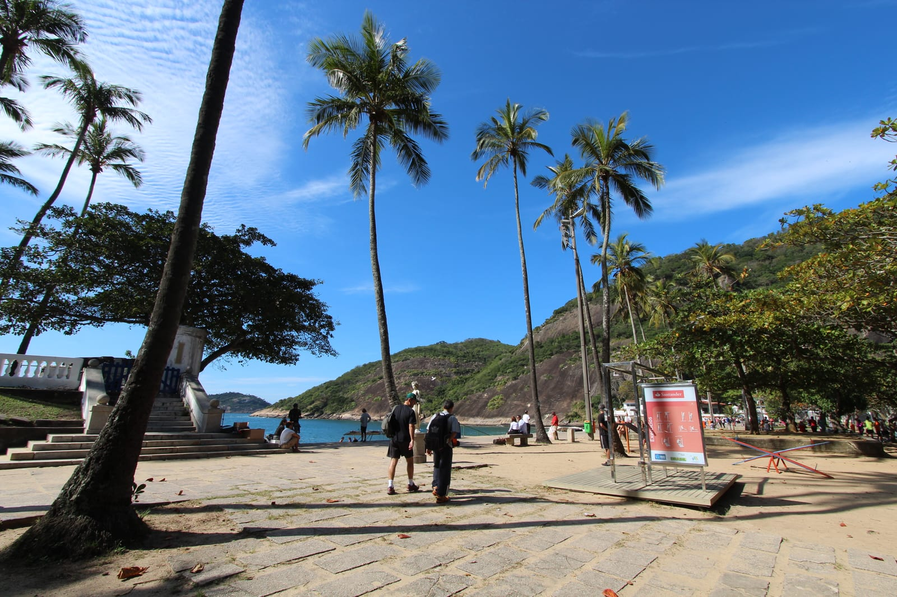
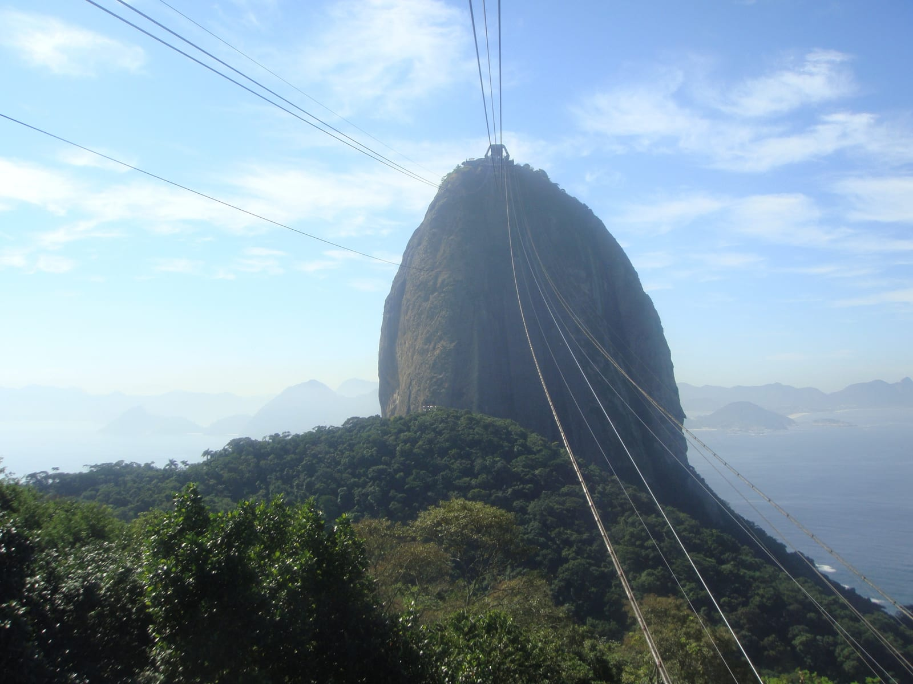
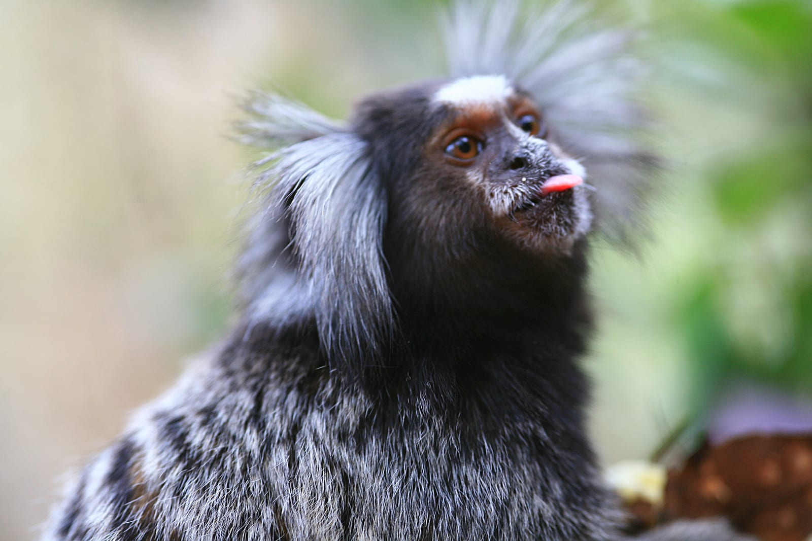

На Сахарную голову можно подняться по канатной дороге, часть пути пройти пешком или взять гида. Самая частая ошибка при сравнении этих вариантов — считать, что они включают одно и то же. **Пешая тропа ведёт только на соседнюю Урку, спуск на канатке оттуда платный, а экскурсия может продаваться без билетов на подъём.**

Сама поездка даёт редкую возможность увидеть устройство Рио: бухты заходят между горами, городские кварталы тянутся вдоль пляжей, а Корковадо со статуей Христа остаётся далеко на другой вершине. На спокойное знакомство мы советуем оставить **полдня вместе с дорогой**, особенно если хотите дождаться вечернего света.

Самостоятельный визит можно организовать по билету оператора. Если важны рассказ и сопровождение на русском, можно выбрать <a href="https://tripster.tpk.mx/cicJCuPT?erid=2VtzqxMZpjc&amp;sub_id=tt_sugarloaf_tour&amp;u=https%3A%2F%2Fexperience.tripster.ru%2Fexperience%2F121874%2F" target="_blank" rel="sponsored noopener">трёхчасовую экскурсию на Сахарную голову</a>. Ниже разбираем её расходы отдельно, чтобы цена гида не выглядела стоимостью всей поездки.

## Две вершины вместо одной

Маршрут начинается возле **Praia Vermelha**, Красного пляжа, в районе Урка. Первая линия доставляет на **Morro da Urca**, вторая — на **Pão de Açúcar**, Сахарную голову. На обратном пути вы снова пересаживаетесь на Урке. Это четыре отдельных переезда за полный визит, а не одна кабина, которая непрерывно идёт от входа до вершины.

Не торопитесь проходить промежуточную остановку. Здесь можно посмотреть на кабины прежних поколений, сравнить их с нынешними и сделать паузу между подъёмами. На верхнем уровне интересны разные направления обзора: залив, город и океан складываются в совершенно разные фотографии. Пройдите по доступным площадкам, прежде чем выбирать место для долгой остановки.

Канатка открывалась поэтапно: **до Урки — в 1912 году, до Сахарной головы — в 1913-м**. Верхняя вершина поднимается на 396 метров. Исторические кабины на Урке напоминают о первых рейсах и обновлении 1972 года: у достопримечательности есть собственная инженерная история, которую легко пропустить в погоне за панорамой.

Сахарная голова и Корковадо — разные места. На Корковадо едут к статуе Христа-Искупителя; здесь смотрят на город со стороны входа в залив. Вписывать обе поездки в один день стоит только после расчёта переездов и времени посещения. Две точки на туристической карте ещё не означают две соседние остановки.

## Сколько стоит подъём и что входит в цену

В таблице — тарифы, проверенные на официальных страницах **16 ноября 2026 года**. Стандартный билет указан **от 205 реалов**: это цена в описании продукта, не подтверждённая стоимость на любую выбранную дату. Перед оплатой проверьте сумму в корзине и категорию посетителя.

| Вариант для взрослого | Опубликованная цена | Что получаете | Что учесть |
|---|---|---|---|
| Обычный билет Bondinho | От R$ 205, ориентировочно 3000 ₽ | Обе линии туда и обратно | Обычная очередь на посадку |
| Пешком на Урку, затем на верхнюю вершину и вниз на канатке | R$ 140, ориентировочно 2050 ₽ | Дальнейший подъём и возвращение к пляжу | Сначала нужно пройти тропу; покупка на Урке |
| Пешком на Урку, вниз на канатке | R$ 65, ориентировочно 950 ₽ | Только спуск к Praia Vermelha | Сахарную голову не посещаете |
| Русский гид, группа 1–3 человека | $136 за группу, ориентировочно 11200 ₽ | Трёхчасовая индивидуальная экскурсия | Канатка дополнительно $41 с человека |

Рублёвые суммы округлены по курсу ЦБ на 14 ноября: **R$ 1≈14,63 ₽, $1≈82,15 ₽**. Это ориентир для бюджета; банк и организатор могут пересчитывать иначе. Тарифы пеших посетителей взяты из [справки службы поддержки Bondinho](https://sac.bondinho.com.br/hc/pt-br/articles/9818455162395-Acesso-ao-Parque-Bondinho-pela-trilha-do-Morro-da-Urca), стандартный — со [страницы билета](https://bondinho.com.br/en/ingresso-bondinho).

Для двух взрослых самостоятельный полный подъём получается **от R$ 410, примерно 6000 ₽**. Если оба идут пешком на Урку, а затем покупают вариант за R$ 140, получается **R$ 280, примерно 4100 ₽**. Разница относительно объявленной нижней цены — R$ 130, около 1900 ₽ за двоих. Это экономия ценой физической нагрузки и более раннего прибытия к воротам тропы.

Проезд из гостиницы, еда и покупки в суммы не входят. Вместо условного «полного дня за столько-то» добавьте к выбранному варианту реальную цену поездки от вашего адреса и заказ по меню. В жару не сокращайте запас воды ради небольшой экономии.

## Как добраться к правильному входу

В приложении транспорта указывайте **Parque Bondinho Pão de Açúcar, Avenida Pasteur, 520**. Это нижняя станция возле Praia Vermelha. Сохраните адрес латиницей: название горы само по себе не всегда помогает понять, где именно должен закончиться автомобильный маршрут.

Ближайшая станция метро — **Botafogo**. Дальше потребуется наземный участок: оператор указывает автобус 513 до района UNIRIO с короткой прогулкой ко входу. Остановку и направление автобуса проверьте в день поездки. У метро нет прямого выхода в очередь канатной дороги.

С ребёнком, после перелёта или при ограниченном времени удобнее сравнить такси от отеля с комбинацией метро и автобуса. Считайте стоимость для всей компании, а не сопоставляйте один билет общественного транспорта с целой машиной. Время в пути лучше взять из навигатора непосредственно перед выездом; единые «двадцать минут из любого района» были бы ненадёжным ориентиром.

На обратном пути заранее выберите удобную точку посадки у нижней станции. Не назначайте встречу водителю «под горой»: после спуска хочется уехать, а не выяснять, у какого из входов он ждёт. Если поездка продолжается в другом городе, пригодится наш [маршрут по Сан-Паулу на два-три дня](/blog/sao-paulo-two-three-days/).

## Когда приезжать: утро, закат и последний подъём

**Утро** удобно, если хотите оставить вторую половину дня свободной и меньше зависеть от одного красивого момента. **Вечер** выбирайте ради перехода от дневной панорамы к огням города. В обоих случаях сначала посмотрите прогноз видимости: красивый час на календаре не отменяет облака на вершине.

На официальном сайте есть расхождение: верхняя строка сообщает закрытие в 21:00 и последнюю посадку в 19:30, а текст FAQ содержит более ранние часы. Поэтому для позднего визита **сверьте расписание на нужную дату при покупке**, включая последнее отправление вниз. На старую статью или поисковый сниппет здесь полагаться не стоит.

Наш совет для заката — прибыть к нижней станции **примерно за два часа до него**. Это планировочный запас на посадки, переход между линиями и поиск ракурса, не замер очереди и не гарантия успеть в любой день. Не оставляйте вторую вершину на последние минуты: даже с билетом в телефоне нужно пройти контроль и дождаться кабины.

Покупка онлайн позволяет заранее оформить вход, но сама по себе не превращает обычный билет в приоритетный. **Fast Pass** — отдельный продукт с приоритетными очередями. Сравнивайте доплату с тем, насколько жёстко у вас ограничено время; обещать отсутствие ожидания даже с таким билетом нельзя.

## Можно ли подняться пешком и бесплатно спуститься

Пешая альтернатива заканчивается на **Morro da Urca**. Она не приводит на вершину Сахарной головы. По справке оператора от 7 августа 2026 года, на тропу нужно ориентировочно **40–60 минут**, а ворота в парк на её верхнем конце работают **с 9:00 до 17:00**.

Спуск на канатке **не бесплатный**. Билет для пришедших пешком продают в терминале на Урке: выбирайте только спуск либо дальнейший подъём на Сахарную голову с возвращением вниз. Проверяйте актуальность этих условий перед выходом, а сообщения о закрытиях тропы — на [сайте природного памятника](https://www.monapaodeacucar.com/).

Не стройте маршрут так, чтобы добраться к верхним воротам ровно к закрытию. Добавьте запас на отдых и собственный темп. Если ваша цель — вечерняя панорама без дополнительной нагрузки, обычный билет от нижней станции снимает вопрос пешего подъёма и времени доступа с тропы.

Для тропы нужны обувь с устойчивой подошвой и вода. После дождя, в сильную жару или при сомнениях в самочувствии экономия на первой линии не должна определять решение. Прогулка по смотровой и подъём по лесной тропе требуют разной готовности; оцените свой вариант до начала маршрута.

## Экскурсия на русском: считайте билеты отдельно

В проверенной программе Tripster заявлены **три часа, русский язык и индивидуальная группа до трёх человек**. Цена гида — $136 за всю компанию. Канатная дорога оплачивается отдельно: в карточке указано $41 с человека. В календаре на 24 ноября при проверке были свободные интервалы; доступность на другую дату нужно смотреть заново.

Арифметика для взрослых без льгот получается такой: один участник — **$177, около 14500 ₽**, двое — **$218, около 17900 ₽**, трое — **$259, около 21300 ₽**. Это гид и заявленная доплата за канатку; такси и еда сверху. Доплату организатора в долларах не приравниваем к тарифу официальной кассы в реалах.

Остаток экскурсии организатор принимает **в бразильских реалах по курсу Google в день поездки**. В карточке указана бесплатная отмена за 48 часов. Место встречи согласовывается отдельно: автоматический забор из гостиницы не заявлен. Отзывов именно об этой экскурсии пока нет; рейтинг организатора объединяет другие его программы.

Откройте <a href="https://tripster.tpk.mx/cicJCuPT?erid=2VtzqxMZpjc&amp;sub_id=tt_sugarloaf_booking&amp;u=https%3A%2F%2Fexperience.tripster.ru%2Fexperience%2F121874%2F" class="aff-cta" target="_blank" rel="sponsored noopener">календарь экскурсии на Сахарную голову</a>, если хотите сопровождение. Для самостоятельной прогулки логичнее сравнить билеты оператора и оставить себе свободу задержаться на понравившейся площадке.

## Маршрут на полдня без спешки

Начните с Praia Vermelha: короткая прогулка поможет увидеть горы снизу и понять, куда пойдут кабины. Затем поднимитесь на Урку, осмотритесь и продолжайте на верхнюю вершину. Если главное — закат, длинную остановку на промежуточном уровне можно оставить на обратный путь, с учётом времени закрытия площадок.

**Наш ориентир — три-четыре часа на парк и пляж без дороги от гостиницы.** Он предполагает прогулки, паузы и несколько ракурсов, а не длинный обед или специальное мероприятие. Если времени меньше, уберите пляж и кафе, но сохраните запас на возвращение с верхней вершины.

Не назначайте сразу после спуска невозвратную экскурсию в другом конце города. Выход с территории, поиск машины и городской трафик тоже занимают время. Лучше поставить следом свободный ужин: тогда задержка не превратит красивый вечер в гонку.

## Дождь, дети и ограничения

Обычный дождь не обязательно останавливает канатную дорогу; сильный ветер или молнии могут привести к паузе в работе. Другая проблема — видимость: работающая кабина ещё не означает открытый вид на город. Если едете ради фотографий, оставьте в программе Рио возможность поменять местами два дня.

При покупке напрямую у оператора действуют свои условия: на странице обычного билета указан свободный перенос или отмена за 24 часа и более, ближе к началу — дополнительные ограничения. **Не переносите эти правила на экскурсию посредника:** у выбранного выше тура иной срок бесплатной отмены. Сохраните условия своего заказа.

Оператор описывает лифты, пандусы и адаптированные туалеты. Для человека с ограниченной мобильностью лучше заранее уточнить доступность всего нужного маршрута и работу оборудования. Пешую тропу не стоит считать равноценной заменой канатке. Семье с коляской также полезно выяснить порядок посадки до оплаты.

Детям оставляйте короткие этапы и паузы, а возрастные льготы проверяйте вместе с документами для подтверждения. Отсутствие усталости у взрослых не означает, что ребёнок готов ждать заката несколько часов. Возможность закончить раньше бывает полезнее плотной программы.

## Фотографии и местные животные

Самый очевидный кадр — панорама сверху. Попробуйте дополнить его видом на канаты и кабину, деталями старого оборудования и пляжем у подножия. Тогда фотографии покажут саму поездку, а не несколько почти одинаковых горизонтов. Для съёмки через стекло подойдите ближе к нему, не мешая другим пассажирам; вечером отражения особенно заметны.

Урка — место, где можно заметить мармозеток. **Не кормите их и не пытайтесь приблизиться ради селфи**: оператор запрещает кормление и контакт с дикими животными. Снимайте с расстояния, а еду держите убранной. Случайная встреча не является включённой частью экскурсии.

Архивные фотографии в статье помогают понять ракурсы, но не обещают такое же небо или освещение. Зум телефона и терпение полезнее попытки занять опасное место у края. Для коммерческой съёмки и нестандартного оборудования действуют отдельные правила парка; обычный туристический билет не заменяет разрешение.

## Какой вариант выбрать

Для первого посещения без физических нагрузок выбирайте обычную канатку и несколько свободных часов. Пеший подъём на Урку подойдёт тому, кто хочет именно прогулку по тропе и готов согласовать её со временем ворот. Русский гид полезен, если важнее рассказ и сопровождение, чем минимальная цена.

Поездку лучше перенести, когда главная цель — дальняя панорама, а вершину закрывает плотная облачность. При сильном страхе высоты заранее оцените, комфортна ли вам сама поездка в кабине: дорогой билет не делает её менее волнительной.

Перед покупкой проверьте **дату, состав билета, возрастные категории, условия отмены и возвращение вниз**. Затем добавьте дорогу от своего адреса. Остальное путешествие удобно планировать по [гайду по Бразилии](/brazil/), а на Сахарной голове — задержаться до первых городских огней.
