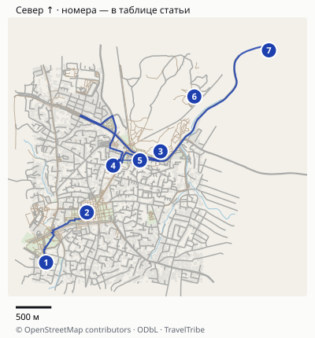
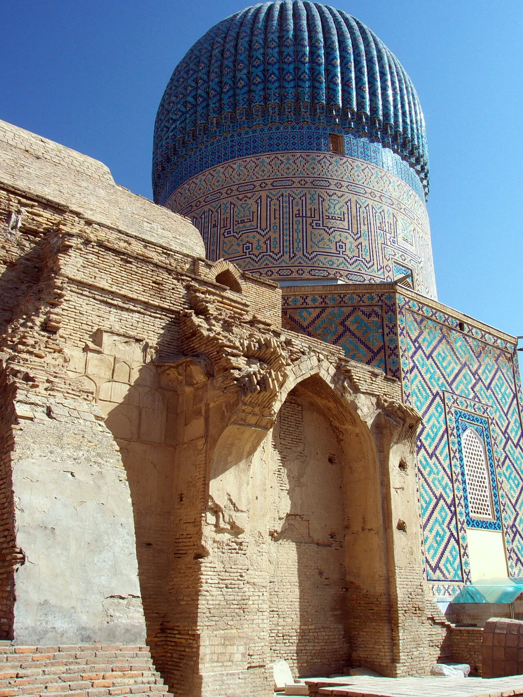
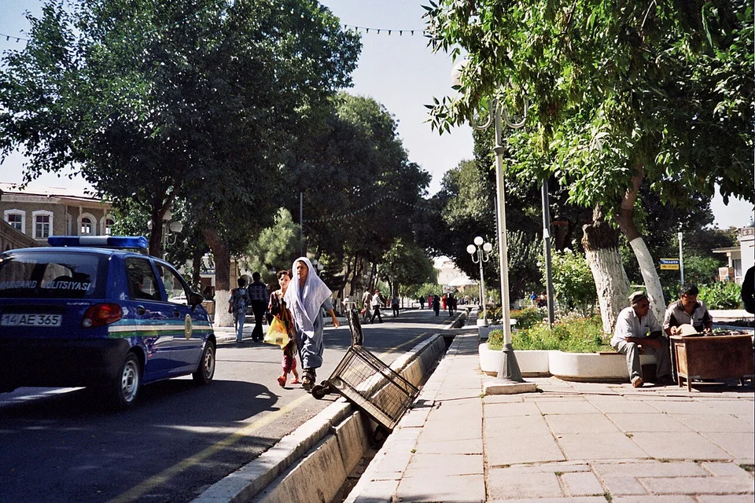
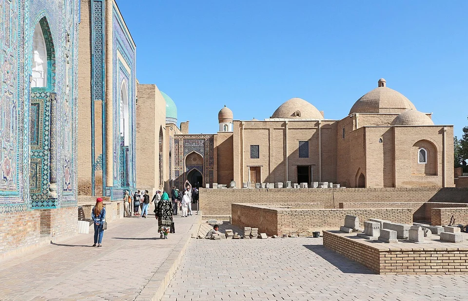
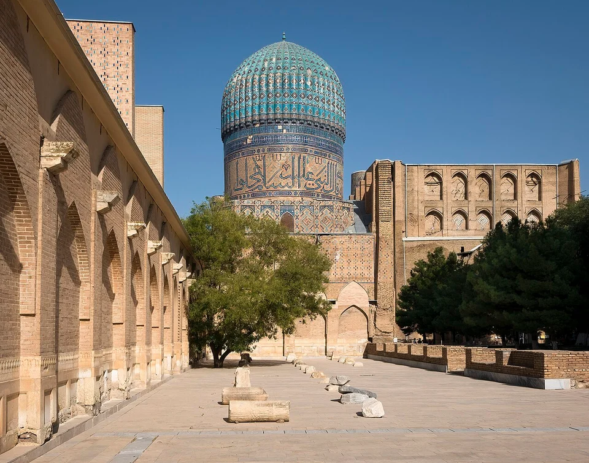

## На какие два дня рассчитан маршрут

Здесь подразумеваются **два полных дня и две ночёвки**, если вы приезжаете накануне вечером и уезжаете после второго дня. При прибытии в обед первая половина первого дня не возникает автоматически: ниже есть сокращённый вариант. В день отъезда сначала зафиксируйте время поезда и запас на вокзал, затем выбирайте оставшиеся памятники.

| Когда | Основная программа | Что оставить по желанию |
|---|---|---|
| День 1, утро | Гур-Эмир и прогулка к Регистану | Подробный осмотр соседних небольших памятников |
| День 1, середина дня | Медресе Регистана, обед и отдых | Экскурсия с гидом вместо самостоятельного осмотра |
| День 1, вечер | Внешний вид освещённого Регистана | Повторный вход, только если условия билета это позволяют |
| День 2, утро | Шахи-Зинда | Более длинный исторический блок с Афрасиабом |
| День 2, середина дня | Биби-Ханым и Сиабский базар | Неспешные покупки после знакомства с рынком |
| День 2, после отдыха | Обсерватория или музей Афрасиаба | Либо свободное время и ранний выезд на вокзал |

Маршрут делит город на два последовательных блока. Он не требует каждый вечер возвращаться в несколько посещённых мест. Если вашему отелю удобен обратный порядок второго дня, его можно развернуть, сохранив один северо-восточный блок.

## Окна посещения и отдельные билеты

У музея-заповедника есть адресные страницы [Гур-Эмира](https://samarkandmuseum.uz/en/muzei-dlya-menyu/mavzolei-amira-temura) и [Биби-Ханым](https://samarkandmuseum.uz/en/muzei-dlya-menyu/mecet-bibi-xanym). У Гур-Эмира опубликован режим **09:00–18:00**; упоминание выходных субботы и воскресенья относится к научным сотрудникам, а не к закрытию памятника для туристов. Поэтому первый день начинайте с Гур-Эмира после 09:00. Для Биби-Ханым оператор также публикует 09:00–18:00; дневной блок второго дня можно поменять местами с базаром. Возможное продление вечерней работы не требуется для выполнения этого плана.

Сайт оператора одновременно содержит старый прайс, связанный с информацией 2023 года. Не считайте показанные там суммы подтверждённым текущим бюджетом: тарифы каждого памятника и платную съёмку уточните перед входом. Актуальный интерактивный тариф Регистана разобран ниже отдельно.

Для Шахи-Зинды в [официальной таблице на правительственном портале](https://api-portal.gov.uz/uploads/146/2025/06/03/72a0627b-5a53-c2fe-8ed0-278d44f48467_media_.pdf) опубликованы **08:00–19:00**, адрес **улица Шохи Зинда, 39** и телефон комплекса **+998 91 532-16-74**. Документ размещён в июне 2025 года: это последнее найденное официальное окно, а не гарантия режима в день поездки. [Фонд Vaqf](https://www.vaqf.uz/p/shohi-zinda/24) подтверждает адрес и описание комплекса, но не публикует действующий иностранный тариф. Для второго утра планируйте подход к **09:00**; накануне уточните часы и стоимость по телефону комплекса или через жильё. Если доступ задерживается, начните с Биби-Ханым после 09:00 и базара. Обещание раннего бесплатного входа в маршрут не входит.

## Карта и точная логистика

[Открыть подробную карту: масштаб, все точки и навигация](/maps/samarkand-za-dva-dnya/). Север вверху; нумерация указана ниже. На обзорной картинке дальние пересадки могут не помещаться — они доступны в подробной карте через «Все точки».

| № | Точка | Ориентир и ограничение |
|---|---|---|
| 1 | [Гур-Эмир](https://www.google.com/maps/search/?api=1&query=39.6484614,66.9690894) | Первое утро; опубликованное окно 09:00–18:00. |
| 2 | [Регистан](https://www.google.com/maps/search/?api=1&query=39.6547776,66.9757583) | Основной дневной блок; вход в медресе по своему билету. |
| 3 | [Шахи-Зинда](https://www.google.com/maps/search/?api=1&query=39.6624809,66.9878108) | Начало второго дня; подход к нижнему входу, далее лестницы комплекса. |
| 4 | [Биби-Ханым](https://www.google.com/maps/search/?api=1&query=39.6606878,66.9800584) | У оператора опубликовано 09:00–18:00; не путать мечеть с соседним мавзолеем. |
| 5 | [Сиабский базар](https://www.google.com/maps/search/?api=1&query=39.6613528,66.9810902) | Связка с Биби-Ханым; торговля и конкретные лавки живут по своему режиму. |
| 6 | [Музей Афрасиаба](https://www.google.com/maps/search/?api=1&query=39.6694058,66.9933439) | Дополнение по интересу, а не обязательная остановка. |
| 7 | [Обсерватория Улугбека](https://www.google.com/maps/search/?api=1&query=39.6752258,67.0055391) | Отдельный выезд за пределы короткой прогулки. |
| 8 | [Вокзал Самарканда](https://www.google.com/maps/search/?api=1&query=39.6854655,66.9289678) | Выбирайте в билете точный вокзал и поезд; нужен запас на вход и посадку. |

### Расстояния, часы входа и вокзал

Первый день: **Гур-Эмир → Регистан около 1,2 км пешком**, ориентир 20–25 минут без осмотра по дороге. Второй день: **Шахи-Зинда → Биби-Ханым около 1 км**, затем к Сиабскому базару ещё около **200 м**. Эти расстояния рассчитаны по дорожкам между отмеченными точками: внутри комплексов ходьба считается отдельно. В жару не заменяйте короткий переезд обещанием комфортной прогулки.

Регистан → отмеченный железнодорожный вокзал: около **6 км по автомобильному маршруту**. Заложите 25–40 минут на вызов, посадку и дорогу, затем отдельный запас на контроль и посадку по правилам вашего билета. Это не обещание приехать к поезду за 25 минут. Сверьте станцию в билете: «Афросиаб» может означать поезд или археологический район, а не название нужного входа на вокзал. Обсерватория Улугбека — отдельный северо-восточный выезд, около **5 км от базара по выбранному автомобильному пути**; на день с ранним поездом его не добавляйте.

Расстояния округлены, время в пути зависит от пробок, погоды и открытых проходов. Метка территории может отличаться от входа: последние метры сверяйте с указателями. [Картографические данные © OpenStreetMap contributors](https://www.openstreetmap.org/copyright), ODbL.

## Первый день: Гур-Эмир, затем Регистан

**На Гур-Эмир оставьте около часа.** Это наш ориентир с запасом на кассу и спокойный осмотр, а не норматив памятника. Здесь находится мавзолей Амира Тимура и ряда его близких. Обратите внимание на купол, пропорции здания и внутреннее убранство: быстрый кадр снаружи даёт лишь часть впечатления.

Купол Гур-Эмира — ориентир первой остановки маршрута. Внешний осмотр и посещение интерьера стоит планировать отдельно.

От Гур-Эмира двигайтесь к Регистану; при желании осмотрите окрестности Рухабада по пути. Не превращайте каждую небольшую остановку в обязательный музей: главный длинный блок дня ещё впереди. В жару используйте короткий переезд вместо прогулки под солнцем, если так сохранятся силы для медресе.

**Регистану отдайте два–три часа с перерывами.** Три медресе — Улугбека, Шердор и Тилля-Кари — удобно смотреть как ансамбль, затем заходить внутрь выбранных дворов и помещений. Сначала оцените площадь и расположение зданий, потом детали. Если хотите понимать архитектуру глубже, именно здесь полезен гид: заранее согласуйте, какие помещения входят в прогулку и сколько времени она занимает.

Не ищите одну и ту же эпоху во всех трёх зданиях. Медресе Улугбека и два других медресе появились в разное время; рассказы о том, что всё построил один правитель, и легенды без источников легко смешивают историю ансамбля. На месте отличайте историческую экспозицию от сувенирного магазина: коммерческое использование помещения само по себе не объясняет его первоначальную функцию.

Между памятниками остаётся обычный город. В летнюю жару длинную прогулку лучше разделить обедом и отдыхом.

## Какой билет нужен в Регистан

[Официальный сервис дирекции](https://tickets.registon.uz/) предлагает отдельный выбор местного жителя и иностранного гостя. Для категории иностранного посетителя из России показаны **100 000 сум за взрослого от 18 лет** — около **687 ₽**. Детская строка обозначена «от 7 до 18» и стоит **50 000 сум**, около **344 ₽**. На возрастной границе восемнадцати лет уточните категорию у дирекции, а не выбирайте меньшую цену самостоятельно. Рублёвый эквивалент помогает сравнить порядок расходов и не является курсом оплаты картой.

Сервис публикует сезонный режим: **20 февраля — 20 ноября 07:00–24:00**, зимой **08:00–20:00**. Это часы комплекса, а не обещание, что каждое помещение, магазин или отдельная программа доступны до последней минуты. Перед поздним входом уточните доступ к нужным интерьерам.

Разделите три разных действия:

- увидеть ансамбль со стороны внешнего пространства;
- пройти по билету внутрь комплекса и медресе;
- вернуться вечером после дневного выхода.

Для третьего случая заранее спросите о повторном входе именно по вашему билету. Не закладывайте бесплатный второй проход и не соглашайтесь на неофициальную плату за обход кассы. Подсветка зданий, объявленное световое представление и обычный вечерний осмотр тоже не одно и то же. Подтверждённого постоянного расписания шоу для всех дат у нас нет, поэтому маршрут от него не зависит.

## После обеда и вечер первого дня

Сделайте паузу в помещении. Два–три часа внутри ансамбля плюс дорога и Гур-Эмир — содержательная программа. Если приехали накануне поздно, свободная вторая половина дня полезнее ещё трёх обязательных точек.

Вернуться к внешнему виду Регистана вечером можно без обещания повторить весь дневной осмотр. Узнайте заранее, где разрешено находиться без нового входа и не проводится ли закрытое мероприятие. Для ужина выбирайте место по своему маршруту и меню, а не по утверждению, что любой ресторан возле площади показывает «настоящий Самарканд».

## Второй день: Шахи-Зинда, Биби-Ханым и базар

Начните с **Шахи-Зинды**, оставив ориентировочно полтора–два часа. Это некрополь и место посещения верующими, а не только ряд ярких фасадов. Проходите спокойно, соблюдайте местные правила одежды, не мешайте молитве и не занимайте узкий проход ради фотографии. В комплексе есть ступени; маршрут не стоит описывать как полностью доступную прогулку без лестниц.

Шахи-Зинда заслуживает отдельного утреннего блока. Узкие проходы требуют внимания к другим посетителям.

Затем двигайтесь к **Биби-Ханым** и Сиабскому базару. На мечеть оставьте примерно час, на рынок — ещё около часа по интересу. В жару или при усталости между комплексами можно взять короткое такси: «рядом на карте» не всегда означает приятную дорогу в конкретный полдень.

Масштаб Биби-Ханым хорошо читается со двора. Не смешивайте её билет с посещением других городских комплексов.

На базаре сначала пройдите торговые ряды, посмотрите лепёшки, сухофрукты и местные сладости. Если покупаете продукты в дорогу, уточните вес и итоговую стоимость до упаковки. Для вывоза домой отдельно проверьте ограничения вашей страны: возможность купить продукт не означает разрешение на его ввоз.

Обед удобнее оставить после этого блока. Плов — один из вариантов, но конкретное популярное место может закончить дневную подачу раньше, чем вы завершите долгий осмотр. Если ресторан принципиален, подстройте под него перерыв и уточните время работы заранее, не оставляя еду на неопределённое «когда всё посмотрим».

## Обсерватория или Афрасиаб: выберите одно дополнение

**Обсерватория Улугбека** подходит, если интересны астрономия и научная история города. Это отдельная остановка с переездом, а не ещё один двор рядом с Регистаном. Не ждите действующего современного телескопа: смысл посещения — в историческом сооружении и объяснении его работы.

**Музей Афрасиаба** выбирайте ради более ранней истории Самарканда и археологии. Не рассчитывайте, что прогулка по обширной территории городища автоматически заменит музейную экспозицию. Уточните доступ к нужному залу до покупки билета.

Если исторические комплексы утомили, пропустите оба дополнения. Два дня с длинным осмотром главных памятников лучше, чем все названия из списка при постоянной спешке. Конигил и дальние комплексы тоже требуют самостоятельного транспортного блока; они не включены в основную городскую петлю.

## Где жить и как учитывать вокзал

Для короткой поездки удобно жильё в пешей доступности от исторического центра, но смотрите на реальный подъезд. В старых переулках машина не обязательно довезёт к двери. До бронирования уточните точку высадки, наличие кондиционера или отопления по сезону, время завтрака и хранение багажа после выселения.

Вокзал — отдельная поездка от исторических памятников. Проложите дорогу от конкретного отеля и добавьте время на получение багажа и посадочные процедуры. Не заканчивайте удалённый музей за полчаса до отправления поезда, ориентируясь только на длительность поездки в приложении.

Если поезд уходит во второй половине дня, после Шахи-Зинды оставьте **один выбор: Биби-Ханым или базар**, затем обед, багаж и вокзал. При прибытии лишь к обеду первого дня перенесите Гур-Эмир на свободное утро либо сократите дополнения второго дня. Не пытайтесь сохранить полную таблицу ценой еды и запаса на отправление.

## Какие расходы подтвердить перед поездкой

Единого подтверждённого билета на все названные памятники в этом маршруте нет. Регистан, Гур-Эмир, Шахи-Зинда, Биби-Ханым и дополнительные музеи проверяйте отдельно. Не умножайте одну найденную цену на число объектов и не пользуйтесь бюджетом из отчёта многолетней давности как текущим прайсом.

При выборе экскурсии попросите перечислить оплачиваемые входы, длительность, язык и точку окончания. Для самостоятельного варианта сохраните названия на карте и страницы операторов. [Гид по Узбекистану](/uzbekistan/) поможет соединить Самарканд с другими городами; этот текст решает более узкую задачу — распределить два дня внутри Самарканда.
