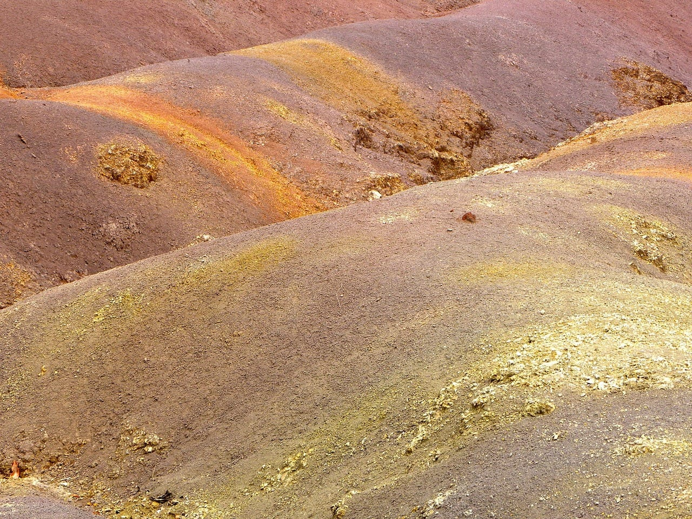
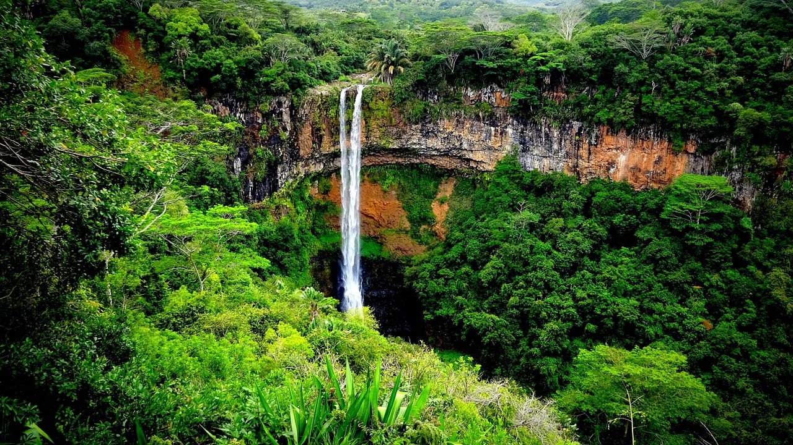
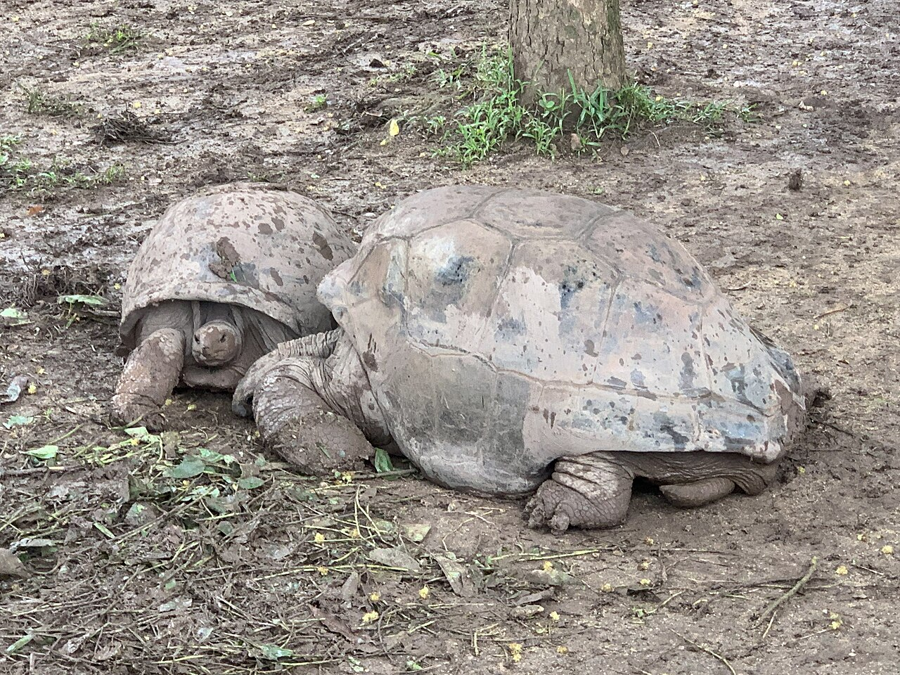

## Стоит ли ехать специально ради семицветных песков?

Шамарель интересен тому, кто хочет на несколько часов сменить пляж на совсем другой пейзаж. На склонах лежат волнистые полосы охры, красного и фиолетового; вокруг — зелень, а по дороге открывается водопад. Здесь приятно рассматривать детали и фотографировать, а не проходить длинный список аттракционов.

Пески — не большая разноцветная пустыня. Их оттенки меняются в зависимости от света, и реальный вид может быть спокойнее обработанной фотографии. Если ради одной короткой остановки придётся пересечь весь остров, сначала сравните её с целым днём на юго-западе. О том, какой берег выбрать базой, есть [отдельный гид по Маврикию](/blog/mauritius-2026/).

**Редакционный выбор:** приезжать, если вам интересны природные детали и вы включили юго-запад в маршрут. Отказаться от отдельной дальней поездки, если хочется только большого активного развлечения или ребёнку трудно долго ехать в машине.

## Что входит в билет и сколько заплатит семья?

У стандартного входа три главные точки: цветная земля, две смотровые водопада и черепахи. Это самостоятельное посещение; услуги гида не включены. [Официальные тарифы](https://chamarel7colouredearth.com/faqs/) для нерезидентов на 10 ноября 2026 года:

| Посетители | Вход, MUR |
|---|---:|
| Взрослый | 800 |
| Ребёнок 5–11 лет | 400 |
| Ребёнок младше 5 лет | Бесплатно |
| Двое взрослых и ребёнок 5–11 лет | 2000 |
| Двое взрослых и ребёнок младше 5 лет | 1600 |

Проживание в отеле на острове не даёт права на льготный тариф резидента. Семейные суммы выше — арифметика входа, а не стоимость дня: транспорт, обед и другие платные места добавляются отдельно.

Для масштаба расходов 2000 MUR — **ориентировочно 3590 ₽** на 10 ноября. Это планировочный ориентир: курс вашего банка, покупка валюты и комиссии могут изменить сумму.

## Самостоятельно или с гидом: что вы покупаете?

С собственной машиной платите за вход и сами определяете темп. До поездки решите вопрос обратной дороги: одноразовая доставка к воротам не равна автомобилю с ожиданием. Сравнивайте предложения водителей по одинаковому маршруту, времени ожидания и возвращению к вашему жилью.

Если водить не хочется, есть <a href="https://tripster.tpk.mx/cicJCuPT?erid=2VtzqxMZpjc&amp;sub_id=tt_shamarel_day&amp;u=https%3A%2F%2Fexperience.tripster.ru%2Fexperience%2F78981%2F" target="_blank" rel="sponsored noopener">индивидуальная экскурсия по юго-западу с посещением Шамареля</a>. Это островной маршрут, а не входной билет: в программе — русский язык, восемь часов и группа до четырёх человек. При бронировании до 15 ноября указана акционная цена €315 за группу, ориентировочно 29 100 ₽ на 10 ноября; последующие условия и курс оплаты проверяйте заново.

В карточке заявлены автомобиль, прохладительные напитки и детское кресло до 18 кг. **Вход в Шамарель оплачивается дополнительно.** Обед, дегустация рома и другие платные остановки также не превращаются в включённые услуги из-за того, что стоят в описании маршрута.

Для семьи 2+1 получается €315 за экскурсию **плюс 2000 MUR за парк**, до еды и дополнительных посещений. Не переводите цену за группу в цену «на человека», пока не определён состав вашей компании. Перед оплатой согласуйте место начала, обязательные остановки, время в парке и кресло под ребёнка.

## Как двигаться по парку и сколько времени оставить?

По [схеме оператора](https://chamarel7colouredearth.com/experiences/geopark/) от въездных ворот до водопада около 1,5 км, до цветной земли — около 3 км. У обеих точек есть парковки. Поэтому пешая прогулка от кассы до дюн и обратно превращается примерно в шесть километров, а не в несколько минут от билета до фотографии.

На машине логика проста: въезд, остановка у водопада, затем дюны и черепахи. Посещение можно построить короткими выходами из автомобиля. Пеший вариант выбирайте осознанно, с учётом жары, дождя и самочувствия; возвращение тоже входит в ваши силы и время.

На неторопливый визит редакция советует оставить два–три часа с запасом на парковку и фотографии. Это планировочный запас, не личный замер. Не ставьте сразу после парка важный трансфер: желание задержаться у водопада или ливень способны сдвинуть день.

## Водопад со смотровой или поход к подножию?

В стандартной программе вы смотрите на падающую воду сверху, с оборудованных точек. На фотографии может казаться, что до чаши под водопадом совсем недалеко, но это другой маршрут. **Самостоятельный спуск к водопаду оператор запрещает; поход к подножию в обычный билет не входит.**

Для первого знакомства остановитесь у смотровых и продолжите путь к дюнам. Если важен именно треккинг, ищите отдельную программу с понятными условиями: длительность, сложность, обувь, сопровождение и отмена при плохой погоде. Не покупайте её по одному похожему названию.

## Что понравится детям и кому будет трудно?

Черепахи добавляют остановку, которую проще объяснить маленькому путешественнику, чем геологическое происхождение цветов. Можно сначала поискать оттенки на дюнах, затем перейти к наблюдению за животными. Кормить черепах посетителям запрещено. Не планируйте интерес ребёнка вокруг обещания потрогать животных: обычный билет предполагает наблюдение.

Семье удобнее ехать с возможностью сделать паузу и вернуться в автомобиль. Длинный пеший подъезд от ворот подходит не каждому ребёнку. При ограниченной подвижности заранее уточните нужный маршрут у оператора: общее описание парка не гарантирует удобство каждого участка.

## Когда приезжать и что проверить перед выездом?

С октября по май парк работает **8:30–17:30**, последняя покупка входа — в 17:00; с июня по сентябрь закрывается в 17:00. Он открыт по воскресеньям и праздникам, но оператор предусматривает закрытие во время циклонов и сильных дождей. Поездку выбирайте по оперативной погоде, а не только по месяцу отпуска.

Практичный вариант — приехать раньше, оставив вторую половину дня свободной. Возьмите удобную обувь, защиту от солнца и дождя. Не стройте маршрут с обязательным возвращением через весь остров сразу после закрытия.

Перед покупкой уточните:

- В билете стоит категория нерезидента и подходящий возраст ребёнка.
- Водитель остаётся на время посещения и довозит обратно.
- В экскурсии разделены услуги гида и входные билеты.
- Дополнительные парки и дегустации не посчитаны бесплатными.
- Вы понимаете отмену: входные билеты оператора невозвратные и однократные, у экскурсии свои условия.

Ebony Forest и другие соседние площадки — самостоятельные посещения. Лучше выбрать одно дополнение, чем покупать насыщенный день, в котором на сами дюны останется только быстрая фотография. Для общей логистики и выбора берега вернитесь к [планированию поездки на Маврикий](/mauritius/).
