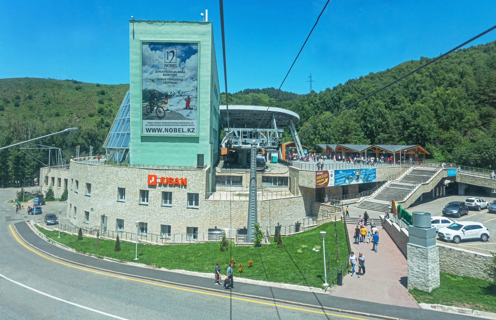
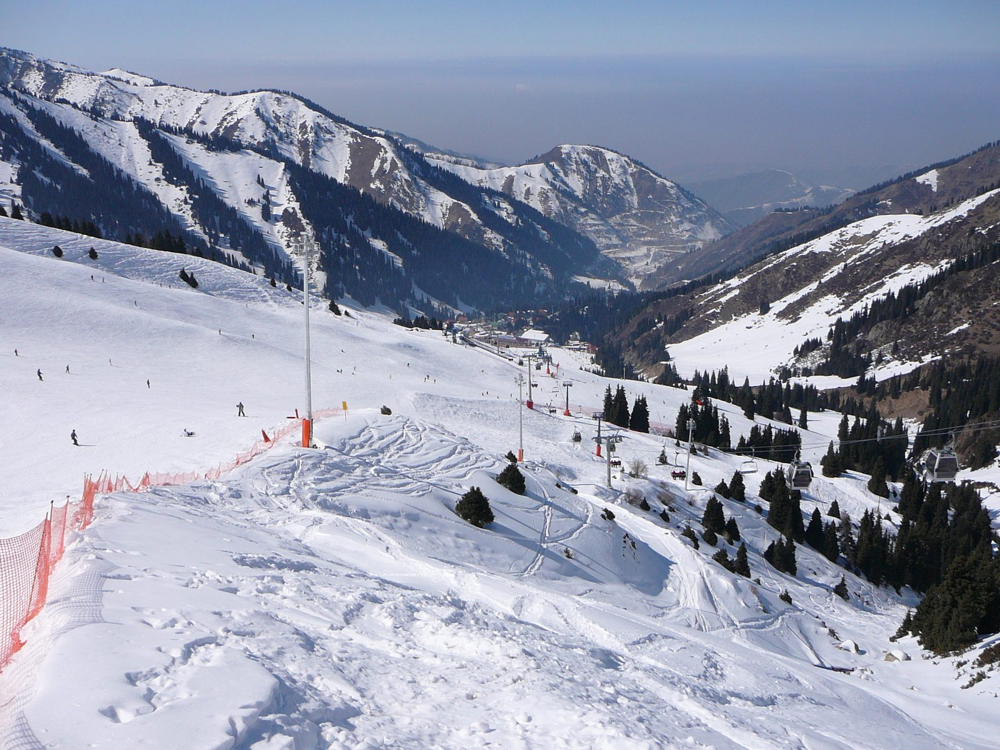
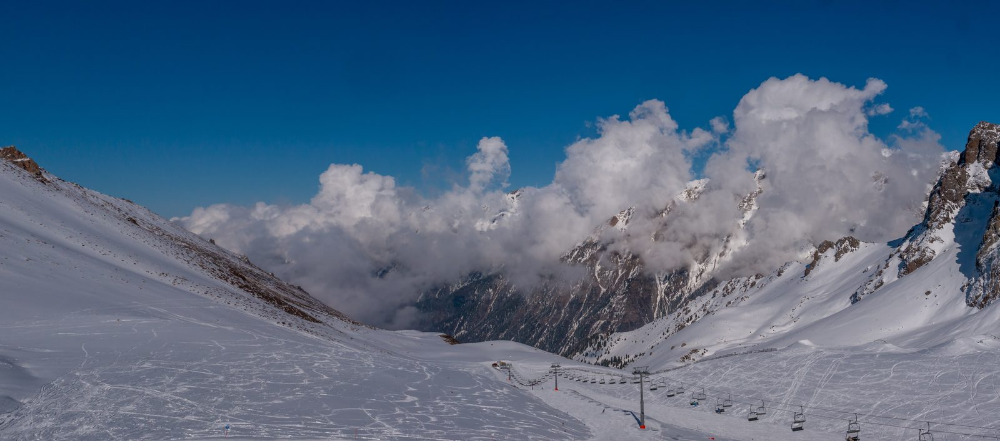

import { tpkDeep } from '../../data/affiliate.js';
export const shymbulakTour = tpkDeep('sputnik8', 'https://www.sputnik8.com/ru/almaty/activities/72706-vse-vklyucheno-gornye-sokrovischa-almaty-medeo-i-shymbulak', 'tt_shymbulak_almaty');

На Шымбулак можно съездить из Алматы на полдня и подняться в горы без лыж. Нижняя гондола везёт от Медеу до посёлка Шымбулак. Для подъёма на Талгарский перевал пересядьте на Комби-1, а затем на Комби-2. Обычный взрослый билет туда и обратно стоит **12 000 ₸ (≈ 2 150 ₽)** и включает все три очереди. **360° за 14 000 ₸ (≈ 2 500 ₽)** даёт тот же маршрут с кабиной со стеклянным полом.

Для самостоятельной поездки проще купить [пеший билет у курорта](https://shymbulak.com/tickets) и доехать до Медеу. Если нужен выезд от отеля с водителем и гидом, есть <a href={shymbulakTour} target="_blank" rel="sponsored noopener">индивидуальная поездка на Медеу и Шымбулак</a>. Уточните, каким способом группа поднимется в горы и до какой станции. Для Талгарского перевала это влияет и на маршрут, и на бюджет.

## Как доехать из Алматы до нижней гондолы

Начинайте со станции канатной дороги **«Медеу»**. В навигаторе укажите нижнюю станцию гондолы на улице Керей-Жанибек хандар, 640В. Поиск по одному слову «Шымбулак» может поставить точку у гостиниц наверху, а «Медеу» — у входа на каток.

Из города идёт автобус **№ 12**. Выходите на остановке «Канатная дорога Медеу». Для такси поставьте нижнюю станцию конечной точкой, а дальше идите к кассам.

В урочище Шымбулак въезд на обычной машине ограничен. В выходные и праздники правило распространяется и на электромобили. Курорт также объявил ограничения на дороге из-за работ до 30 ноября 2026 года. После этой даты продолжает действовать [решение маслихата](https://old.adilet.zan.kz/rus/docs/G26R000356M). Перед поездкой проверьте [сообщения курорта](https://shymbulak.com/), особенно если рассчитываете вернуться на машине.

На летнем кадре видны стеклянная башня станции и площадка перед ней. Это ориентир для выхода из автобуса или такси. После спуска возвращайтесь к этой же площадке. Если заказываете машину заранее, закладывайте время доехать до Медеу по канатной дороге и выйти из здания станции.

## Какой билет взять на канатную дорогу

Для прогулки ищите раздел пеших тарифов. На нижней станции полезно сразу уточнить, открыты ли Комби-1 и Комби-2 и до какого времени пускают на спуск. Порядок пересадок сохраняется, время и набор работающих очередей могут измениться.

| Что хотите увидеть | Какой пеший билет нужен | Взрослый от 15 лет | Ребёнок 6–14 лет |
| --- | --- | --- | --- |
| От Медеу до Комби-2 и обратно | Shymbulak Ticket туда и обратно, обычная гондола | 12 000 ₸ (≈ 2 150 ₽) | 4 000 ₸ (≈ 720 ₽) |
| Тот же маршрут с кабиной со стеклянным полом | Shymbulak Ticket 360° туда и обратно | 14 000 ₸ (≈ 2 500 ₽) | 3 000 ₸ (≈ 540 ₽) |
| Только один проезд между Медеу и посёлком | Shymbulak Ticket в одну сторону | 7 000 ₸ (≈ 1 250 ₽) | 2 000 ₸ (≈ 360 ₽) |
| Две верхние очереди от посёлка Шымбулак | Комби-1 и Комби-2 туда и обратно, в кассе | 7 000 ₸ (≈ 1 250 ₽) | 3 000 ₸ (≈ 540 ₽) |

[Таблица курорта](https://shymbulak.com/info/tariffs) указывает одну цену для будней, выходных и праздников. Детский 360° в ней стоит 3 000 ₸, а обычный билет туда и обратно — 4 000 ₸. Проверьте обе строки в кассе, прежде чем покупать билеты семье. Для ребёнка младше шести заранее спросите, как оформить проход и нужен ли документ о возрасте.

Взрослый платит за кабину со стеклянным полом на 2 000 ₸ больше. Если нужна прогулка на самом перевале, выбирайте обычный билет до Комби-2. Билеты туда и обратно действуют в день покупки. Для билета в одну сторону сначала определите, как будете возвращаться. Автомобильная дорога и работа гондолы живут по разным правилам.

## Два маршрута на полдня

**Сначала посёлок.** Возьмите обычный билет туда и обратно. После гондолы прогуляйтесь там, где разрешён проход пешком, и оставьте время согреться или пообедать. Это удобный вариант, когда едете с ребёнком, верх скрыт облаками или вечером нужно вернуться в Алматы. Лыжная трасса остаётся для катающихся. В ясный день виды на ущелье открываются ещё в кабине.

**Дальше на перевал.** От выхода нижней гондолы найдите посадку на Комби-1. После неё пересядьте на Комби-2. Если хотите увидеть перевал, поднимайтесь туда в первой половине прогулки и оставьте обед на возвращение в посёлок. На открытых площадках выше холоднее и сильнее ветер. При плохой видимости проверьте, открыта ли нужная очередь, прежде чем идти к посадке.

В [кассе курорта](https://shymbulak.com/tickets) опубликованы часы трёх очередей. Нижняя гондола работает до **18:00**, Комби-1 — до **17:00**, Комби-2 — до **16:30**. Курорт указывает посадку за полчаса до закрытия. При таком графике для спуска с перевала ориентируйтесь на **16:00**. Для нижней гондолы расчётная отсечка — **17:30**. Проверьте время последнего спуска на каждой платформе. Время нижней гондолы само по себе ничего не говорит о том, когда нужно уходить с перевала.

Если вы в посёлке к 14:45, до расчётной отсечки для спуска с перевала остаётся 1 час 15 минут. В этот запас должны поместиться очереди, подъём на Комби-1 и Комби-2, переходы между платформами и прогулка наверху. Спросите у сотрудника о текущем ожидании и времени последней посадки вниз. При тесном запасе оставайтесь в посёлке. Для коляски или кресла уточните у курорта посадку и проход между платформами на каждом звене.

## Когда брать экскурсию с трансфером

У <a href={shymbulakTour} target="_blank" rel="sponsored noopener">поездки Sputnik8 на Медеу и Шымбулак</a> заявлены шесть часов, трансфер от отеля и обратно, гид, обед и подъём канатной дорогой либо горным такси. Цена **209 000 ₸ (≈ 37 500 ₽)** относится к группе до трёх человек. Перед бронированием спросите, включены ли обе верхние очереди и какой транспорт доступен в выбранную дату, если канатная дорога закрыта.

Каток Медеу реконструируют. В программе продавца упоминается зимнее посещение, но выход на лёд закладывать в маршрут пока рано. Если вам важна именно канатная дорога, подтвердите её с организатором до оплаты. Поездка с гидом удобна, когда хочется начать от отеля и провести в горах несколько часов без подготовки пересадок.

Для двух взрослых самостоятельный подъём до перевала по обычному тарифу обойдётся в **24 000 ₸ (≈ 4 300 ₽)**. Дорога до Медеу и обед оплачиваются отдельно. Если у вас второй свободный день в Алматы, пригодится [маршрут в Чарынский каньон](/blog/charynskiy-kanon/). Горы, каньон и остальной маршрут удобно собрать по [путеводителю по Казахстану](/kazakhstan/).
