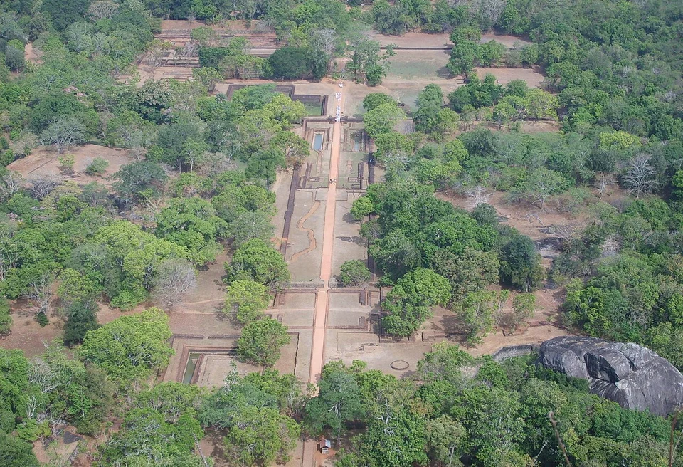
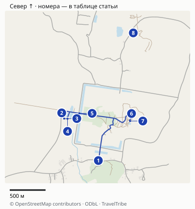
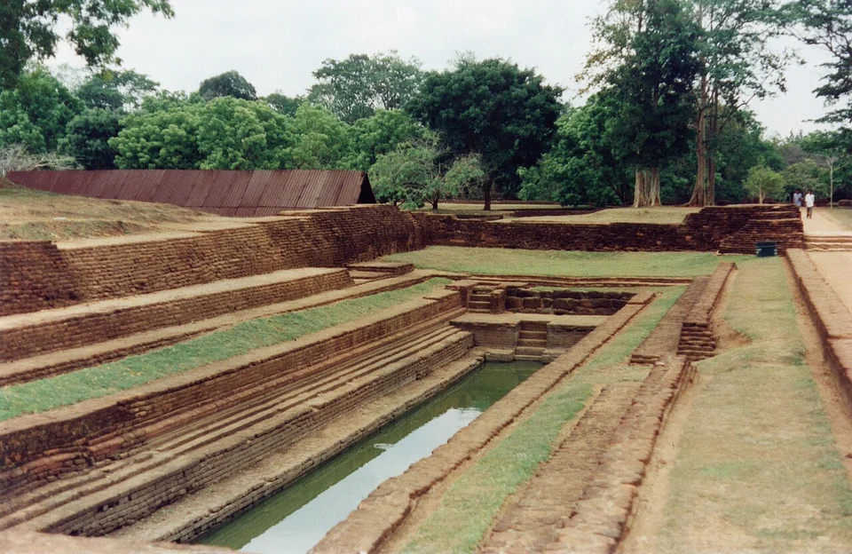
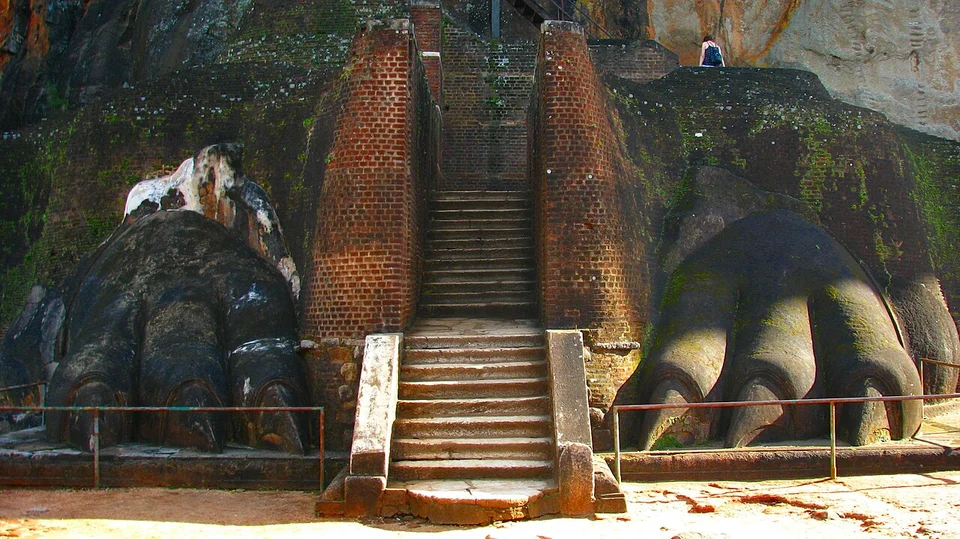
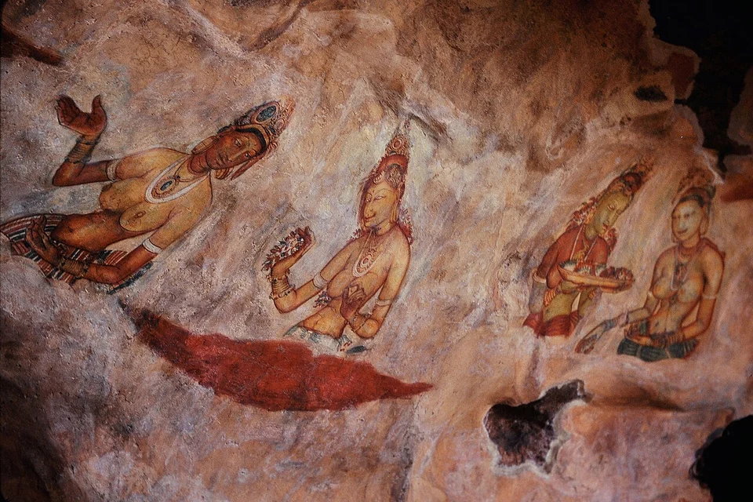

## Что вы увидите и кому подойдёт подъём

Сигирия — комплекс V века: симметричные водные сады внизу, валуны и террасы на подходе, галерея фресок, Зеркальная стена, львиные лапы у верхней лестницы и остатки построек на плато. На вершине нет целого царского дворца: интересны его планировка, водоёмы, следы сооружений и вид на окрестности. [Описание CCF](https://ccf.gov.lk/heritage-sites/sigiriya-rock-fortress/).

Подъём проходит по каменным и металлическим лестницам, местами открытым по отношению к высоте. Не оценивайте нагрузку только по количеству ступеней. Жара, очереди и страх высоты могут влиять сильнее, чем сами ступени.

Если вам интересны история и устройство комплекса, Сигирия оправдывает отдельный визит. Если нужен только знакомый вид монолитной скалы посреди зелени, сначала разберитесь с Пидурангалой ниже: с самой Сигирии её собственный силуэт не увидеть.

## Билет: сначала сравните с CCF

[Страница цен CCF](https://ccf.gov.lk/is/index.php) показывает для Сигирии **35 USD (около 2900 ₽) за полный иностранный билет** и **20 USD (около 1657 ₽) за детский Half Ticket**. В условиях электронной покупки детская категория относится к возрасту 6–12 лет. Сумма в рупиях меняется с применяемым курсом: фиксировать старые 5500 или 11 655 LKR как неизменную цену нельзя.

В прайсе есть и отдельная строка Sigiriya Museum за 6 USD (около 497 ₽). При этом [посетительская страница CCF](https://ccf.gov.lk/vsl/tickets.html) указывает, что музей включён в билет Сигирии. Для обычного полного посещения не прибавляйте музей автоматически ещё раз; отдельная строка важна для музейного визита без полного комплекса.

У посредника [Sputnik8 есть входной билет в Сигирию](https://www.sputnik8.com/ru/srilanka/activities/86458-sigiriya-vhodnoy-bilet-v-drevnyuyu-krepost-lvinaya-skala). Карточка показывает взрослый билет 13+ за 59 USD (около 4888 ₽), вход в комплекс и музей; услуги гида не включены. Это дороже опубликованного тарифа CCF. Выбирайте такой вариант ради подходящих вам условий покупки и отмены, а не потому, что его цена якобы официальная или что он включает сопровождение.

**Онлайн-покупка CCF не означает проход прямо к лестнице.** В [условиях портала](https://eservices.ccf.gov.lk/eticketing/landing) указано получение билета в кассе объекта по номеру заказа. Вход однократный в соответствующий день, оплата заказа не возвращается. Прочитайте условия до оплаты, сохраните номер заказа и билет до окончания визита. Обходить эту процедуру по скриншоту чужой покупки не стоит.

## Когда приходить: не перепутайте кассу, музей и вершину

CCF указывает для касс объектов **07:00–17:00**, а на посетительской странице для Сигирии — **07:00–17:00**. Музей там указан отдельно: **08:00–17:00**. Если хотите попасть на особый ранний доступ, например до этого времени, подтвердите его непосредственно у CCF; обещания входа с пяти утра из стороннего гайда мало.

Для обычного визита разумная цель — прийти к открытию кассы. Ночёвка рядом со скалой удобнее раннего дальнего выезда с побережья. Учтите дорогу от конкретного отеля до кассы: название «Сигирия» в адресе не гарантирует десятиминутную прогулку.

**Почему музей лучше после подъёма:** ранний старт позволяет использовать прохладу на наиболее открытых лестницах. Если сначала ждать открытия музея и подробно осматривать экспозицию, подъём сдвинется на более жаркое время. Историю комплекса полезно прочитать накануне, а макеты и объяснения в музее посмотреть после спуска. Это редакционный выбор порядка, а не правило оператора.

Сады показывают планировку комплекса. На полном визите оставьте им время после основной нагрузки, а не проходите всё внизу на бегу.

## Карта и точная логистика

[Открыть подробную карту: масштаб, все точки и навигация](/maps/sigiriya/). Север вверху; нумерация указана ниже. На обзорной картинке дальние пересадки могут не помещаться — они доступны в подробной карте через «Все точки».

| № | Точка | Ориентир и ограничение |
|---|---|---|
| 1 | [Автобусная остановка](https://www.google.com/maps/search/?api=1&query=7.9516933,80.7559047) | Остановка у южного подъезда; от неё ещё нужен подход к музейно-кассовой зоне. |
| 2 | [Парковка у музея](https://www.google.com/maps/search/?api=1&query=7.95768855,80.75126485) | Удобный ориентир для водителя при поездке к западному входу. |
| 3 | [Музей](https://www.google.com/maps/search/?api=1&query=7.9569719,80.751573) | Посещение музея лучше оставить после подъёма: опубликованное открытие08:00. |
| 4 | [Кассы у музея](https://www.google.com/maps/search/?api=1&query=7.9569555,80.7520006) | В картографических данных отмечена касса для иностранцев; на месте сверяйте указатели Foreigners. |
| 5 | [Контроль билетов](https://www.google.com/maps/search/?api=1&query=7.957629750000001,80.7535078) | Обмен онлайн-заказа на билет и контроль входа — разные действия. |
| 6 | [Львиные лапы](https://www.google.com/maps/search/?api=1&query=7.9576062,80.7601078) | Точка решения перед верхним участком лестниц. |
| 7 | [Верхняя площадка](https://www.google.com/maps/search/?api=1&query=7.9566634,80.7599301) | Подъём по лестницам; расчётное расстояние не отражает очереди и нагрузку. |
| 8 | [Вход на Пидурангалу](https://www.google.com/maps/search/?api=1&query=7.9677496,80.7603298) | Отдельное место с отдельными условиями; не входит в билет Сигирии. |

### Как попасть от остановки к подъёму

На карте разделены **остановка в посёлке, западная музейная зона, касса для иностранцев и контроль**. Остановка Sigiriya не означает высадку у лестницы. Расчёт пешего подхода от отмеченной остановки до музейной зоны — около **1,5 км**, ориентир 20–30 минут без жары и остановок. Если подъём запланирован рано утром, заранее согласуйте с водителем высадку у посетительской парковки западного входа.

Касса для иностранных посетителей отмечена отдельно: не идите по надписи Domestic Ticket Counter. По [условиям CCF](https://www.eservices.ccf.gov.lk/eticketing/landing) онлайн-подтверждение нужно обменять на входной билет. Сначала касса и контроль, затем сады, Львиные лапы и верхняя площадка. Пешеходный навигатор не оценивает нагрузку лестниц и возможное одностороннее движение на них: его минуты нельзя использовать как время подъёма. На весь визит оставляйте 3–4 часа, а при прибытии после открытия добавляйте запас на кассу.

Пидурангала — другой вход и отдельное посещение. Точка на карте нужна для выбора альтернативы, а не для обещания короткого перехода с вершины Сигирии.

Расстояния округлены, время в пути зависит от пробок, погоды и открытых проходов. Метка территории может отличаться от входа: последние метры сверяйте с указателями. [Картографические данные © OpenStreetMap contributors](https://www.openstreetmap.org/copyright), ODbL.

## Последовательность полного посещения

**Касса и подход через сады.** Заберите билет, уточните состояние маршрута и актуальные ограничения. Водные сады, рвы и каналы — часть Сигирии, а не отдельный парк, случайно оказавшийся у кассы. На подходе посмотрите, как ось садов направлена к скале; длинный подробный осмотр можно оставить на возвращение.

**Террасы и лестницы.** Двигайтесь по текущим указателям и не пытайтесь проходить против потока ради «правильного порядка» из отчёта. На узких участках дайте людям пройти, а для остановки выберите площадку. Зеркальную стену и фрески рассматривайте с соблюдением местных ограничений: разрешённый подъём не означает разрешения снимать всё подряд.

**Площадка с львиными лапами — момент оценить верхний участок.** Посмотрите на лестницу и своё состояние до того, как идти дальше. Если высота вызывает сильный дискомфорт или вы перегрелись и устали, вершина не должна становиться обязательством. Не ждите, что наверху будет более простой обратный путь без лестниц.

**Вершина и спуск.** Оставьте время спокойно осмотреть руины и водоёмы, затем вернуться по разрешённому пути. Обсудите с водителем точку встречи у выхода заранее: после спуска не хочется искать машину с разряжающимся телефоном. После подъёма можно закончить осмотр садов и зайти в музей.

На весь комплекс с остановками оставьте **три–четыре часа**, а при медленном темпе — больше. Это наш запас для планирования. Официальная оценка самого подъёма не включает автоматически кассу, музей, ожидание и длинные остановки.

Сигирия интересна и ниже верхней лестницы: устройство садов помогает понять масштаб замысла.

Лестница между львиными лапами: на площадке перед ней можно остановиться и решить, продолжать ли подъём.

## Если не хочется на вершину

Программа без верхнего подъёма имеет смысл, когда вам интересны сады и история, но лестницы или открытая высота не подходят. Не называйте её бесплатным осмотром: заранее выясните, какой билет нужен для выбранной части, и не рассчитывайте на скидку только из-за отказа от вершины.

Можно ограничиться садами и музеем либо пройти до допустимого комфортного участка, согласовав возвращение с персоналом. Не обещайте себе посещение фресок «без подъёма»: галерея тоже связана с лестницами и высотой. Если нужна действительно спокойная прогулка без ступеней, проверяйте условия конкретной зоны заранее.

Не делите людей на тех, кому «легко», и всех остальных. Отзывы о тридцатиминутном подъёме другого человека не описывают вашу нагрузку с ребёнком, на жаре или в очереди.

## Сигирия или Пидурангала

| Что важно | Сигирия | Пидурангала |
|---|---|---|
| Дворцовый комплекс, сады, фрески | Главная причина визита | Не заменяет эти объекты |
| Вид на отдельную скалу Сигирии | С вершины собственного силуэта не увидеть | Основная причина выбирать эту панораму |
| Характер подъёма | Обустроенные, но местами крутые и открытые лестницы | Иной маршрут, включая каменистый верхний участок |
| Одна короткая остановка в районе | Выбирайте по интересу к археологии | Выбирайте по интересу к панораме, оценив тропу |

Не называйте Пидурангалу безопасной облегчённой версией Сигирии: другой маршрут тоже требует оценки сил, обуви, погоды и видимости. Текущую стоимость, доступ и условия прохода через храмовую часть проверяйте отдельно; билет Сигирии туда не относится.

Если хотите обе скалы, лучше разделить подъёмы отдыхом или разными днями. Утром Сигирия, затем еда и отдых, второй подъём — только при подходящих условиях и оставшихся силах. Два обязательных восхождения подряд в жару не нужны для удачной поездки.

Фрески — важная часть памятника. Наличие лицензированного изображения в статье не отменяет действующих ограничений на съёмку у галереи.

## Дорога и следующий пункт маршрута

**Из Дамбуллы:** выберите местный автобус в сторону Сигирии либо заранее согласованный тук-тук/машину. У автобуса проверьте конечную остановку и дорогу от неё до билетной кассы; высадка в населённом пункте и вход на территорию комплекса — разные точки. У водителя машины согласуйте ожидание, обратную посадку и итоговую цену всей поездки.

**Из Канди:** для подъёма к обычному открытию удобнее приехать в район Дамбуллы или Сигирии накануне. Автобусный день через Дамбуллу включает пересадку и ожидание. Не обещайте себе прохладное утро у скалы, считая только время движения между городами.

**Из отеля в районе Сигирии:** проверьте расстояние именно до кассы и точку утреннего выезда. Название Sigiriya в адресе не гарантирует короткий пешеходный подход. Накануне договоритесь о завтраке до выезда либо еде после спуска.

**С побережья:** сравнивайте полноценное время дороги туда и обратно с длительностью осмотра. Для одной скалы длинная однодневная поездка утомительна; отдельная ночёвка в культурном треугольнике оставляет место для отдыха и соседних памятников. У организованной экскурсии спросите, включён ли вход CCF и сколько часов остаётся на сам комплекс.

Точное расписание местного автобуса и цену индивидуального трансфера мы не подтвердили: уточните их у перевозчика или своего жилья на выбранный день. Старые суммы из отчётов не заменяют действующую договорённость.

Не ставьте после спуска несколько дальних обязательных остановок. Если хочется совместить Сигирию с храмами Дамбуллы, оставьте время на еду, дорогу, ещё один подъём и отдельные условия посещения храма. Пидурангала, Дамбулла и сафари в один день после Сигирии — отдельная перегруженная программа.

Для всей поездки полезно сопоставить остановку с [маршрутом по Шри-Ланке](/blog/sri-lanka-guide-2026/) и [гидом по направлению](/sri-lanka/). Выбор берега и сезон пляжа не определяют автоматически погоду на скале в конкретное утро.

## Что подготовить вечером

Возьмите воду, головной убор, защиту от солнца и удобную нескользкую обувь. Сохраните билет и контакты водителя, подготовьте наличные или подходящий способ оплаты и заранее уточните точку встречи после спуска. В дождь ступени могут быть скользкими; при закрытии следуйте указаниям сотрудников.

Не кормите животных и не тревожьте ос. CCF отдельно требует соблюдать распоряжения персонала при встрече с дикой фауной. Если участок закрыли, не пытайтесь пройти, потому что «в отзывах всем было безопасно». Удачный визит — тот, где хватило времени на памятник и сил на возвращение.

