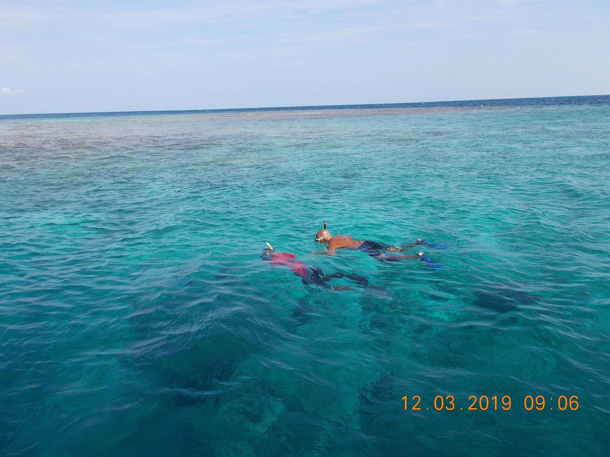
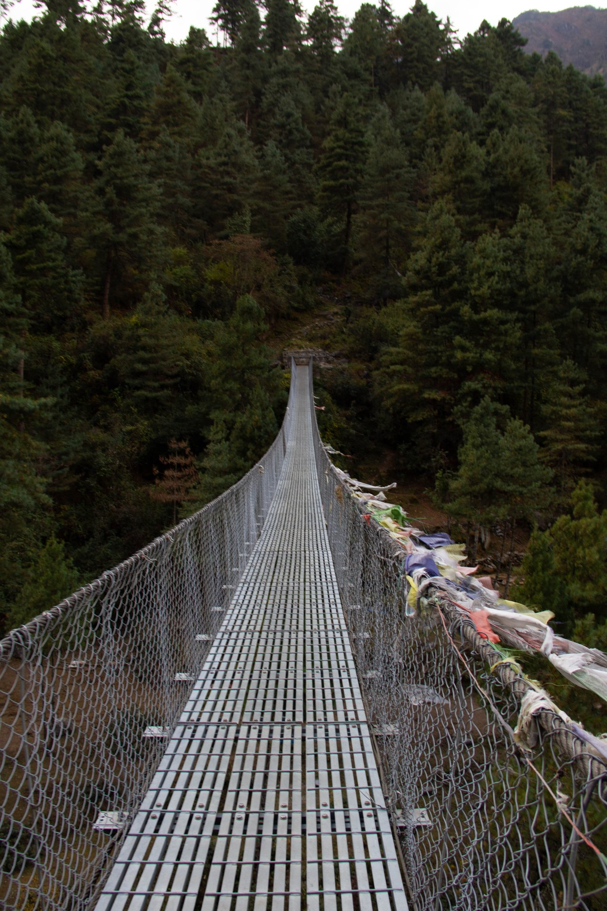
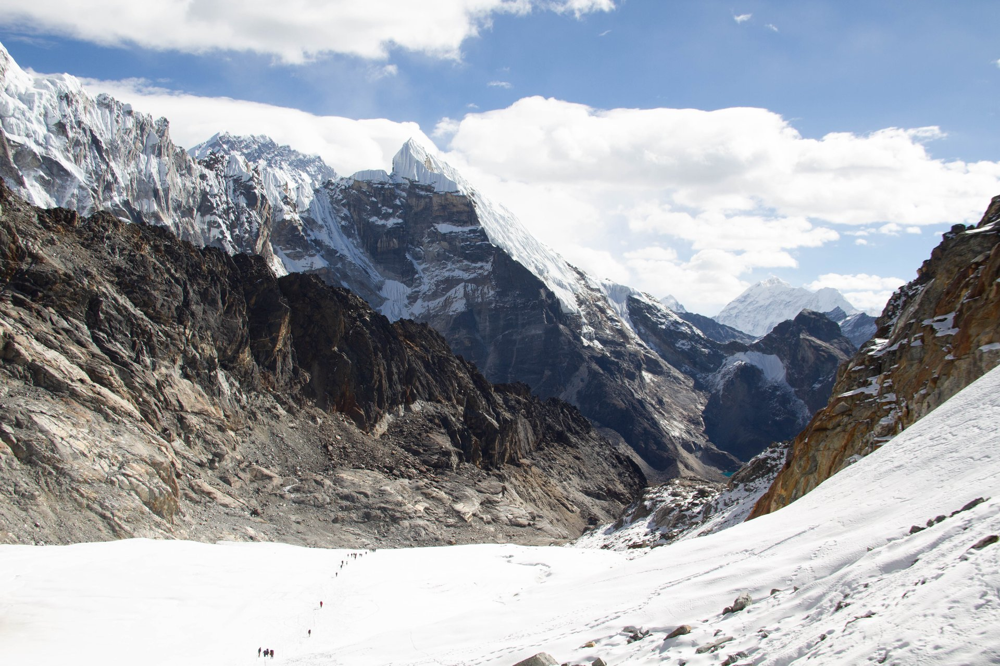

import { cherehapaTravel } from '../../data/affiliate.js';

export const activeCompare = cherehapaTravel('active_insurance_compare');
export const divingCompare = cherehapaTravel('active_insurance_diving');
export const trekkingCompare = cherehapaTravel('active_insurance_trekking');

**Для снорклинга, дайвинга и треккинга нужен полис, который покрывает ваше занятие в его реальных условиях.** Название «Активный отдых» на кнопке не определяет допустимую глубину, высоту, сопровождение и способ эвакуации. Даже одно пробное погружение проверяют как дайвинг, а прогулку в горах — по маршруту, а не по числу дней.

> **До оплаты:** запишите занятия, максимальную глубину или высоту, наличие инструктора и технического снаряжения. Затем проверьте их в выбранном договоре вместе с медицинскими расходами, поиском, спасением и эвакуацией. <a href={activeCompare} rel="sponsored noopener">Сравнить полисы для своих активностей</a> можно после этого списка: выберите страну, даты и каждое занятие для каждого участника.

## Почему одинаковая опция не означает одинаковое покрытие

Одна компания включает часть развлечений в базовый полис, другая просит добавить расширение, третья относит занятие к опасному или экстремальному спорту. Поэтому фраза «взял спортивную страховку» оставляет главный вопрос открытым: какой именно спорт и при каких условиях.

Например, в FAQ Tripinsurance дополнительная опция нужна для рекреационного дайвинга **не глубже 12 метров с инструктором**. В Правилах №5 ЕВРОИНС дайвинг до 40 метров относится к категории опасного спорта, а более глубокие погружения со специальными дыхательными смесями — к экстремальному. Эти условия относятся к конкретным продуктам; они не означают, что любой полис автоматически покрывает 12 или 40 метров.

Точно так же рекламное «треккинг» не обещает помощь на любой высоте. Сначала выбирают занятие, затем проверяют программу, индивидуальные условия и исключения. Общие вопросы франшизы, срока начала защиты и медицинской помощи разобраны в [гайде по туристической страховке](/blog/strahovka-dlya-puteshestviy-2026/).

## Снорклинг: плавание с маской или погружения на задержке дыхания

**Опишите, что вы будете делать в воде.** Плавание у поверхности с маской и трубкой, ныряние на задержке дыхания и погружение с аквалангом могут относиться к разным занятиям. Не заменяйте название активности словом «купание», если планируется не только плавание у берега.

Для снорклинга спросите, покрывается ли выход с лодки, удаление от берега и помощь в открытом море. Если хотите нырять под воду без акваланга, уточните, считается ли это фридайвингом по условиям выбранного договора. Если будете пользоваться баллоном, переходите к проверке дайвинга: маска и ласты не делают эти занятия одинаковыми для страховщика.

Cherehapa позволяет выбрать конкретные занятия, и у некоторых предложений снорклинг может входить в базовое покрытие. Это повод проверить результат сравнения, а не покупать расширение по одному общему названию. В перечне активностей отметьте нужный вид отдыха для всех, кто собирается выходить в воду: опция одного участника не распространяется на остальных.

## Дайвинг: глубина и инструктор важнее слова «любительский»

Для полиса важна **максимальная глубина запланированного погружения**, включая возможное изменение программы. Инструктор не отменяет числовой предел. Если договор допускает погружение до определённой отметки, более глубокий дайв нельзя считать покрытым только потому, что рядом профессионал.

До покупки передайте страховщику сведения:

- Пробное это погружение или самостоятельный рекреационный дайв; кто сопровождает.
- Максимальная глубина и тип дыхательной смеси.
- Есть ли сертификат и какие требования к квалификации устанавливает договор.
- Планируются ли пещеры, затонувшие объекты, подлёдное или техническое погружение.
- Нужны ли медицинская транспортировка с места погружения и лечение декомпрессионных нарушений, включая барокамеру.

Последний пункт не заменяется высокой общей страховой суммой. Нужны ответ о включении конкретного лечения и предел расходов по нему, а также порядок согласования помощи. Не принимайте список доступных клиник за подтверждение покрытия вашего погружения.

Росгосстрах прямо перечисляет в исключениях погружения в пещеры и на затонувшие объекты, хотя слово «дайвинг» есть в описании продукта. Это пример того, почему предложение проверяют целиком. <a href={divingCompare} rel="sponsored noopener">Подобрать полис с нужным видом дайвинга</a> стоит до бронирования погружений; подтвердите глубину и формат по документам конкретного предложения.

## Треккинг: проверяйте самую высокую точку, а не высоту отеля

**Для горного маршрута нужна максимальная высота всей программы.** В неё входят перевал, радиальный выход и возможная вершина. Высота аэропорта, ночёвки или основной деревни не описывает весь поход.

Составьте маршрут с высотами и отметьте участки, где нужны верёвка, кошки, ледоруб, движение по леднику или иная техническая подготовка. Такие условия могут изменить категорию занятия. Название тура «лёгкий трек» не обязывает страховую считать его обычной прогулкой.

Полезный пример границы есть в Правилах №5 ЕВРОИНС: треккинг **до 3500 метров** отнесён к опасному спорту, **выше 3500 метров** — к экстремальному. В этой классификации точка 3500 метров и точка 3501 метр попадают в разные категории. Это не разрешение идти на пределе по показанию телефона: используйте надёжное описание маршрута и запас для возможного изменения пути.

Для другой программы граница может быть иной либо занятие исключено целиком. У Росгосстраха треккинг выше 3500 метров указан среди исключений; доплата за общую опцию не делает такой маршрут допустимым. <a href={trekkingCompare} rel="sponsored noopener">Сравнить полисы под свой треккинг</a> нужно с высотой и техническими участками перед глазами. Планируете маршрут к Эвересту — отдельно посмотрите [разбор трека по Непалу](/blog/nepal-everest-trek-2026/): он не подменяет страховые условия.

Условия высокогорного маршрута разобраны в [страховке для треккинга в Непале](/blog/strahovka-dlya-trekkinga-v-nepale/).

## Лечение, поиск и эвакуация — три разных вопроса

**Оплата больницы не подтверждает оплату поиска в горах или на море.** Чтобы попасть в клинику из удалённого места, сначала может понадобиться найти человека, добраться до него и вывезти. Каждое звено проверяйте отдельно.

| Что происходит | Что искать в условиях |
|---|---|
| Нужны осмотр, диагностика и лечение | Медицинские расходы, их исключения и лимиты |
| Человека нужно найти или снять с маршрута | Поисково-спасательные работы, территория и условия организации |
| Нужно доставить пострадавшего до помощи | Медицинская транспортировка, допустимый транспорт, согласование |
| Требуется перевозка дальше или домой | Медицинская эвакуация, основания и порядок решения |

В правилах ЕВРОИНС транспортировка, медицинская эвакуация и поиск со спасением описаны отдельными пунктами. Для медицинской эвакуации предусмотрены медицинские основания и согласование. Возможность оплатить вертолёт не означает, что он доступен в любую погоду, прилетит в выбранную точку или будет предоставлен по желанию туриста.

Уточните, входят ли эти расходы в общий лимит или ограничены отдельной суммой. В таблице ОПТИМА общая страховая сумма уменьшается по мере выплат, а отдельные лимиты действуют внутри неё. Не складывайте строки покрытия так, будто каждой доступна вся общая сумма независимо от остальных.

## Что отправить страховщику до покупки

Отправьте запрос по конкретному предложению с его номером или приложенными условиями. Фраза «у вас есть страховка для гор?» слишком широка. Для туриста важен ответ по своему маршруту и программе.

Можно использовать такой текст:

> Планирую поездку в [страна] с [дата] по [дата]. Занятия: [перечень]. Для дайвинга: максимальная глубина [значение], [с инструктором или самостоятельно], [квалификация], [тип погружений]. Для треккинга: маршрут [название], максимальная высота [значение], технические участки и снаряжение [перечень]. Подтвердите, пожалуйста, покрытие этих занятий по выбранной программе и укажите пункты договора, ограничения лечения, поиска, спасения и эвакуации. Какие опции должны быть отражены в полисе?

Ответ сохраняйте вместе с договором. Если сотрудник пишет «всё подходит», а в PDF занятие исключено, нужно устранить расхождение до оплаты: получить подходящий документ либо выбрать другую программу. Переписка помогает уточнить предложение, но сама по себе не добавляет отсутствующий риск в договор.

## Как сравнить цену без потери нужной защиты

Сравнивайте предложения с одинаковыми параметрами. Страна, даты, возраст участников, занятия, высота или глубина, страховая сумма и франшиза должны совпадать. Иначе более дешёвый вариант может решать другую задачу.

Сначала исключите неподходящие договоры. Затем сравните оставшиеся по полной стоимости и расходам, которые придётся нести самостоятельно. Отдельно проверьте повреждение снаряжения и ответственность перед другими людьми: лечение вашей травмы не означает оплату разбитого арендованного оборудования или вреда другому участнику.

Не сравнивайте туристический медицинский полис и страховку от несчастного случая только по цене. У второго продукта может быть выплата при определённой травме, а организация и оплата лечения за границей — иной риск. Нужный состав должен быть указан прямо. Уверенность продавца экскурсии в своей страховке тоже не заменяет ваш договор: выясните, кто застрахован и на какие случаи.

## Если программа изменилась в поездке

Решили добавить дайвинг, подняться выше запланированного или выйти на технический участок — **сначала проверьте возможность изменения полиса**. Новая опция не начинает действовать задним числом, а покупка из-за границы может иметь особые условия и задержку начала защиты. Не исходите из того, что полис сразу покроет событие после нажатия кнопки оплаты.

Если подтвердить покрытие до занятия не получилось, выбирайте вариант отдыха, который соответствует имеющемуся договору. Общее слово «экскурсия» не меняет фактическое действие под водой или на маршруте. Для лыж, сноуборда, трасс и фрирайда нужен [отдельный разбор горнолыжной страховки](/blog/gornolyzhnaya-strahovka/).

## Что делать при происшествии

При угрозе жизни сначала обращайтесь за экстренной помощью на месте, затем связывайтесь с сервисной компанией по контактам полиса при первой возможности. В остальных случаях согласуйте обращение и расходы в порядке, установленном договором. Не задерживайте необходимую помощь ради попытки добиться ответа в чате.

До выхода на маршрут сохраните офлайн полис, контакты помощи, сведения об участниках и местонахождении. Если связи нет, спутник или организатор может передать информацию; условия самостоятельной организации расходов и невозможности согласования проверяйте заранее. Сохраняйте медицинские документы, назначения, счета и подтверждения оплаты. Не обещайте себе автоматическое возмещение: решение зависит от обстоятельств случая и договора.

Завершает подготовку короткая проверка: все участники указаны верно, страны и даты охватывают поездку, нужные занятия и категории отражены в документах, ограничения подходят маршруту. После этого можно покупать программу отдыха, которую вы собирались страховать.
