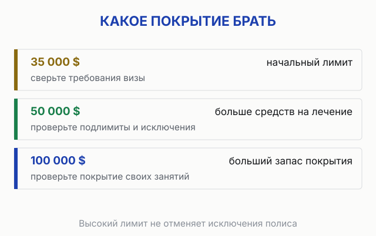

import { cherehapaTravel } from '../../data/affiliate.js';

export const chIns = cherehapaTravel('strahovka_2026');

**Страховку для путешествий выбирают под страну, срок, здоровье и занятия, затем сравнивают цену.** Два полиса с одинаковым общим лимитом могут по-разному оплачивать стоматологию, обострение болезни, эвакуацию и обращение после покупки за границей. Название страховой и рейтинг отзывов эти различия не заменяют.

На Яве после поездки к вулкану мне понадобилась клиника, и счёт закрыла страховка. Это помогло понять, зачем нужен полис. Но один удачный случай не позволяет ранжировать все страховые или обещать такую же помощь в другой стране.

<a href={chIns} class="aff-cta" rel="sponsored noopener">Сравнить полисы под свою поездку</a>

## Какая страховка лучше для путешествий в 2026 году?

**Та, которая принимает ваш риск и даёт понятный способ получить помощь в нужной стране.** Для отдыха в городе, месяца на Бали и горнолыжной поездки критерии будут разными. Сначала отсекайте неподходящие договоры, потом выбирайте среди оставшихся.

У страхования три участника. Продавец помогает оформить полис; страховщик принимает риск и решает вопрос оплаты по договору; ассистанс организует помощь — связывается с клиникой, направляет к врачу и согласует расчёты. Иногда сервис работает под одним брендом со страховщиком. Адресат вашего звонка всё равно должен быть понятен до поездки.

**Ассистанс важен вместе с договором.** Даже оперативный оператор не может добавить в полис исключённую активность. А высокий лимит не гарантирует, что выбранная вами клиника принимает гарантийные письма и вам не придётся временно платить самостоятельно.

### Сначала опишите свою поездку

Запишите страны, даты, возраст каждого туриста, место постоянного проживания, ВНЖ и второе гражданство, занятия и то, началась ли поездка. Для нескольких государств проверьте всю территорию маршрута. Для семьи — кто именно включён в документ и как лимит установлен на каждого человека.

Полис для визы и защита для лечения должны одновременно подходить вашей задаче. Страны устанавливают собственные требования; безвиз не означает отсутствия обязательной страховки. Например, у [Грузии есть отдельные условия въезда](/blog/georgia-insurance-2026/), а для [шенгенской визы](/blog/schengen-insurance-2026/) нужно проверить ещё и принятие конкретного страховщика консульством.

## Сравнение действующих программ: условия и ограничения

**Сравнивать нужно названные программы и режим покупки.** Ниже два продукта, у которых различаются условия оформления после выезда. Это сравнение условий, а не рейтинг скорости помощи или обещание одинаковой цены. В индивидуальном расчёте могут отличаться состав рисков, территория и доступность.

| Критерий | Tripinsurance | ЕВРОИНС: ОПТИМА / ОПТИМА в поездке |
|---|---|---|
| Какой режим выбрать | Туристический продукт и оформление за границей нужно различать | Для начавшейся поездки нужна специальная программа «ОПТИМА в поездке» |
| Если покупаете в той стране, где находитесь | Защита начинается не ранее шестого дня после оплаты; есть исключение при непрерывном продлении | Оформление в поездке нужно указать; срок полиса от десяти дней, начало на восьмой день |
| Франшиза при такой покупке | Безусловная 50 единиц валюты покрытия по каждому новому случаю | Размер проверяют в конкретном полисе: Правила №5 допускают франшизу по случаю и человеку |
| Куда обращаться | Сервисная служба Tripinsurance; контакты в полисе | Сервисный центр по контактам именно вашего полиса |
| Что нельзя переносить на другой вариант | Условия покупки до выезда не равны условиям покупки в поездке | Условия ОПТИМА не делают все продукты ЕВРОИНС одинаковыми |

Франшиза **50 $ — около 4 000 ₽; 50 € — около 4 500 ₽**. Проверьте валюту: слово «у.е.» без неё не говорит размер доплаты в рублях. В Tripinsurance повторные визиты по одному заболеванию или травме не означают новую франшизу на каждый приём. Новое заболевание или другая травма могут быть отдельным случаем.

У ОПТИМА есть конкретные различия внутри одной линейки. Общая сумма может быть **50 000 € (около 4,5 млн ₽)** или **100 000 € (около 9 млн ₽)**; экстренная стоматология при этом ограничена **250 € (около 22 600 ₽)** или **300 € (около 27 100 ₽)**, а не всей суммой медицинского покрытия. «ОПТИМА в поездке» в опубликованной таблице имеет общий лимит **100 000 €** и стоматологию **300 €**. Подлимит находится внутри общей суммы: складывать их как дополнительную защиту нельзя.

Для выбора это означает следующее: если критичен конкретный риск, откройте его строку в договоре. Если нужна защита после выезда, сначала сравните дату начала. По продукту, который начинает работать позже, даже высокий лимит не решает проблему первых дней.

<a href={chIns} class="aff-cta" rel="sponsored noopener">Сопоставить доступные полисы по условиям</a>

### Почему здесь нет победителя по цене

Цена имеет смысл при одинаковых стране, датах, возрастах, валюте и сумме, франшизе, занятиях и статусе «до поездки / в поездке». Тариф «от» на главной странице не равен котировке для вашей семьи. Сравнение июльских цен на августовский отпуск не выбирает полис на другую дату.

Получите расчёт с одинаковыми параметрами и сохраните два-три подходящих предложения вместе с условиями. Если один продукт не допускает нужный маршрут, он выбывает до сравнения цены. Если оба подходят, сравните стоимость и возможную доплату, а не число логотипов в выдаче.

## Какое покрытие брать: 35 000, 50 000 или 100 000 $

**Не существует суммы, которая делает любой полис подходящим.** Сначала выполните минимум страны или визы в нужной валюте. Затем проверьте пределы расходов, которые важны вашему маршруту: лечение, перевозка, поиск и спасение, экстренная стоматология, помощь при обострении болезни.

Разница между общим лимитом и подлимитом особенно заметна на стоматологии: в ОПТИМА увеличение общей суммы вдвое не удваивает стоматологический предел. Условия эвакуации тоже требуют отдельного чтения — её медицинская необходимость и согласование могут быть обязательными. Самостоятельный заказ вертолёта не превращается в оплаченный расход из-за крупной суммы в полисе.

Для долгой поездки проверьте ещё три границы: общий срок договора, продолжительность одного выезда и допустимое пребывание в стране проживания. Годовой документ не обязательно защищает каждый день непрерывного годового путешествия. Например, на странице оформления ЕВРОИНС годовой вариант ограничивает одну поездку **45 днями**; это нельзя переносить на другие годовые программы.

Больший лимит имеет смысл рассматривать, когда остальные условия подходят и вам нужен больший запас на допустимые расходы. Он не заменяет включение спорта, не снимает ограничение по месту проживания и не покрывает события до начала защиты.

## Франшиза: когда экономит, а когда съедает выплату

**Безусловная франшиза — часть согласованных расходов, которую оставляют вам.** Узнайте, применяется ли она к случаю, человеку, риску или иначе: эти варианты дают разный результат.

Условный пример в одной валюте: безусловная франшиза **50**, согласованный счёт **120**. Собственная часть — **50**, часть страховщика — **70**, если остальные условия выполнены. При счёте **35** расходы целиком остаются вам. Это арифметика условия, а не цена лечения в какой-либо стране.

Если по тому же случаю нужны повторные визиты, прочитайте правило накопления франшизы. В FAQ Tripinsurance она привязана к случаю: при первом счёте меньше франшизы остаётся доплатить её остаток, а не новый полный размер. Не считайте автоматически каждый визит новым заболеванием — и не распространяйте условие одного продукта на все договоры.

Полис без франшизы удобен, когда вы не хотите заранее установленной доплаты за покрытое обращение. Но сравнивайте, что получаете взамен: продукт с франшизой может быть подходящим при нужном риске, доступности после выезда или большем покрытии. Главное — осознанно принять собственную часть расходов.

**Нулевая франшиза не означает нулевые расходы при любом обращении.** Остаться могут исключённые услуги, превышение подлимита или временная самостоятельная оплата до возмещения. Порядок согласования сохраняется.

## Какие условия проверить в полисе

- **Занятия.** Ищите своё действие, а не общее слово «отдых»: снорклинг, дайвинг, лыжи, треккинг, поездка водителем или пассажиром мопеда. Важны глубина, высота, трасса, инструктор и снаряжение, если договор их называет. Для воды и пеших горных маршрутов есть [разбор страховки активного отдыха](/blog/strahovka-dlya-aktivnogo-otdyha/), для зимнего склона — [горнолыжная страховка с различиями трассы и фрирайда](/blog/gornolyzhnaya-strahovka/).
- **Хронические заболевания.** Экстренная помощь при обострении отличается от планового лечения. Проверьте цель помощи, ограничения и отдельный лимит. Не скрывайте диагноз ради попытки попасть в покрытие.
- **Беременность.** Срок, осложнения, преждевременные роды и помощь новорождённому могут регулироваться раздельно. Одно упоминание беременности не обещает оплату всех четырёх ситуаций.
- **Опьянение и транспорт.** Опция не отменяет автоматически требования к правам, шлему, законности управления и остальные исключения. Проверьте последствия именно для нужного риска.
- **Страна проживания.** Второе гражданство, ВНЖ и длительность пребывания могут менять применимость. Надпись «весь мир» не отменяет определения места проживания в договоре.

Медицинские расходы и отдельная выплата при несчастном случае — разные покрытия. Первая оплачивает допустимое лечение; вторая выплачивается при предусмотренных последствиях травмы. Отсутствие дополнительной выплаты само по себе не означает, что любой перелом исключён из медицинского покрытия.

### Если поездка началась

Честно отметьте это в анкете. Проверьте, принимает ли продукт такую покупку, с какого дня действует именно в вашей стране и что происходит при продлении. При разрыве между договорами дни могут остаться без защиты. Начавшееся до покрытия заболевание нельзя сделать новым страховым случаем покупкой полиса.

Если причина покупки — случившаяся травма или симптомы, сначала решайте задачу медицинской помощи. Новый договор не является способом оплатить произошедшее задним числом.

## Как обращаться за помощью, чтобы сохранить право на возмещение

**При угрозе жизни сначала вызывайте местную экстренную службу.** Нужный номер сохраните до поездки: **112 работает не во всех странах мира**. Получение неотложной помощи не должно зависеть от ожидания ответа страховщика; когда сможете, сообщите сервисному центру и передайте полис врачам.

Когда можно согласовать визит, позвоните или напишите по контактам полиса. Сообщите номер, симптомы, местонахождение и способ обратной связи. Получите номер обращения, адрес клиники и объяснение оплаты: отправит ли служба гарантию или вы платите с последующим возмещением.

Если клиника просит депозит, не считайте это автоматическим отказом страховщика. Уточните, получили ли там гарантийное письмо и кто согласует конкретную услугу. Сохраните переписку и чеки. А если связи с сервисом нет и медицинская помощь нужна, документируйте попытки связи и действуйте по предусмотренному договором порядку самостоятельного обращения.

Для возмещения обычно нужны медицинский отчёт с диагнозом и проведённым лечением, назначения, подробный счёт и подтверждение оплаты. При покупке лекарств сохраняйте рецепт и аптечные чеки; до передачи единственного рецепта в аптеку сделайте копию. Срок подачи, переводы и оригиналы уточните в своём договоре — одинакового правила для всех нет.

У ЕВРОИНС на странице медицинских расходов указан срок выплаты **45 рабочих дней после получения всех необходимых документов**. Загрузка неполного комплекта не равна началу окончательного срока и тем более не подтверждает выплату. У другого страховщика порядок может отличаться.

## Как выбрать полис за 5 минут

Пять минут подходят для предварительного отбора. Если у вас сложный маршрут или неясное условие, не заканчивайте выбор оплатой до письменного ответа страховщика.

1. **Задайте один сценарий.** Например, взрослый турист 35 лет, Турция, десять дней, покупка до выезда, городской и пляжный отдых. Это пример входных данных, не готовое предложение.
2. **Зафиксируйте одинаковые параметры сравнения.** Страны, сроки, состав туристов, валюта и сумма, франшиза, занятия. Отдельно проверьте применимость к проживанию.
3. **Отсейте неподходящие договоры.** Нет нужной активности, страна исключена или начало защиты позже нужной даты — такой вариант не решает задачу независимо от цены.
4. **Сравните оставшиеся условия.** Подлимиты, собственная доплата, организация помощи и самостоятельная оплата. Откройте полис, правила и особые условия до покупки.
5. **Получите документ и сохраните его офлайн.** Сверьте имена, даты и территорию; сохраните сервисный контакт, резервный способ связи и подтверждение оплаты. Для сложного случая получите письменное пояснение.

<a href={chIns} class="aff-cta" rel="sponsored noopener">Подобрать страховку под свою поездку</a>

### Нужна ли ещё страховка от невыезда или задержки?

Это отдельные риски. Медицинский полис не обещает вернуть стоимость сорвавшегося отпуска или заплатить за задержку самолёта. Для невозвратных расходов прочитайте [разбор страховки от невыезда](/blog/strahovka-ot-nevyezda/), а для сбоя перевозки — [условия страховки от задержки рейса](/blog/strahovka-ot-zaderzhki-reysa/).

### Может ли полис от банка заменить отдельную покупку?

Может, если конкретная программа подходит всем путешественникам и поездке. Проверьте необходимость активации, включение семьи, территорию, одну поездку, место проживания и момент начала. Сам факт наличия банковской карты страховое покрытие не подтверждает. Для возможной самостоятельной оплаты пригодится [разбор оплаты за границей](/blog/pay-abroad-2026/).
