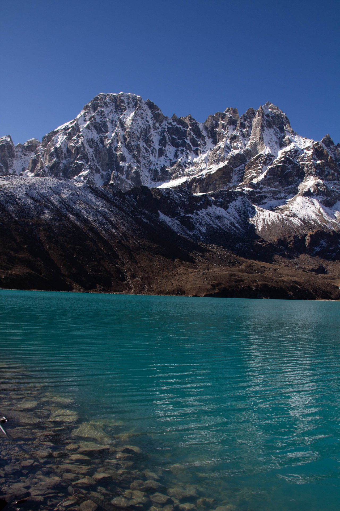
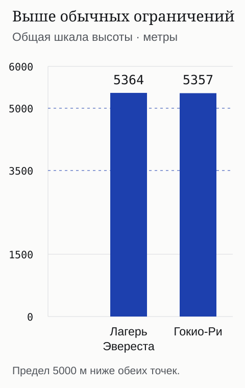
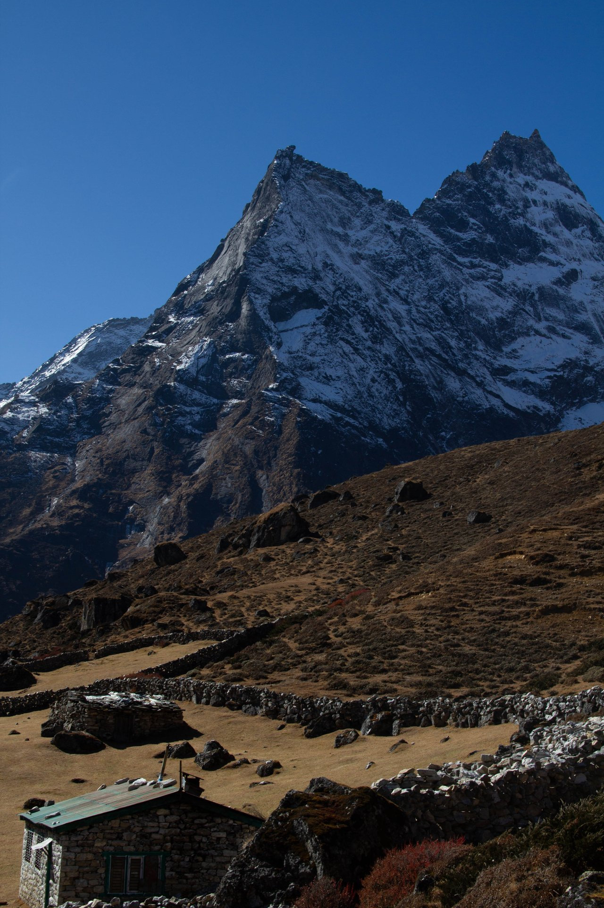

import { cherehapaCountry } from '../../data/affiliate.js';
export const nepalInsurance = cherehapaCountry('nepal', 'strahovka_trekking_nepal');

**Для треккинга к Эвересту и Гокио выбирайте полис по самой высокой точке всей программы, виду активности и условиям спасения.** Строки «Непал» и «медицинская страховка» недостаточно. Доставка заболевшего в клинику, поиск пропавшего человека и эвакуация домой могут оплачиваться из разных лимитов.

Я снимал долину Гокио в ноябре 2022 года. Фотографии помогают представить маршрут, но не подтверждают, что конкретный страховщик оплатит помощь. Ниже — сравнение договоров и расчётов, без истории личной страховой выплаты. Организацию самого путешествия, разрешения и дорогу в Луклу разбираю отдельно в [гайде по треккингу к Эвересту](/blog/nepal-everest-trek-2026/).

## Какую высоту указывать для Эвереста и Гокио

**Берите максимальную высоту с учётом перевалов и радиальных выходов, а не только ночёвок.** Название «Гокио» может обозначать прямой путь к озёрам, подъём на Гокио-Ри или связку с базовым лагерем Эвереста через Чо-Ла. Это разные программы.

| Маршрут | Что сверить с полисом | Где легко ошибиться |
|---|---|---|
| Базовый лагерь Эвереста | Сам лагерь находится на 5 364 м; проверьте все дополнительные выходы | Покрытие до 5 000 м не хватает даже без Кала-Патхара |
| Эверест с Кала-Патхаром | Высшая точка программы оказывается примерно на 5,5–5,6 км; запросите точное значение у организатора | Лимит ровно 5 500 м нельзя принимать без проверки точки разворота |
| Гокио с Гокио-Ри | Гокио-Ри — 5 357 м; сверяйте также другие выходы из долины | Высота лоджа у озера меньше высоты смотровой площадки |
| Гокио и Эверест через Чо-Ла | Нужны весь маршрут, высоты перевала и смотровых площадок, сведения о снаряжении | Страхование одной долины не подтверждает покрытие ледового участка и перевала |

Если страховщик предлагает категории до 5 000 и до 6 000 м, для таких программ рассматривайте второй диапазон. Но отметка «до 6 000» решает только вопрос высоты. Она не подтверждает автоматически вид спорта, вертолёт и спасработы. Для технического восхождения со страховочной системой нужен отдельный разбор альпинизма.

*Гокио: полис подбирают под всю программу, включая подъём над озером.*

## За что отвечает каждая строка покрытия

Перед сравнением цен разделите четыре возможных счёта:

| Расход | Пример ситуации | Что искать в договоре |
|---|---|---|
| Лечение | Врач обследует заболевшего участника и назначает помощь | Болезнь или травма признана страховой, нужная активность включена |
| Поиск и спасение | Человека нужно найти, добраться до него или снять с трудного участка | Покрытие гор и удалённых районов, поиск с воздуха, отдельный лимит |
| Доставка в клинику | Известного пациента перевозят с маршрута к врачу | Допустимый транспорт, медицинские основания, согласование и лимит вертолёта |
| Возвращение домой | После оказанной помощи необходима медицинская репатриация | Кто принимает решение, какое сопровождение и транспорт оплачиваются |

Слово «эвакуация» продавец может использовать для разных этапов. Поэтому задавайте конкретный вопрос: **что произойдёт, если участник находится в лодже на высоте маршрута, не может продолжать путь и нуждается в доставке к врачу?** Отдельно спросите о ситуации, когда человека ещё предстоит найти. Ответ на один вопрос не заменяет ответ на другой.

Общая сумма полиса не отменяет подлимит конкретного риска. И нулевая франшиза не отменяет исключения. Даже при прямой оплате клинике полезно иметь доступный резерв: гарантия может охватывать лишь согласованную часть расходов.

## Какие предложения есть в реальном расчёте

Для сравнения задан **условный взрослый 35 лет, 20 дней — с 10 по 29 ноября**, гражданин России до выезда, Непал. В форме выбраны **горный треккинг, эвакуация вертолётом и поисково-спасательные мероприятия**. Валюта предложений — евро. Эти возраст и даты придуманы для примера.

| Предложение | Медицинский лимит | Вертолёт и спасработы в карточке | Стоимость за 20 дней |
|---|---|---|---|
| Согласие | €50 000, около 4,5 млн ₽ | Вертолёт €10 000 и спасработы €10 000: примерно по 898 000 ₽; франшиза обозначена как отсутствующая | 31 041 ₽ |
| Евроинс | €50 000 | На вертолёт и поисково-спасательные мероприятия показано €50 000; франшиза обозначена как отсутствующая | 38 478 ₽ |

Это не обещание фиксированного тарифа и не рейтинг урегулирования. Разные суммы в строках нельзя складывать в общий гарантированный запас: проверьте, входят ли расходы в единую страховую сумму и как она расходуется. Семье, человеку другого возраста и участнику уже начавшейся поездки нужен свой расчёт.

**С чего начать выбор.** У Евроинс полные правила прямо относят треккинг выше 3 500 м к экстремальному спорту и отдельно описывают медицинскую помощь с вертолётом и поиск в удалённых районах. Сопоставьте эти пункты с тем, что будет включено в ваш договор. У Согласия карточка даёт конкретные лимиты вертолёта и спасработ, но опубликованный общий образец не подтверждает индивидуальное покрытие всей высокогорной программы.

<a href={nepalInsurance} class="aff-cta" rel="sponsored noopener">Сравнить полисы для треккинга в Непале</a>
В форме проверьте три выбранных условия: горный треккинг, вертолёт и поисково-спасательные работы. Одна выбранная страна эти опции не заменяет.

## Почему карточка не заменяет полные правила

У Евроинс нужны как минимум три проверки. **Пункт 2.51.3** классифицирует треккинг выше 3 500 м как экстремальный спорт. **Пункт 17.1.1.4** предусматривает воздушную скорую до ближайшего медицинского учреждения, если пациент находится в критическом состоянии и физически не может добраться самостоятельно без медицинского сопровождения. Одного желания спуститься на вертолёте для этого недостаточно. **Пункт 17.2.4** отдельно касается поиска и спасения, в том числе в горах и удалённых местах.

При этом пункт 18.1.33 исключает эвакуацию при незначительном состоянии, которое назначенный страховщиком консультант считает поддающимся местному лечению и не препятствующим продолжению поездки. Пункт 18.1.34 связывает оплату с организацией через страховщика или сервисную компанию, предусматривая исключения для уважительных причин невозможности согласования. Вертолёт для удобного завершения усталого похода из этих условий не следует.

Есть и другая ловушка: **медицинская транспортировка, организованная самим путешественником**, описана отдельно — в пункте 17.2.1.1 с пределом €500 (около 45 000 ₽), если договор не меняет условие. Эту строку нельзя подменять лимитом вертолёта из карточки.

У Согласия скачиваемый образец содержит программу А: в ней обычный треккинг ограничен 1 500 м и есть исключение экстремальных видов спорта. Это общий образец, а не доказательство отказа по любому продукту компании. Но и доказательством подходящего полиса для Эвереста он не является. Если в предложении выбираете расширение, получите условия именно этого расширения и проверьте, как оно отражено в договоре.

## Сколько закладывать на страховку

В показанном сравнении 20 дней стоят 31–38,5 тыс. ₽. Делить цену на число дней удобно только внутри одинакового сценария: нельзя сравнивать её с дешёвым полисом для прогулок по Катманду без горных занятий. Набор рисков, возраст, срок, валюта и страховая сумма должны быть понятны до сравнения.

Не оценивайте достаточность эвакуационного лимита по одной рассказанной кем-то цене вертолёта. Рейс, наземное спасение, сопровождение и дальнейшее лечение могут составить несколько разных счетов. Уточните у организатора реальную схему помощи на вашем участке, а у страховщика — какие её части и в каком порядке он оплачивает. Чужая история выплаты не изменяет ваш договор.

Для городских дней до и после маршрута сохраняйте непрерывные даты защиты. Если прилёт задерживается, выход с трека переносится или меняется страна начала поездки, сначала проверьте условия. В частности, в общих правилах Евроинс есть ограничение поездок, начатых не из России, если программа или договор не предусматривают иного.

## Что проверить до оплаты

Подготовьте один лист с программой: даты, максимальная высота, перевалы, радиальные выходы, сопровождение и снаряжение. Сравнивайте его с документами, а не только с рекламным названием спорта.

1. **Территория и применимость.** Непал включён; возраст, гражданство, постоянное проживание и место начала поездки подходят продукту.
2. **Активность.** Горный треккинг и нужное расширение отражены в условиях вашего предложения; обычная категория до 1 500 или 3 500 м не осталась единственной.
3. **Высота и характер пути.** Проверены все точки программы, использование снаряжения, самостоятельный или организованный формат. Если трактовка неясна, получите письменный ответ до оплаты.
4. **Виды помощи.** Лечение, поиск, спасение и перевозка к врачу рассмотрены отдельно; известны подлимиты, франшиза и правила согласования.
5. **Документы.** Вы видите редакцию правил и условий выбранной программы. Общий скачанный образец не выдавайте за свой договор; сразу после оформления сверьте полученный полис и исправьте несоответствия до выезда.

Сохраните ответ страховщика вместе с программой. Он помогает подтвердить, какие сведения были сообщены, но сам по себе не переписывает исключения договора. Базовые различия полисов разбираю в [страховке для активного отдыха](/blog/strahovka-dlya-aktivnogo-otdyha/).

<a href={nepalInsurance} class="aff-cta" rel="sponsored noopener">Подобрать полис под свою программу и возраст</a>

## Что делать, если помощь нужна на маршруте

**Сначала безопасность человека.** Не откладывайте необходимую экстренную помощь ради ожидания согласования. Свяжитесь с гидом, местной медицинской или спасательной службой и ассистансом, как только это возможно. Страховщик определяет оплату по договору; решение о необходимой медицинской помощи не стоит заменять спором о лимите.

Если связь есть, сообщите номер полиса, точное место, высоту, состояние участника и контакт того, кто остаётся рядом. Запишите номер обращения. Спросите, кто организует транспорт, куда везут, отправлена ли гарантия оплаты и какую сумму она покрывает. Предложение посредника вызвать борт не равно согласию страховщика оплатить его.

*На треке сохраните название лоджа и координаты. Одного названия долины для поиска участника может быть недостаточно.*

Когда согласование объективно невозможно, сохраняйте сведения о попытках связи и обстоятельствах срочности. Попросите подробные медицинские и платёжные документы, включая описание перевозки. Порядок обращения и сроки возмещения читайте в своём полисе. Не подписывайте пустые счета и не подтверждайте услуги, которых не было.

До выхода сохраните офлайн полис, правила, контакты ассистанса, маршрут и контакты организатора. Передайте копии близкому человеку. Городские дни перед треком можно спланировать по [гайду о Сваямбунатхе](/blog/svayambunath/).

## Частые вопросы

### Подходит ли опция «активный отдых» для высокогорного трека?

Нет. У одного продукта это может означать треккинг лишь до 1 500 м, у другого — иной диапазон. Нужны определение занятия, высота и включённые виды помощи именно в вашем договоре.

### Большая страховая сумма гарантирует оплату любого вертолёта?

Нет. Важны медицинские основания, организация через сервисную компанию, применимый лимит, исключения и условия конкретного полиса. Сама сумма на первой странице этого не подтверждает.

### Полис для Гокио подходит и для Эвереста?

Только если весь изменённый маршрут остаётся в пределах высоты, активности и прочих условий. Добавление Чо-Ла или технического восхождения проверьте до изменения программы.

### Можно ли пользоваться страховкой банковского пакета?

Проверьте её по тем же пунктам. Название премиального обслуживания не подтверждает горный треккинг, поиск и вертолёт. Нужны именной документ и действующие условия.
