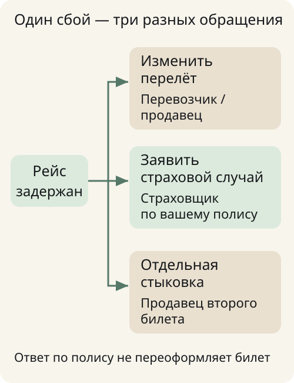
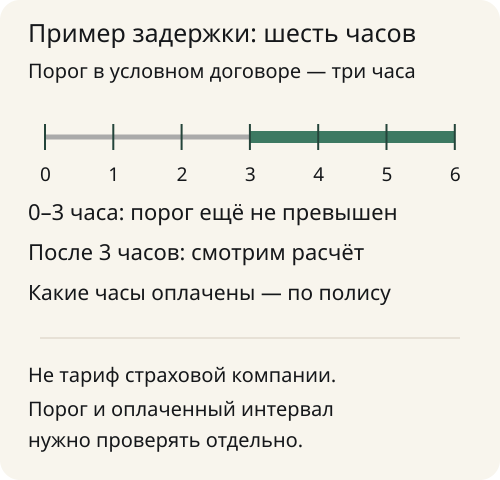
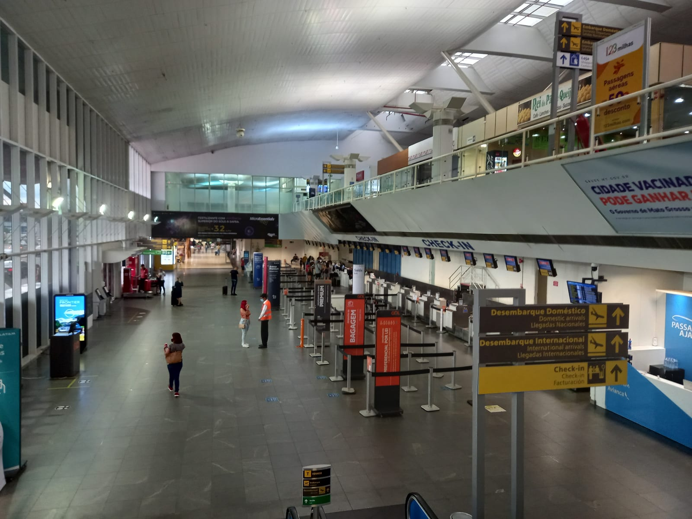
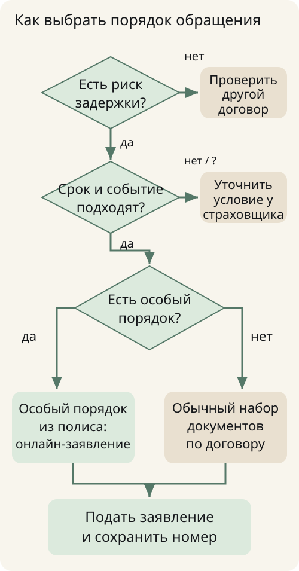

**Страховка от задержки рейса платит за событие, которое подходит под условия вашего полиса.** Важны не только часы на табло, но и застрахованный пассажир, нужный перелёт, срок действия, причина сбоя и исключения. Слова «туристическая страховка» в банковском приложении сами по себе такого покрытия не подтверждают.

Если рейс перенесли, сначала найдите купленный полис и порядок обращения. Если только планируете поездку, сравните условия до оплаты. Новый договор нельзя считать способом получить деньги за известную задержку: для такого обещания потребовалось бы прямое подтверждение страховщика, а не возможность нажать кнопку покупки.

## Сначала разделите три задачи

У задержанного пассажира могут одновременно возникнуть три разных вопроса: что будет с билетом, кто оплатит ожидание и что положено по страховке. Не пытайтесь решить их одним обращением к продавцу полиса.

Билет и изменение маршрута обсуждаются с перевозчиком или продавцом, у которого оформлена покупка. Заявление о страховой выплате направляется страховщику по порядку вашего договора. Оплата нового самостоятельного перелёта — ещё одно решение со своими расходами; её нельзя заранее считать суммой будущего возмещения.

Например, рейс перенесли, а следующий сегмент куплен отдельно. Полис с почасовой выплатой не превращается автоматически в защиту стоимости второго билета. Проверьте, есть ли отдельное покрытие пропущенной стыковки и какие условия должны совпасть. До этого не покупайте дорогую замену в расчёте, что страховая вернёт всю сумму.

Если вы вообще не можете начать поездку по личной причине, нужен другой разбор: [страховка от невыезда](/blog/strahovka-ot-nevyezda/). Задержка рейса, отказ от путешествия и медицинская помощь за границей — разные риски.

## Как найти нужный полис?

**Найдите договор, в котором назван риск задержки рейса, и проверьте, что вы включены в число застрахованных.** Начните с письма после покупки билета, раздела полисов в банковском приложении или личного кабинета страховой компании. Сохраните сам документ и приложенные к нему условия.

В банковском пакете может быть страхование путешествий, но из названия не видно, кто именно покрыт: только владелец, семья при совместной поездке или другой состав. Для родственника не стоит подавать заявление от имени владельца пакета без проверки этого пункта. Важны и ограничения поездки, и подтверждение родства, когда его требует программа.

Сверьте имя, даты и конкретный перелёт с маршрутной квитанцией. Уточните, где заканчивается ответственность одного полиса, если путешествие включает несколько рейсов. При ошибке в документе обратитесь к тому, кто его оформил; самостоятельная правка PDF ничего не меняет в договоре.

Проверять медицинский полис как замену страхованию рейса бессмысленно. В [обзоре страховки для путешествий](/blog/strahovka-dlya-puteshestviy-2026/) разобраны другие задачи покрытия. Для нынешней ситуации ищите именно нужный дополнительный риск.

## Сколько часов должны задержать рейс?

**Единого порога для всех полисов нет: он указан в вашем договоре.** Смотрите одновременно момент начала выплаты, способ подсчёта полных часов и максимальное число оплачиваемых часов. Фраза «до определённой суммы» не означает, что всю сумму перечислят после первой задержки.

Не смешивайте порог события и расчёт денег. Это два разных пункта. Если страховой случай начинается после некоторого интервала, из этого ещё не следует, что оплачиваются все часы ожидания с самого начала. Не следует и обратное: франшизу нельзя самостоятельно вычесть, если такого порядка нет в условиях.

Для проверки удобно выписать время по билету, фактическое отправление и норму расчёта. Сравнивайте время в одной часовой зоне, особенно при международном маршруте. Перенесённое время в приложении не должно бесследно заменить исходную квитанцию: сохраните оба сообщения.

Ниже схема вымышленного примера с порогом три часа. Она показывает, почему длительность ожидания и оплачиваемый интервал могут различаться. Это не тариф конкретной компании и не обещание выплаты за нарисованные часы.

## Что показывают реальные программы

У Cherehapa в описании отдельного полиса указан порог **более трёх часов**, предел **до 15 тысяч рублей** при задержке и до 12 тысяч при отмене. FAQ ограничивает один полис пятью перелётами. Для сложного маршрута это полезная проверка: количество поездок и количество полётных сегментов не одно и то же.

Это описание одного предложения, а не свойства всех страховок. Перед оплатой откройте условия выбранного договора и проверьте свои рейсы. Особенно внимательно сопоставьте обещание покрытия любой авиакомпании с перечнем перелётов, который вы действительно указали в форме. Пустое поле не заменяет согласованное покрытие.

У СберСтрахования есть отдельная инструкция обращения по полису путешественника; для банковских пакетов и самостоятельного страхования порядок отличается. В Условиях №1, опубликованных на сайте, раздел задержки относится к регулярным рейсам и содержит исключение для чартеров. Эту редакцию нельзя автоматически назначить вашему банковскому пакету.

Сопоставлять программы только по крупной цифре на странице рано. Сначала убедитесь, что сравниваете одинаковые рейсы, состав пассажиров и события. Лимит на человека не равен лимиту на всю семью, а предел на путешествие не обязан повторяться на каждом участке.

## Какие причины и исключения проверить

Ограничения воздушного пространства, погода, техническая неисправность и опоздание самого пассажира — разные обстоятельства. Нельзя переносить ответ об одном из них на остальные. Ищите не только раздел с риском задержки, но и общие исключения договора.

В частности, раздел 9 Условий №1 СберСтрахования исключает чартерные рейсы и опоздание на регистрацию или посадку. В нём отдельно оговорены отмена или перенос, о которых сообщили более чем за сутки до планового вылета. Это пример того, почему одинаковый итог на табло ещё не означает одинаковое страховое событие.

В этой же редакции есть исключения для решений органов власти и администрации аэропорта, а также для стихийных бедствий. Поэтому сообщение об ограничениях в авиаузле само по себе не подтверждает страховую выплату.

Не пользуйтесь советом «при закрытии аэропорта платят всем». Даже если компания публиковала сообщение о выплатах по определённой программе, оно не расширяет другой ваш полис. Для неясного случая направьте страховщику номер договора, рейс, причину и время уведомления и попросите указать применимый пункт условий.

Также не выдавайте свою неявку на рейс за задержку перевозчика. Данные о фактическом отправлении и действиях пассажира проверяются отдельно. Если спор возник из-за причины отказа, сначала получите письменное объяснение, а не меняйте описание события под удобный риск.

## Что делать после объявления задержки

Сохраните маршрутную квитанцию с исходным расписанием, посадочный талон, сообщения о переносе и документы по фактическому перелёту. Пока вы в аэропорту, уточните у перевозчика, как получить подтверждение задержки и причины. Даже если ваша программа отслеживает рейс автоматически, собственные документы помогут разобраться при расхождении.

Проверьте указанный в полисе срок уведомления. Не ждите конца отпуска по привычке: в разных программах различаются и момент обращения, и перечень документов. Отправьте заявление предусмотренным способом и сохраните его номер или подтверждение получения. Отсутствие SMS не доказывает, что случая не было, как и наличие SMS не заменяет прочтения решения.

Параллельно решайте маршрут с перевозчиком. Страховое заявление не переносит время посадки и не сохраняет место на следующем самолёте. Если предстоит ночёвка, сначала выясните предоставляемое обслуживание, затем согласуйте расходы, которые рассчитываете предъявить страховщику.

При сбоях московского авиаузла 14 октября Аэрофлот отдельно просил сверять конкретную бронь и не приезжать в аэропорт при отмене. В [заметке об изменениях рейсов](/novosti/2026-10-14-aeroflot-flight-changes/) сохранены дата и границы этого сообщения. Оно не подтверждает покрытие вашим полисом и не показывает текущий статус каждого рейса.

## Как отличить почасовую выплату от возмещения расходов

При фиксированной выплате расчёт привязан к предусмотренной договором шкале. При возмещении расходов понадобится подтвердить те траты, которые договор разрешает предъявлять. Не подменяйте один механизм другим: чек за гостиницу сам по себе не увеличивает фиксированную сумму, а обещание лимита не отменяет требования к расходам.

Перед самостоятельной оплатой выпишите, на что именно распространяется покрытие. Новый билет, питание, такси и отель могут оцениваться по разным условиям или вообще не входить в выбранный риск. Уточните необходимость согласования и документы для подтверждения. Сохраняйте счета в исходной валюте и платёжные подтверждения; способ пересчёта также ищите в договоре.

Не складывайте заранее возврат перевозчика, банковскую выплату и компенсацию страховщика как гарантированную прибыль. Для разных требований могут действовать собственные основания и ограничения. Сообщайте о полученных возмещениях, если этого требуют условия. Разбор конкретного спорного расчёта начинается с договора и решения, а не с общей таблицы в интернете.

## Что проверить до следующей поездки

Составьте перечень всех полётных сегментов, пассажиров и дат. Отметьте регулярные и чартерные рейсы, единый билет или самостоятельную пересадку. Затем посмотрите, решает ли рассматриваемая страховка именно ваш риск: несколько часов ожидания или дорогую потерю дальнейшего маршрута.

Отдельно выясните последний срок покупки и начало действия. У разных предложений возможен обязательный промежуток до вылета; универсальных «купите хоть у трапа» здесь нет. Если задержка известна, задайте прямой вопрос о ней до оплаты и сохраните письменный ответ. Возможность заполнить форму не подтверждает, что известное событие будет признано страховым.

После покупки убедитесь, что документ пришёл и данные совпали. Сохраните доступ к полису без интернета. Возьмите официальный адрес подачи заявления из самого договора, чтобы во время сбоя не искать поддержку по случайным рекламным ссылкам.

## Вернут ли стоимость нового билета?

**Только если соответствующие расходы покрыты вашим договором и выполнены его условия.** Почасовая выплата за ожидание не обещает возмещения всей замены. До покупки нового рейса уточните порядок переоформления у перевозчика и нужное согласование у страховщика.

## Нужна ли справка, если компания сама следит за рейсом?

**Это зависит от программы: автоматическое отслеживание не отменяет все остальные документы.** Сохраните билет, данные пассажира и подтверждение фактического перелёта. Если сервис запросил справку или сведения о причине, уточните перечень по своему полису и номеру заявления.

## Можно ли получить деньги за всю семью одной заявкой?

**Не рассчитывайте на это без проверки: нужны покрытие каждого человека и предусмотренный программой порядок обращения.** Уточните состав застрахованных, семейные условия и реквизиты получателей. Несколько пассажиров в одной брони сами по себе не превращают один персональный полис в семейный.
