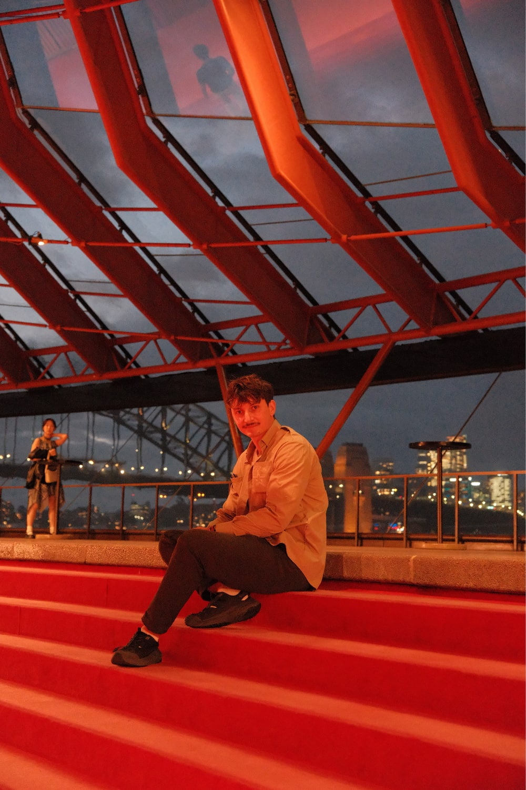
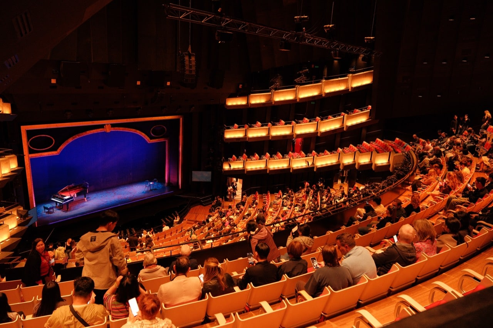
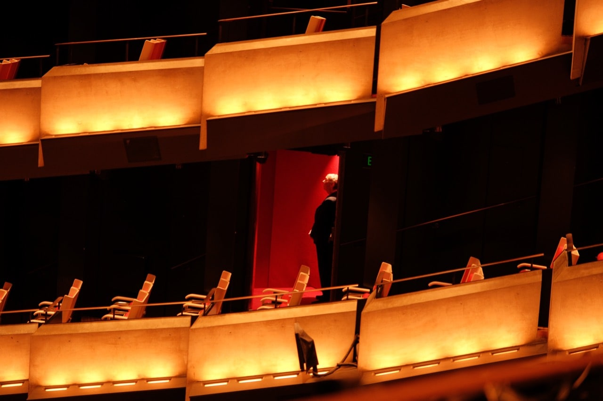
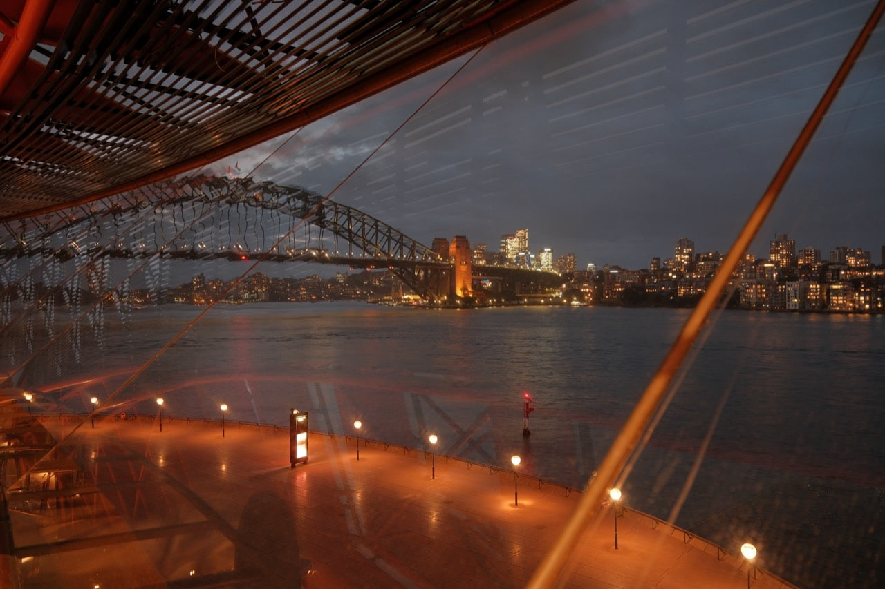

Я сходил на оперу в Сиднее. На моих фотографиях — вечер у входа, красные лестницы, зрительный зал и гавань за стеклом. Вблизи знаменитые паруса оказываются поверхностью с мелким рисунком плитки, а внутри внимание постоянно переключается между бетоном, тёплым светом и мостом за окнами.

Но при планировании важнее другая деталь: под этой крышей несколько залов. Билет в Сиднейскую оперу ещё не говорит, что именно вы увидите. Можно попасть на балет, концерт арий с фортепиано, симфоническую программу или экскурсию, у которой вообще нет представления. Начать стоит с выбора вечера.

## Прогулка, экскурсия или представление: что выбрать?

Если хочется услышать музыку в зале, выбирайте программу. Если интереснее устройство здания — экскурсию. Покупать оба варианта только ради доступа внутрь необязательно: они дополняют друг друга, когда интересны и архитектура, и выступление.

| Вариант | Что получите | Сколько времени оставить | Что важно при покупке |
|---|---|---|---|
| Прогулка вокруг | Паруса вблизи, лестницы, виды гавани | 30–60 минут по вашему темпу | Внешний осмотр бесплатный; временные перекрытия возможны |
| Стандартная экскурсия | История и доступные в этот день внутренние пространства | Сам тур около часа плюс дорога и регистрация | 50 AUD заранее, 55 AUD в день; конкретный зал не гарантирован |
| Концерт оперных арий | Несколько отдельных номеров, удобный первый шаг в жанр | По длительности программы | Это может быть фортепиано, а не оркестр и декорации |
| Полная опера или балет | Одна постановка с собственным сюжетом | Время из афиши плюс запас до начала | Проверить язык, антракты, зал, обзор и переводы |

Для прогулки по центру с рассказом на русском можно <a href="https://tripster.tpk.mx/cicJCuPT?erid=2VtzqxMZpjc&amp;sub_id=tt_sydney_opera_city&amp;u=https%3A%2F%2Fexperience.tripster.ru%2Fexperience%2F106625%2F" target="_blank" rel="sponsored noopener">выбрать двухчасовую экскурсию по Сиднею</a>. Это знакомство с городом: билет на представление и экскурсию по внутренним залам нужно покупать отдельно. Ради одного фасада можно погулять самостоятельно.

Красные лестницы и наклонное остекление фойе. Прогулка вокруг здания и доступ в зрительскую часть — разные сценарии посещения.

На стандартную экскурсию нужно прийти в Welcome Centre на Lower Concourse за 15 минут до начала. По [условиям оператора](https://www.sydneyoperahouse.com/tours/sydney-opera-house-tour), опоздание более чем на пять минут означает потерю тура без возврата. Это другой порядок входа, чем на вечернее представление.

## Как выбрать программу и не перепутать залы

Сначала проверьте название зала и формат события, затем выбирайте места. Основная площадка Opera Australia и Австралийского балета — Joan Sutherland Theatre, до 1507 зрителей. Concert Hall — другой зал, с вместимостью до 2664 при круговом размещении. Его схема рассадки не поможет выбрать боковую ложу в оперном театре.

Практичная последовательность: откройте [афишу Opera Australia в Сиднее](https://opera.org.au/sydney/), найдите свои даты, прочитайте описание и проверьте строку Venue. Название Sydney в афише компании не означает автоматически представление внутри здания: бывают и отдельные площадки на открытом воздухе.

Для первого знакомства с жанром есть Great Opera Hits: примерно 90 минут, включая двадцатиминутный антракт, известные арии и сопровождение фортепиано. Это концерт, без обещания полноценной оперной постановки. В [карточке программы](https://opera.org.au/productions/great-opera-hits-sydney/) объявлен билет от 69 AUD и сбор 9,80 AUD. Один билет с таким сбором — 78,80 AUD, ориентировочно 4500 ₽. Дешёвая категория доступна не на каждую дату; итог проверяйте до оплаты.

Если вам интересна конкретная опера, заранее прочитайте короткое содержание. Тогда перевод над сценой помогает следить за действием, а не становится единственным способом понять, кто с кем сейчас выясняет отношения. Язык перевода и продолжительность смотрите у выбранной постановки.

Зал перед началом выступления: зрители занимают места, на сцене стоит рояль, по сторонам поднимаются освещённые балконы.

## Какие места брать: проверьте не только сцену, но и перевод

Самая полезная проверка перед оплатой — видны ли с места сцена и надписи над ней. В Joan Sutherland Theatre перевод доступен не со всех кресел. Если без него будет трудно, уточните видимость у кассы, даже когда цена и положение места кажутся подходящими.

Метка restricted view означает ограниченный обзор. Для человека, который приходит прежде всего слушать, это иногда приемлемая экономия. Для первого балета или постановки, где важны движения по всей сцене, последствия заметнее. Боковое место может находиться близко к артистам по схеме и при этом смотреть на сцену под неудобным углом.

Универсального лучшего ряда для всех программ нет. Выбирайте на схеме конкретного события: расположение исполнителей и используемая часть сцены меняются. При одинаковом бюджете разумнее сравнить более центральное место подальше с боковым поближе, чем автоматически покупать самое близкое к сцене.

Параметры доступности тоже лучше решать через кассу. Место для коляски, сопровождающего, возможность пройти без лестниц и читаемый перевод — отдельные потребности, которые не сводятся к общей надписи «здание доступно».

Боковые балконы выглядят эффектно, но для покупки важнее реальная линия взгляда на сцену и экран перевода.

## Почему Сиднейская опера так знаменита

За узнаваемым силуэтом стоит инженерное решение, которое несколько лет не удавалось найти. Утзон задумал оболочки крыши, но их первоначальная сложная геометрия мешала повторять конструктивные элементы. Выходом стала поверхность одной сферы: из её частей удалось получить разные оболочки. Появилась возможность изготавливать элементы заранее и собирать их в единую форму.

На крыше 1 056 006 керамических плиток. Их разрабатывала шведская Höganäs: поверхность должна была ловить меняющийся свет гавани, а не ослеплять зеркальным блеском. Рисунок плитки можно рассмотреть снаружи, не покупая билет.

У строительства есть и человеческая история. После конфликта с властями Утзон в 1966 году покинул проект и Австралию. Достраивала здание другая команда. Архитектор больше не вернулся в страну и не увидел свою работу законченной.

Первоначальный бюджет составлял 7 млн австралийских долларов, итоговый — 102 млн. Планировали закончить в 1963 году, открыли в 1973-м. Значительную часть денег собрали через специальные лотереи. В 2007 году оперу включили в список Всемирного наследия ЮНЕСКО.

Эти детали хорошо держать в голове во время прогулки: знакомый силуэт состоит из повторяющихся элементов, долгих расчётов и решений, из-за которых люди спорили годами.

## Как спланировать вечер у гавани

Оставьте отдельное время на набережную и входной контроль. Из Circular Quay к опере идти примерно 7–10 минут. Здесь сходятся поезда, паромы и другой городской транспорт; маршрут от своего жилья удобнее проверить в [планировщике Transport for NSW](https://transportnsw.info/trip).

Для вечера с готовым электронным билетом я бы заложил 45–60 минут до начала на прогулку, фотографии и проход внутрь. Это рекомендация по планированию, а не обязательный норматив. Сам театр советует прибывать минимум за 20 минут с готовым билетом или за 30 минут, если его нужно получать в кассе.

Сначала можно пройти вдоль воды и посмотреть на оболочки снизу, затем найти вход под Monumental Steps. Крупная лестница снаружи — хороший ориентир, но не повод идти к любым дверям наверху. Дальше остаются проверка вещей, поиск своего зала и места. При опоздании могут попросить дождаться подходящей паузы в выступлении.

Плотный ужин перед самым началом усложняет этот маршрут. Удобнее поесть раньше или заранее выбрать место после программы. Если хотите напиток в антракте, спросите о предзаказе: Opera Australia советует эту возможность, чтобы меньше времени провести в очереди.

Вид из фойе на Harbour Bridge. После наступления темноты на стекле заметнее отражения внутреннего света.

## Десять приёмов, которые пригодятся при посещении

1. **Сравнивайте итог покупки.** Цена «от» может не включать сбор. Для двух билетов, тура и пакета с ужином сравнивайте всю корзину и условия отмены, а не только крупную цифру в афише.

2. **Семье проверьте отдельный тариф.** На стандартную экскурсию два взрослых и двое детей 5–15 лет по отдельности стоят 160 AUD при покупке заранее. Семейный билет — 130 AUD, около 7430 ₽. Разница 30 AUD; ради неё не нужно искать промокод.

3. **Не переносите детскую льготу экскурсии на спектакль.** Бесплатный вход до пяти лет относится к стандартному туру. Возрастной допуск и необходимость отдельного места на представлении задаёт конкретное событие.

4. **Для архитектуры берите именно экскурсию.** Билет на концерт открывает путь к вашему залу, а не свободное хождение по всем сценам и закулисью. У обычного тура тоже нет гарантии каждого пространства: здание работает.

5. **Оцените лестницы заранее.** Стандартный часовой маршрут включает до 2,5 км ходьбы и около 300 ступеней. Если это много, выбирайте [вариант без лестниц или более медленный тур](https://www.sydneyoperahouse.com/tours/access-mobility-friendly), а не рассчитывайте найти лифт по дороге с обычной группой.

6. **Берите небольшую сумку.** Вещи крупнее листа A4, рюкзаки и зонты в залы не допускаются и требуют сдачи. Но гардероб не работает как универсальное хранилище багажа для любого прохожего: правила приёма привязаны к билету и решению сотрудников.

7. **Смокинг оставьте на своё усмотрение.** Обязательного дресс-кода у Opera Australia нет. Удобная одежда и дополнительный слой для прохладного зала практичнее покупки костюма ради одного вечера.

8. **Снимайте до начала, а не во время арии.** Правила Opera Australia допускают фотографии до и после выступления и в антракте; во время исполнения съёмка запрещена. Следуйте объявлениям конкретного события. Профессиональную камеру или записывающее оборудование в зал могут не допустить.

9. **Для вида через стекло уберите вспышку.** Вспышка отражается в окне. Попробуйте подойти ближе к стеклу, держать телефон устойчиво и найти участок без яркого светильника за спиной. Во время выступления экран телефона остаётся выключенным.

10. **Не привязывайте поездку к непроверенному ежедневному расписанию.** У экскурсии и спектаклей разные календари. Например, стандартный тур не проводится 25 и 31 декабря 2026 года. На другие даты наличие времени и мест тоже проверяйте до планирования всего дня.

## Что говорят посетители и где советы расходятся

Отзывы полезнее читать по своему залу и формату события. В двух обсуждениях Reddit о боковых ложах и выборе между туром и представлением встречаются противоположные оценки: одни готовы уступить обзор ради музыки, другие жалуются, что пропустили часть сценического действия. В разговоре о ложах участники отдельно исправляют путаницу между Concert Hall и Joan Sutherland Theatre.

Во второй ветке советуют выбирать тур ради архитектуры, а выступление — ради интересной программы. При этом предположение, что утренний тур обязательно покажет оба главных зала, нельзя превращать в обещание: оператор прямо оставляет маршрут зависимым от работы театра.

Это небольшая выборка из двух веток, прочитанных в ноябре 2026 года, представительной считать её нельзя. Интерфейс относит обсуждения приблизительно к четырём и десяти месяцам ранее; точные даты всех комментариев не установлены. Практический вывод один: проверяйте отзывы о нужном зале и своём типе билета.

## Что проверить перед покупкой

- Нужное событие проходит внутри Sydney Opera House, а не на другой площадке у гавани.
- В билете указан тот зал, схему которого вы изучали.
- Обзор сцены и видимость перевода подходят именно вам.
- Итоговая сумма включает понятные сборы; условия отмены прочитаны.
- Продолжительность, антракты и возрастные правила подходят вашей компании.
- Маршрут без лестниц или специальные места согласованы, если они нужны.
- После дороги из Circular Quay остаётся запас на контроль вещей и поиск места.

Для экскурсии начните с [официального календаря тура](https://www.sydneyoperahouse.com/tours/sydney-opera-house-tour), для музыкального вечера — с программы. А общую поездку помогут собрать [путеводитель по Австралии](/blog/australia-guide-2026/) и [гид по восточной части страны](/australia-east/). Если хочется ещё одного дня у гавани, отдельно есть [маршрут по зоопарку Таронга](/blog/taronga-zoo-sydney/): это полноценная прогулка, которую удобнее не сжимать между дневной экскурсией и вечерним спектаклем.
