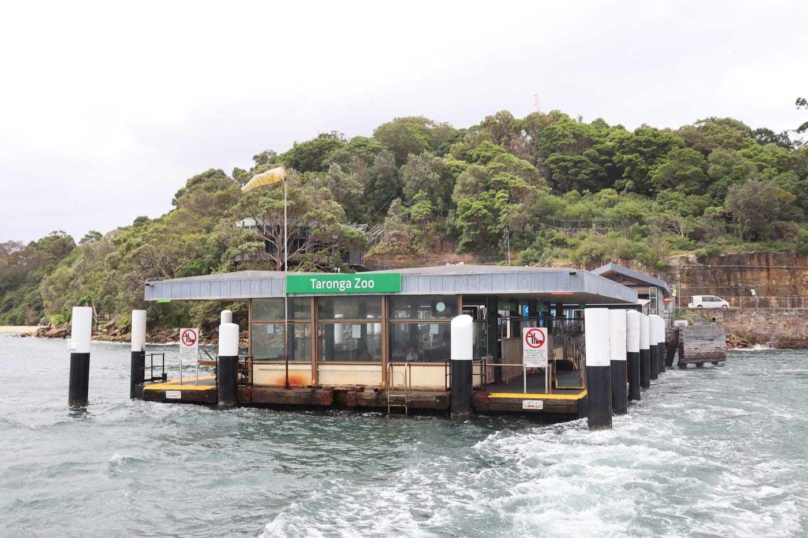
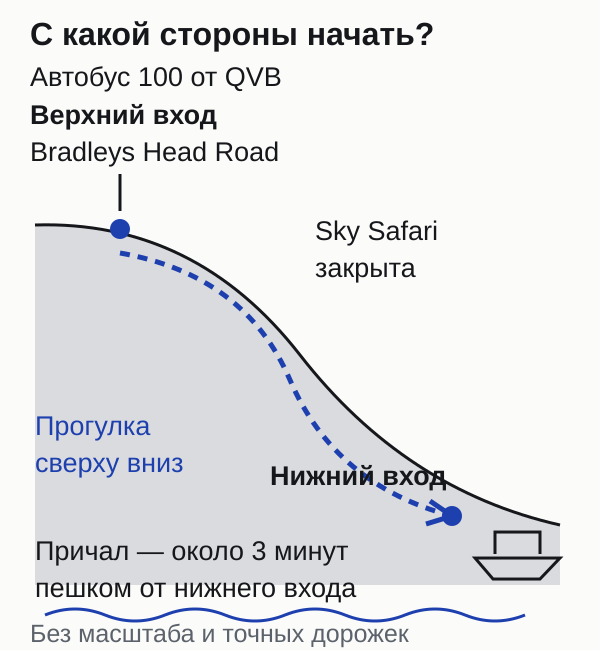
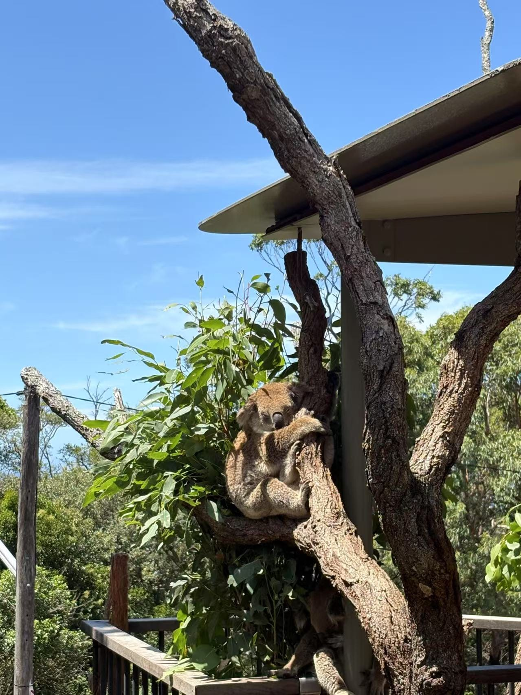
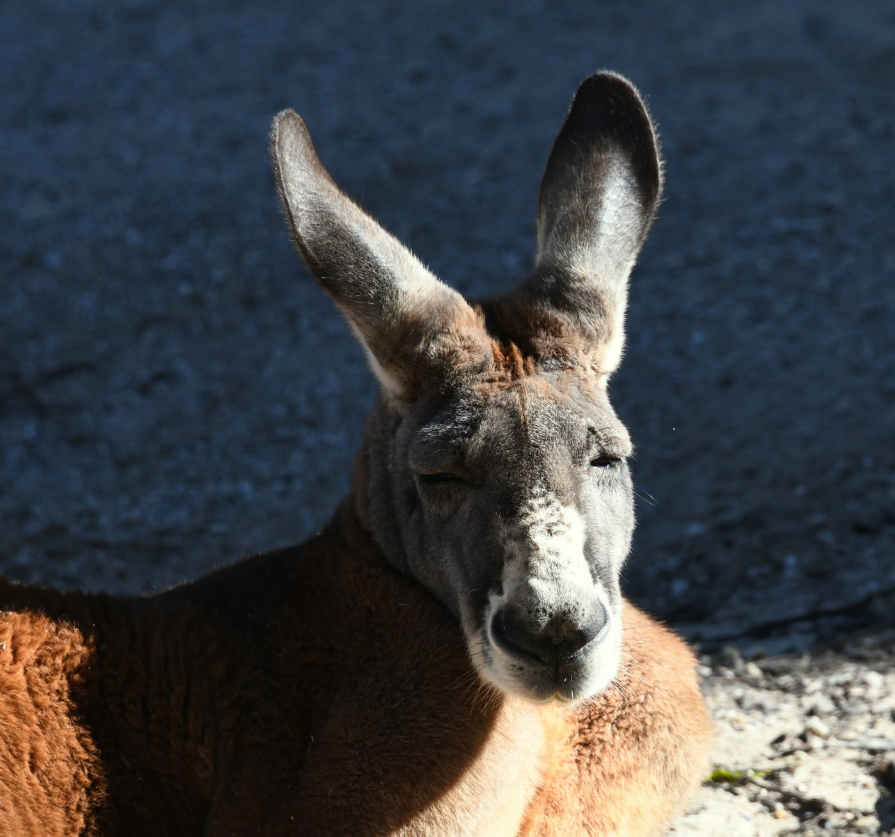
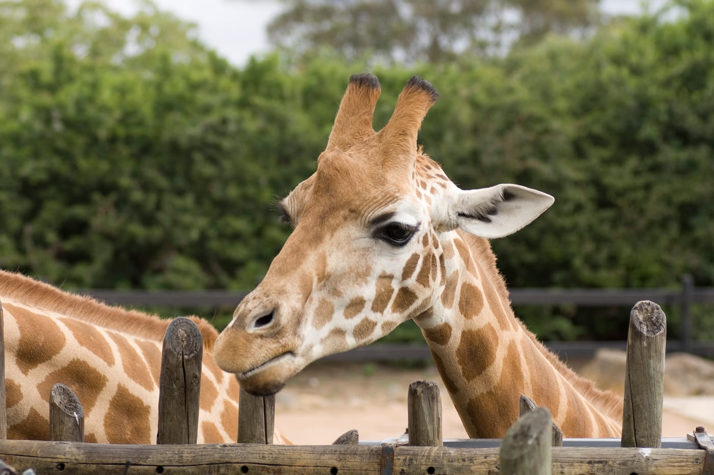

import { tpkDeep } from '../../data/affiliate.js';

Таронга подходит для отдельного спокойного дня в Сиднее. Если свободен только час и хочется прежде всего прокатиться по гавани, покупка входа в зоопарк необязательна: сама поездка на пароме решает другую задачу. За животными лучше приезжать с запасом времени, а не вставлять их между пляжем и вылетом.

## Кому стоит идти в Таронгу?

**Тем, кто хочет увидеть австралийских животных в одном месте и готов несколько часов ходить по склону.** Здесь можно совместить коал, кенгуру и ночных животных с жирафами и видами гавани. Это зоопарк с вольерами и дорожками, а не встреча с дикой Австралией без ограждений.

С детьми удобно выбрать две главные зоны и одну беседу сотрудника. Взрослым, которые любят наблюдать за животными, тоже есть чем заняться: не обязательно покупать отдельную встречу или пытаться собрать все шоу.

Если зоопарки вам неинтересны, ради одного вида на Сидней билет брать незачем. А при сильном дожде и ограниченной подвижности решение зависит от готовности провести день на дорожках: крытые участки не превращают всю Таронгу в помещение.

## Какой билет выбрать и сколько он стоит?

**Для обычной прогулки берите входной билет; паром и близкие встречи с животными проверяйте отдельно.** У продукта Tiqets Entry Ticket включены вход, обычные беседы сотрудников и ежедневные шоу. Обратный паром продаётся в другом варианте, а канатная дорога не работает ни с одним билетом.

| Вариант | Для кого и что оплачиваете | Ориентир цены |
|---|---|---|
| Вход на официальном сайте | Взрослый; транспорт покупается отдельно | Онлайн от AUD 51,30, примерно 2 950 ₽ |
| Вход в кассе | Взрослый без онлайн-тарифа | AUD 57, примерно 3 280 ₽ |
| Tiqets Entry Ticket | Взрослый от 16 лет; вход, беседы и ежедневные шоу | На 23 октября €35,55, примерно 3 270 ₽ |
| Детский Tiqets Entry Ticket | Ребёнок 4–15 лет | На 23 октября €20,58, примерно 1 890 ₽ |

У оператора ребёнок 4–15 лет онлайн стоит от AUD 29,70, примерно 1 710 ₽. Детям младше 4 лет обычный вход бесплатный; в выбранном продукте Tiqets бесплатная категория 0–3 оформляется только вместе со взрослым.

Для сравнения состава и даты можно <a href={tpkDeep('tiqets', 'https://www.tiqets.com/en/sydney-attractions-c60400/tickets-for-taronga-zoo-sydney-p1062880/', 'taronga_entry')} class="aff-cta" rel="sponsored noopener">посмотреть входной билет в Таронгу</a>. Он **невозвратный**. Если планы зависят от погоды, это существеннее небольшой разницы в цене. Не выбирайте партнёрский вариант автоматически: [официальный онлайн-тариф](https://www.taronga.org.au/sydney-zoo/plan/visitor-information/ticket-prices) может оказаться дешевле.

Рублёвые суммы здесь помогают оценить порядок расходов. Итог зависит от тарифа на вашу дату, валюты оплаты и конвертации банка. Приём российской карты не подтверждён; наличие русской версии сайта не доказывает возможность такой оплаты.

## Как добраться без Sky Safari?

**Для прогулки преимущественно сверху вниз приезжайте к главному входу автобусом, а паром оставьте на обратную дорогу.** Маршрут 100 идёт от QVB в центре Сиднея к Мосману. Нужная точка для верхнего входа — Taronga Zoo на Bradleys Head Road; перед поездкой сверьте остановку и рейс в [транспортном планировщике NSW](https://transportnsw.info/trip).

У нижнего входа другая логика: паром от Circular Quay идёт около 12 минут, затем примерно 3 минуты пешком от причала. Это красивое прибытие по воде, но после него прогулка начинается снизу. От причала к верхнему входу идёт общественный автобус 238: можно сначала подняться снаружи, а затем гулять по зоопарку вниз. Проверьте его рейс на время прибытия парома. Не рассчитывайте на бесплатный шаттл вне объявленных оператором дат школьных каникул.

Sky Safari закрылась в 2023 году. Новую канатную дорогу планируют к концу 2027-го; это будущий проект, а не доступный способ попасть от парома к животным. Советы из старых путеводителей «сразу поднимитесь на фуникулёре» сейчас не помогают.

Не путайте общественный паром с круизом из пакетного билета. У разных перевозчиков могут различаться причал отправления, расписание и условия посадки. Если покупаете пакет с паромом, следуйте инструкции именно этого продукта; обычный входной билет проезд не добавляет.

## Что включить в первую прогулку?

**Начните с двух задач: австралийская фауна в Nura Diya и жирафы в African Savannah.** Дальше добавляйте шоу или другую зону по времени и силам. Это выбранный набор для первого визита, а не обещание увидеть всех животных без ожидания.

### Австралийские животные

В Nura Diya Australia есть участки с коалами, кенгуру, динго, ночными животными и птицами. Оператор отводит на знакомство около 45 минут. Такой ориентир удобен, чтобы не отдать первый час случайному обходу и затем бежать к выходу.

Пандусы есть по маршруту, но Blue Mountains Bushwalk отличается более крутым рельефом. С коляской или при ограниченной подвижности выбирайте путь по [карте доступности зоопарка](https://www.taronga.org.au/siteassets/tzs/map/tz-accessibility-map-online.pdf); наличие пандуса не означает одинаковый уклон везде.

Коала может спать, а животное — находиться в глубине вольера. Покупать отдельную встречу только ради гарантированной фотографии без проверки условий не стоит: обычный вход не обещает близкий контакт и позирование.

### Жирафы и African Savannah

На African Savannah заложите ещё 20–30 минут. Здесь перечислены жирафы, зебры, львы, сурикаты и другие виды. Для общего знакомства эта зона дополняет австралийскую часть: не нужно выбирать между местной фауной и жирафами только потому, что времени мало.

Широкие дорожки этой зоны имеют пологие уклоны и несколько площадок наблюдения. Отдельное кормление жирафа относится к дополнительным встречам; обычный вход не включает его автоматически.

### Беседы и шоу

Сначала посмотрите дневное расписание, затем выберите одно событие по пути. Гонка между несколькими площадками легко съедает время, ради которого вы приехали. Входной билет включает обычные беседы и ежедневные шоу, но время, доступность мест и фактическое проведение нужно смотреть на день посещения.

## Сколько времени оставить и как распределить силы?

**На первое посещение разумно заложить 3–5 часов; с маленькими детьми и длинными остановками — больше.** Это запас для планирования, а не обещание оператора обойти зоопарк за фиксированное время. Две выбранные зоны занимают меньше, но между ними нужны переходы, отдых и еда.

| Ваш запас | Как ограничить план |
|---|---|
| Около 3 часов | Две главные зоны, короткая остановка на еду, выход по выбранной стороне |
| Полдня | Те же зоны, одна беседа или шоу, дополнительные остановки без спешки |
| Меньше 2 часов | Одна основная цель; не покупать день ради обещания успеть всё |

Таронга открыта ежедневно: с сентября по апрель 09:30–17:00, с мая по август 09:30–16:30. Это часы всего зоопарка, а не гарантия, что любой вольер или мероприятие доступно до последней минуты. При зимнем посещении особенно важно оставить время на выход и транспорт.

Возьмите воду и защиту от солнца; при прогнозе дождя — подходящую одежду. Свой пикник допустим, кафе тоже есть. Зоопарк безналичный: наличные не заменят рабочую карту для покупок внутри. Животных своей едой не кормят.

Семье полезнее заранее решить, что можно пропустить, чем пытаться ускорить ребёнка на каждом повороте. Если путь к парому оказался неудобен по силам или доступности, вернуться через верхний вход наземным транспортом — нормальная альтернатива, а не испорченный план.

## Какие советы посетителей стоит перепроверить?

**Прежде всего советы о канатной дороге и длительности прогулки.** В двух обсуждениях Reddit, просмотренных 22 октября 2026 года, встретились противоположные рекомендации: начинать сверху и спускаться к парому либо прибывать по воде и подниматься на Sky Safari. Это маленькая выборка, представительной её считать нельзя; точные даты отдельных комментариев не установлены.

Совет про спуск согласуется с расположением двух входов. Совет про работающую Sky Safari противоречит действующим условиям оператора. Даже свежая рекомендация в обсуждении может повторять старый опыт. Чужое «хватит пары часов» тоже не задаёт темп вашей семье: два конкретных приоритета надёжнее чужого общего впечатления.

## Частые вопросы

### Можно ли прокатиться на Sky Safari?

**Нет.** Старая канатная дорога закрыта; новая пока планируется к концу 2027 года.

### Включён ли паром во входной билет?

**В выбранный Tiqets Entry Ticket — нет.** Для проезда нужен отдельный билет или другой продукт, где прямо указан return ferry.

### Есть ли бесплатный вход детям?

**Да, младше 4 лет.** В проверенном продукте Tiqets бесплатную категорию 0–3 оформляют вместе со взрослым.

### Можно ли вернуть выбранный билет Tiqets?

**Нет, он указан как невозвратный.** До оплаты проверьте правила конкретного варианта: у другого продукта они могут отличаться.

### Можно ли идти без ребёнка?

**Да.** Маршрут по животным и площадкам наблюдения не требует семейного формата; дополнительные встречи тоже необязательны.

### Можно ли прийти в понедельник?

**Да, обычный режим — ежедневно.** Временные закрытия отдельных зон проверяются отдельно.

### Нужна ли отдельная плата за кормление жирафа?

**Да, это дополнительная встреча.** Обычный вход и наблюдение у вольера её не заменяют; наличие мест не гарантировано.

### Обязательно ли ехать на пароме?

**Нет.** Автобус к верхнему входу позволяет начать день без подъёма от воды; обратно тоже можно выбрать наземный транспорт.

### Можно ли принести еду?

**Да, свой пикник допустим.** Кормить животных этой едой нельзя.

### Работает ли российская карта при покупке?

**Подтверждения нет.** Не считайте доступную страницу билета подтверждённой оплатой; заранее подготовьте подходящий способ расчёта.

## Что почитать дальше

- [Восточная Австралия](/australia-east/) — чтобы связать Сидней с поездкой по региону.
- [Гайд по Австралии](/blog/australia-guide-2026/) — для общего маршрута и подготовки.
- [Виза в Австралию](/blog/australia-visa-2026/) — отдельная задача до покупки поездки.

Другие идеи для путешествий — в [@traveltriberu](https://t.me/traveltriberu).
