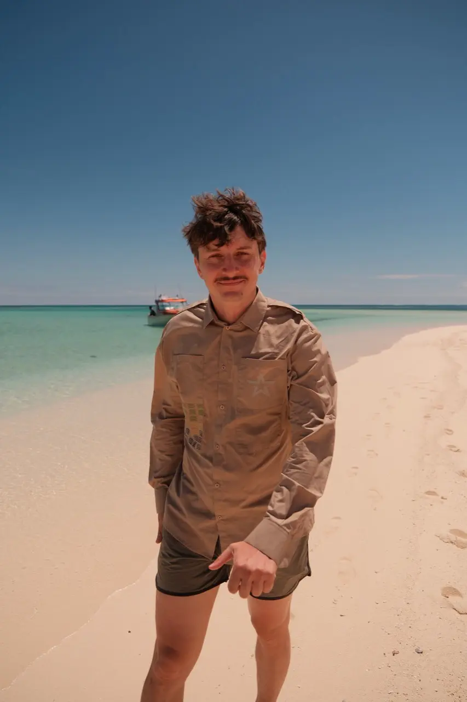
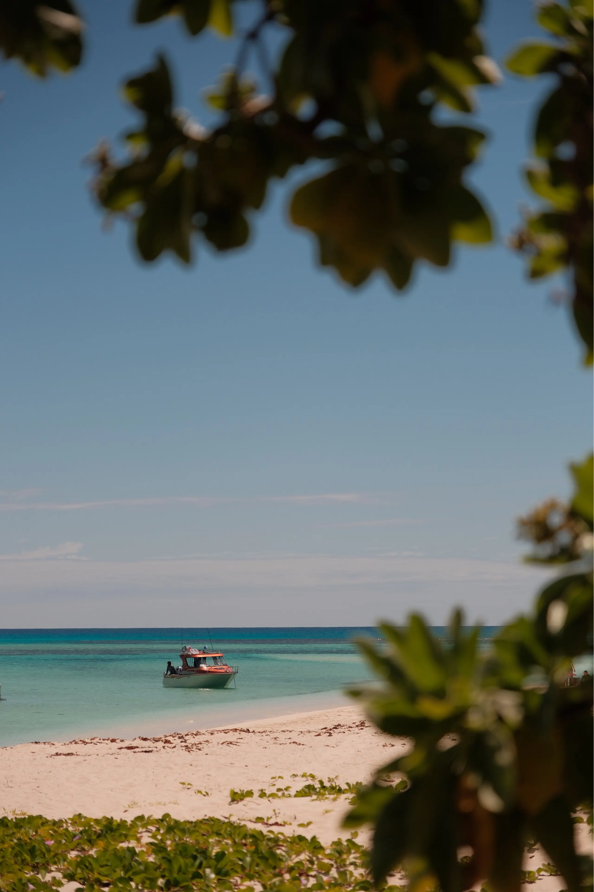
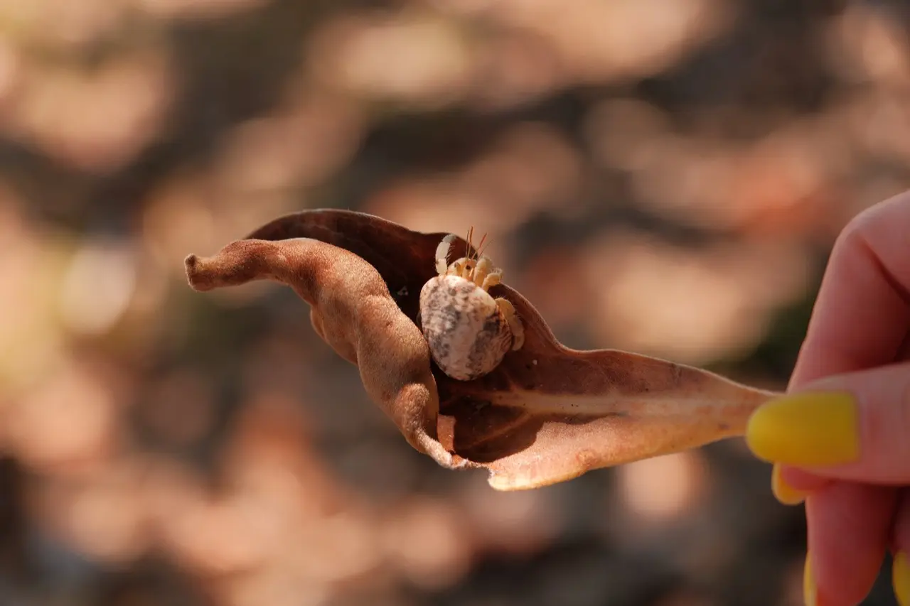
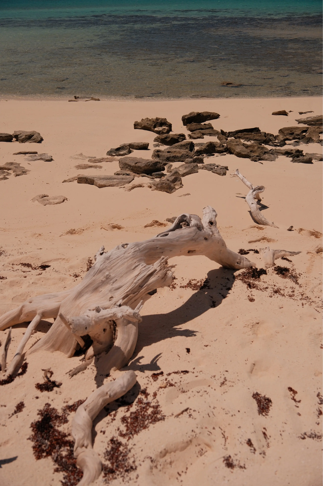
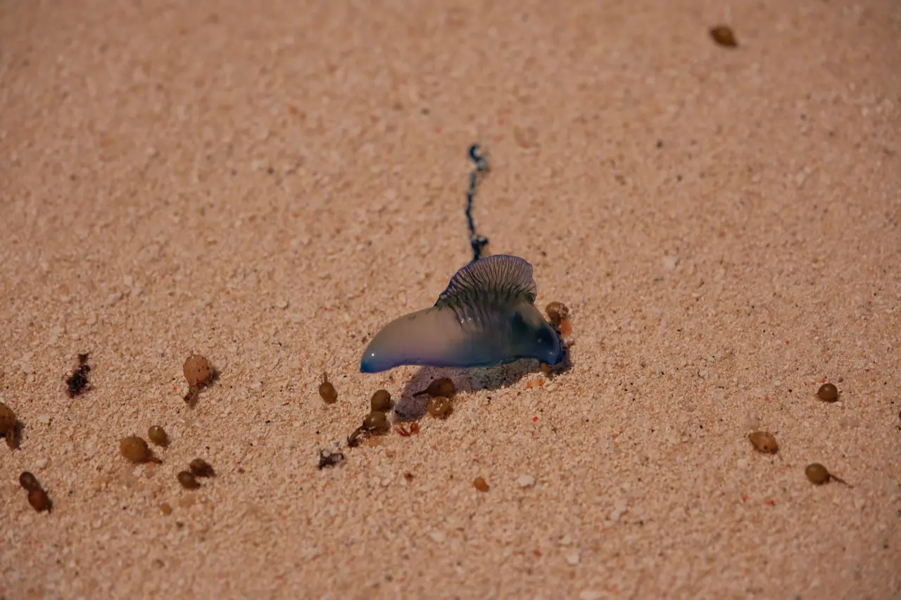
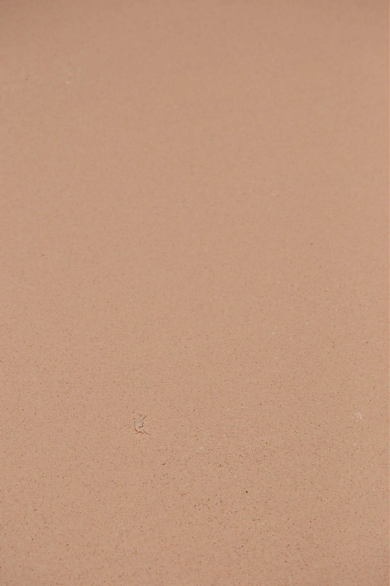

В Тонга можно устроить пляжный день с лодкой и небольшим островом, оставаясь на Тонгатапу. **Для этого не обязателен отдельный перелёт на Вавау:** сначала посмотрите варианты рядом с Нукуалофой. Главные вопросы до оплаты — куда везут, разрешена ли высадка, что включено и как вернуться. Пустой берег на фотографии ничего не говорит о расписании лодки и наличии обеда.

Китов я показал в [отдельной истории о поездке из Нукуалофы](/blog/tonga-whales/). Здесь — мои пляжные кадры из Тонга и разбор островного дня. Конкретный остров на снимках я не называю: его название не подтверждено. Представлять эти фотографии как рекламу определённого курорта было бы нечестно.

*Тонга. Пляжный портрет с укладкой от ветра.*

## Где искать островной пляж рядом с Нукуалофой?

**Нукуалофа — столица на острове Тонгатапу.** Отсюда имеет смысл начинать, если хочется совместить город, морской выезд и пляж без дополнительного внутреннего перелёта. В числе соседних островов, куда предлагают поездки, встречаются Пангаимоту, Фафа и Атата.

Это список направлений для проверки, а не обещание, что на каждый остров завтра есть общедоступная лодка. Выберите конкретное место и получите подтверждение от принимающей стороны. Уточните, работает ли дневной приём, можно ли приехать без ночёвки и кто организует переправу. Старая фотография работающего ресторана не гарантирует, что он открыт сейчас.

Выбор зависит от задачи. Если нужен обед, тень и туалет, ищите подтверждённый дневной пакет с инфраструктурой. Если хочется высадки на малом острове, заранее выясните, какие удобства будут на месте. Эти два варианта могут выглядеть одинаково на картинке, но требуют разных вещей в рюкзаке.

## Как договориться о лодке и обратном пути?

Попросите письменное подтверждение программы до оплаты. Даже короткая переправа требует понятного места встречи и обратного времени. Название причала лучше получить вместе с точкой на карте: фраза «встретимся в порту» оставляет слишком много вариантов.

Вот что я бы спросил у организатора:

- Какой остров указан в программе и подтверждён ли доступ на берег?
- Где и во сколько встречаемся, кто встречает и как связаться в день выезда?
- Включены ли обе переправы, вход на остров, обед и питьевая вода?
- Есть ли тень, туалет, возможность оставить вещи и купить еду?
- Входит ли снаряжение для снорклинга и сопровождает ли кто-то в воде?
- Что происходит при плохой погоде: перенос, возврат или другая программа?
- Во сколько возвращаемся и что делать, если выход задерживается?

У Kingdom Encounters, с которыми я ездил к китам, островная программа на сайте помечена **Coming Soon**. Не переносите доступность китового тура на пляжный выезд: это разные предложения. Если выбираете их, сначала получите подтверждение нужной даты и состава поездки.

*Тонга: лодка у берега. Время возвращения стоит выяснить до высадки.*

## Где жить и как считать стоимость пляжного дня?

Для короткого выезда из Нукуалофы удобнее сравнить два сценария: ночёвка в городе с отдельной лодкой либо проживание на острове с трансфером. В первом случае проще менять планы между городом и морем. Во втором нужно особенно внимательно проверить время переправы, питание и условия возвращения к международному вылету.

Не сравнивайте только строку «лодка». **Полный бюджет дня — дорога до причала, переправа туда и обратно, возможный вход или дневной пакет, еда и снаряжение.** Спросите, цена указана за человека или за всю лодку, есть ли минимальное число участников и что произойдёт, если группа не соберётся. Личного чека за эту пляжную поездку я здесь не привожу.

Местная валюта — **паанга, TOP**. Не путайте её с новозеландским долларом NZD: одинаковый знак доллара не делает суммы сопоставимыми. Перед оплатой попросите итог с названием валюты. Для такси и небольших заведений держите наличные мелкими купюрами; рассчитывать только на карту не стоит.

Дорогу до Тонга и варианты стыковок я разобрал в [материале о китах и Нукуалофе](/blog/tonga-whales/#как-долететь-до-тонга-и-добраться-до-выхода-в-море). Если собираете более длинную поездку, посмотрите также [мой дайвинг на Фиджи](/blog/fiji-shark-diving/) и [путеводитель по Новой Зеландии](/blog/new-zealand-guide-2026/). Право транзита через страну пересадки проверяется отдельно.

## Что взять на остров без подтверждённой инфраструктуры?

Собирайтесь под подтверждённые условия, а не под фотографию пальм. Для дневного выезда я бы положил питьевую воду, еду при отсутствии обеда, головной убор, защиту от солнца, полотенце и сухую одежду. Телефон и документы убрал бы в гермомешок. Заряд телефона нужен ещё и для связи с организатором.

Маску берите свою либо заранее уточните размер и наличие прокатной. Не считайте слова «прозрачная лагуна» подтверждением безопасного купания: место входа, течение и границы зоны плавания обсудите с местной командой. Красивый цвет воды этих вопросов не решает.

Пакет для собственного мусора тоже пригодится. Если на острове нет урн, всё привезённое должно уехать обратно. Ракушку перед тем, как поднять, лучше рассмотреть: в ней может жить тот, кто не планировал переселяться в ваш чемодан.

*Тонга: маленький жилец ракушки на сухом листе.*

## Почему воскресенье меняет маршрут по Тонга?

**Воскресенье в Тонга — день церкви, семьи и отдыха.** Магазины закрываются, внутренних авиарейсов нет; некоторые рестораны и курорты продолжают работать. Поэтому день закупок и смену острова лучше не оставлять на воскресенье без прямого подтверждения всех участников маршрута.

Это не значит, что любой пляжный выезд запрещён или любая лодка отменяется. Но конкретный организатор должен подтвердить, что принимает гостей именно в этот день. Если остаётесь в городе, заранее выясните, где будете есть. Вода и перекус, купленные в субботу, избавят от поиска открытого магазина.

Пляжную лодку я бы не ставил вплотную к международному вылету независимо от дня недели. Погодная задержка не обязана учитывать ваш билет. Для последнего дня выбирайте занятие, после которого вы сами контролируете дорогу в аэропорт.

## Как одеваться на пляже, в городе и деревне?

Курортный пляж и общественное место здесь предполагают разную одежду. **В город и деревню выходите в обычной одежде, не в купальнике.** На общественных пляжах тоже учитывайте местные консервативные обычаи; привычный курортный формат лучше уточнить у принимающей стороны.

Практически это решается без сложной подготовки: рубашка или футболка и одежда поверх купального костюма лежат в той же сумке, что полотенце. Переоденьтесь до возвращения к городскому причалу. Заодно сухая рубашка пригодится после мокрой и ветреной лодки.

*Тонга: песок, камни и выбеленное дерево у кромки воды.*

## Что за синий пузырь лежит на песке?

На моём снимке он **похож на физалию**, которую называют португальским корабликом. Точный вид по этому кадру я не определяю. Но это хороший повод напомнить: красивый синий «парус» на берегу не стоит брать в руки.

Физалия относится к сифонофорам. Она устроена как колония связанных специализированных организмов: одни части обеспечивают плавучесть, другие захватывают и переваривают добычу. По поверхности её перемещают ветер и течение. То, что похоже на игрушечный парус, помогает держаться на воде.

**Выброшенная на берег физалия всё ещё может жалить.** Не трогайте её и щупальца, не берите для фотографии в руку и предупредите детей. Фото с расстояния вполне хватит. Это также причина смотреть под ноги, даже когда берег кажется пустым.

*Тонга: находка на берегу, похожая на физалию. Не трогать руками.*

Краб на следующем кадре устроил другую задачу: попробуйте сначала найти его без увеличения. Песок здесь занят гораздо плотнее, чем кажется с лодки.

*Тонга: краб в нижней левой части кадра.*

## Как спланировать один пляжный день?

**Накануне** подтвердите остров, точку встречи, погоду, обратную лодку и состав пакета. Подготовьте наличные и вещи. Если следующий день — воскресенье, отдельно проверьте питание и работу организатора.

**Перед отправлением** уточните у команды место купания и способ связи на острове. Если программа изменилась, сначала договоритесь о новой цене и времени, затем садитесь в лодку. Не заменяйте конкретное согласование фразой «на месте разберёмся».

**На берегу** сначала найдите место высадки и оговорённую точку возвращения, затем отправляйтесь гулять. Уточните, куда можно заходить: маленький остров не обязательно целиком открыт для посетителей. Если уходите из зоны, где видна лодка, держите в уме обратное время.

## Частые вопросы о пляжах Тонга

### Можно ли обойтись без перелёта на Вавау?

Да, для пляжного дня можно рассмотреть острова рядом с Тонгатапу и выезд из Нукуалофы. Доступность конкретного острова и лодки подтверждается под вашу дату. Из этого не следует, что все предложения работают ежедневно.

### На каком острове сделаны фотографии?

На фотографиях — Тонга. Название конкретного острова не подтверждено, поэтому я не подписываю снимки как Пангаимоту, Фафа или Атата.

### Сколько стоит лодка?

Подтверждённой цены именно этой поездки у меня здесь нет. Запрашивайте итог за обе стороны, вход, питание и оборудование; уточняйте валюту, оплату за человека или лодку и минимальную группу.

### Можно ли поехать на пляж в воскресенье?

Возможность зависит от организатора и принимающей стороны. Не переносите обычное расписание на воскресенье: получите прямое подтверждение. Закупки и внутренние перелёты планируйте на другие дни.

### Можно ли потрогать синий пузырь на фото?

Не стоит. Он похож на физалию, а выброшенные на берег физалии сохраняют способность жалить. Рассматривайте с расстояния и не трогайте щупальца.
