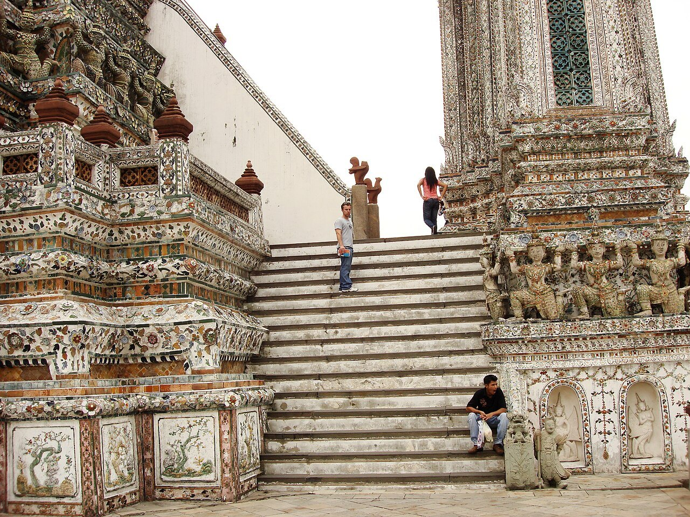
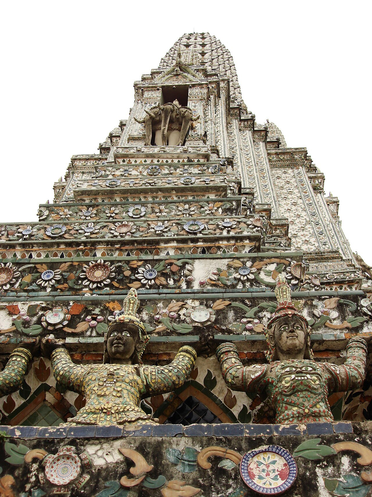
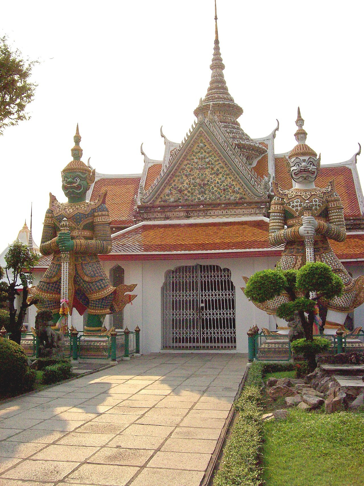
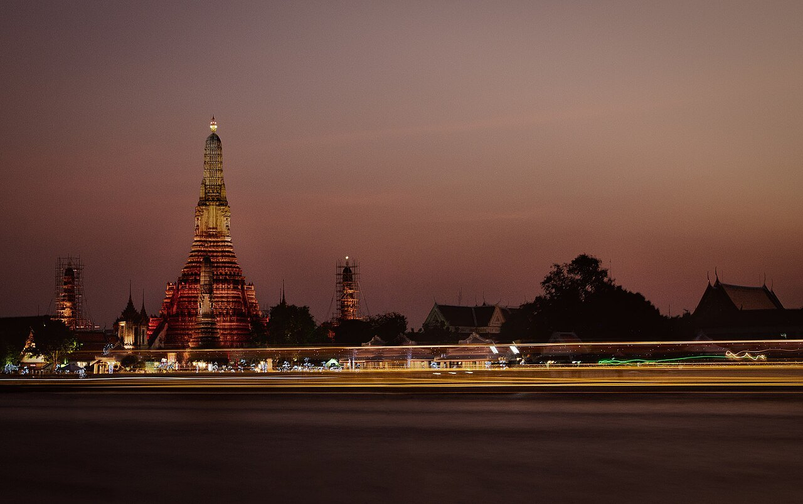

У Ват Арун два совершенно разных вида. Внутри комплекса видны фарфоровые цветы, фигуры под карнизами и крутые ступени. С противоположного берега всё это складывается в знакомый силуэт над рекой. Если приехать только на закат, можно получить красивую фотографию и не успеть посмотреть сам храм.

Для первого знакомства заложите **час–полтора внутри**, а вечерний вид оставьте отдельной остановкой. Ват Арун открыт с **08:00 до 18:00**; взрослый иностранный посетитель платит **около 490 ₽, или 200 батов**. Дорога, ожидание лодки, обед и съёмка в эту продолжительность не входят. На полдня удобно объединить храм с Ват Пхо на другом берегу.

Если хотите провести с русскоязычным гидом целый день, можно посмотреть <a href="https://tripster.tpk.mx/cicJCuPT?erid=2VtzqxMZpjc&amp;sub_id=tt_wat_arun_tour&amp;u=https%3A%2F%2Fexperience.tripster.ru%2Fexperience%2F54796%2F" target="_blank" rel="sponsored noopener">автомобильную экскурсию по Бангкоку с посещением Ват Арун</a>. Она занимает восемь часов и включает другие остановки. Ради одного входа в храм такая программа не нужна.

## Чем Ват Арун отличается от других храмов Бангкока

Главная башня называется пранг. Издалека она кажется почти одноцветной, но вблизи поверхность распадается на орнаменты из глазурованного фарфора. Здесь интересно менять расстояние: сначала рассмотреть всю башню, затем один ярус, потом отдельный цветок или фигуру. У соседнего Ват Пхо главным впечатлением часто становится лежащий Будда; у Ват Арун — сама архитектура.

Название связывают с Аруной, божеством рассвета. Оно не означает, что туристическая территория открывается на восходе: часы посещения начинаются позднее. История храма уходит в эпоху Аюттхаи, а его нынешний облик формировался при последующих правителях. Здесь некоторое время находился Изумрудный Будда, позднее перенесённый в Ват Пхра Кео на другом берегу.

Комплекс остаётся религиозным местом. Для прогулки важны не только касса и фототочки: есть помещения для молитвы, прихожане и правила поведения. Снимайте архитектуру, пропускайте молящихся и соблюдайте местные ограничения. Сцены, где туристы позируют в тайской одежде, не превращают весь храм в съёмочную площадку.

## Как добраться и не купить лишнюю прогулку на лодке

Ват Арун стоит на западном берегу Чаопхраи, в районе Тонбури. Ват Пхо находится напротив, на восточной стороне. Сначала определите, с какого берега вы приезжаете: это полезнее, чем искать один «лучший транспорт» для всего Бангкока.

**Из района Ват Пхо** удобна короткая переправа от Tha Tien. На причале уточняйте именно переход на другой берег к Wat Arun. Экскурсионная прогулка по каналам, туристический речной маршрут и поперечная переправа — разные услуги. Смотрите название причала назначения и цену до оплаты, особенно если вам предлагают частную лодку.

**С других речных причалов** можно воспользоваться маршрутом с остановкой Wat Arun. Проверяйте список остановок конкретного рейса: одинаковая река не означает одинаковое расписание. Не покупайте дневной проездной автоматически ради одной переправы. Сначала посчитайте, сколько речных поездок действительно будет в вашем плане.

**По MRT** ориентиром служит станция Itsaraphap синей линии. Она находится на стороне храма, но от станции ещё нужно пройти по городским улицам. Постройте пеший подход от своего выхода и оцените его по погоде. В полуденную жару маршрут с меньшим числом пересадок может оказаться утомительнее короткой поездки по реке.

**На такси** указывайте сам Wat Arun, а не кафе с видом на него. Они могут находиться на противоположном берегу. Для возвращения оставьте время на городское движение: обещать десять минут до любого центрального отеля здесь нельзя. А общий маршрут между Бангкоком и курортами удобнее собирать по [путеводителю по Таиланду](/blog/thailand-guide-2026/).

## Маршрут по храму: что смотреть кроме высокой башни

Начните с общего вида центрального пранга и окружающих его меньших башен. Обойдите доступную часть основания: украшение хорошо читается при боковом взгляде, когда видны выступающие фигуры и глубина орнамента. Не пытайтесь сразу вместить весь высокий храм в кадр с ближайшей точки — широкий угол сильно изменит пропорции.

Затем выберите несколько деталей. На поверхности можно разглядеть цветочные мотивы, керамические фрагменты и небольшие скульптуры. Хорошая задача для прогулки с ребёнком — найти разные цветы или сравнить лица фигур. Это позволяет рассматривать храм вместе и не сводить посещение к ожиданию, пока взрослые закончат фотографировать.

Поднимайтесь только по открытым для посетителей лестницам. Старые фотографии с высоких ярусов не доказывают, что туда разрешат пройти сегодня. Ступени крутые; при плохом самочувствии, дожде или страхе высоты можно остаться внизу. Покупка входного билета не должна восприниматься как обещание доступа на вершину.

После пранга найдите вход в зал посвящения с двумя крупными фигурами стражей. У этого участка другая композиция: крыша, ворота, скульптуры и пространство двора. Здесь получается разнообразить прогулку и фотографии, а не собирать десять одинаковых изображений одной башни. Входите в религиозные помещения только там, где это разрешено, и снимайте обувь по указателям.

На завершение оставьте несколько минут у реки. Посмотрите, куда отправляется ваша лодка, и решите, продолжать ли день на этом берегу. Такой порядок помогает не бегать между входом, башней и причалом, когда пора уезжать.

## Утро, день или закат: выбираем по цели

| Когда | Ради чего | Что учесть |
|---|---|---|
| К открытию в 08:00 | Рассмотреть детали и спокойно начать день | Пустой храм не гарантирован; до открытия внутрь не рассчитывайте попасть |
| В середине дня | Вписать храм между другими остановками | Открытые участки, яркое солнце и жара; нужны вода и паузы |
| Во второй половине дня | Совместить осмотр с вечерним видом через реку | Прийти заранее для полного посещения и переправы |
| После закрытия | Смотреть подсвеченный силуэт с другого берега | Это внешний вид, а не вечерний вход в комплекс |

Наш выбор для первого раза — утро, если дальше предстоит насыщенный день, или вторая половина дня, если главным планом стал храм и река. Приходить к закрытию ради «самого красивого света» неудобно: между вами и фотографией остаются касса, осмотр и переход на противоположную сторону.

Не привязывайте весь день к одному закатному снимку. Облачность и дождь меняют свет; даже в хорошую погоду место у воды может быть занято. Сначала выполните основную часть прогулки, а вечернее небо воспринимайте как приятное дополнение. Для выбора сезона пригодится [календарь поездки в Таиланд](/thailand/).

[Новый год в Таиланде](/blog/novyy-god-tailand-2027/): для праздничной поездки заранее проверьте ограничения движения и программу района.

## Как увидеть храм с другого берега

Панорамный вид ищите на стороне Ват Пхо и Tha Tien. Именно отсюда река оказывается перед храмом, а башни помещаются в кадр целиком. Прогулка внутри и наблюдение через воду дополняют друг друга: сначала вы узнаёте детали, затем видите, как они работают в общей форме.

Для вечернего кафе проверяйте конкретное место за столом, а не только фотографию в карточке заведения. Формулировка «вид на реку» ещё не обещает прямого вида на Ват Арун. Уточните этаж, посадку у окна или на террасе, минимальный заказ и условия бронирования. Стоимость ужина не входит в билет храма.

Если ресторан не нужен, ищите доступный общественный подход к воде и соблюдайте ограждения. Не рассчитывайте, что любой причал можно надолго занять штативом: он нужен пассажирам и сотрудникам. Для снимка с движущейся лодки приготовьте камеру заранее и оставайтесь на безопасном месте.

Обычная вечерняя подсветка и специальные фестивальные представления — разные вещи. Не стройте маршрут вокруг обещания ежедневного светомузыкального шоу без объявления организаторов на вашу дату. Красивый силуэт можно увидеть и без отдельной программы.

## Бюджет: вход самостоятельно или день с гидом

Вход для взрослого иностранца стоит **200 батов, ориентировочно 490 ₽**. Для двух взрослых это **400 батов, около 980 ₽**. Это только посещение храма: транспорт, еда, аренда одежды и необязательная фотосъёмка считаются отдельно. Возьмите наличные баты, чтобы выбор способа оплаты на месте не задержал прогулку.

Рублёвые суммы ориентировочные: покупка валюты или списание картой могут обойтись дороже. Детские льготы и состав семейного билета уточняйте для возраста ребёнка; взрослый тариф не стоит автоматически умножать на всех членов семьи.

<a href="https://tripster.tpk.mx/cicJCuPT?erid=2VtzqxMZpjc&amp;sub_id=tt_wat_arun_tour&amp;u=https%3A%2F%2Fexperience.tripster.ru%2Fexperience%2F54796%2F" target="_blank" rel="sponsored noopener">Восьмичасовая экскурсия «Бангкок. В поисках просветления»</a> стоит ориентировочно **24 810 ₽ за одного участника — 299 долларов**, либо **18 260 ₽ с человека — 220 долларов**, если вас двое. Итого для двух взрослых — около **36 510 ₽**. Это индивидуальная автомобильная программа на русском языке с Ват Арун, Ват Прайюн, смотровой Mahanakhon, IconSiam и речным круизом.

Продавец указывает, что в стоимость всё включено. Перед оплатой сверьте состав именно выбранного варианта, возраст детей и порядок расчёта остатка с гидом. Предоплата — 26%; бесплатная отмена предусмотрена не позднее чем за 48 часов. Это условия конкретной экскурсии, а не всех туров по Бангкоку.

Самостоятельный визит подходит, если нужен прежде всего храм и вы готовы разобраться с дорогой. Экскурсия оправдана, если хочется провести с сопровождающим весь день и действительно интересны остальные остановки. Сравнивать её цену с одним входным билетом бессмысленно: покупаются разные объёмы программы.

## Одежда, лестницы и посещение с детьми

Одежда должна закрывать плечи и колени. Удобнее сразу выбрать лёгкие длинные брюки или юбку и закрытый верх, чем искать прокат у входа. Национальный костюм для фотографии — необязательная услуга. До аренды узнайте полную стоимость, залог, время возврата и входит ли работа фотографа.

Для открытой территории возьмите воду, головной убор и защиту от солнца. Обувь должна держаться на ноге и не скользить; иногда её придётся снимать перед входом в помещение. Маленькая сумка освобождает руки на лестницах. Тяжёлый чемодан лучше оставить в гостинице, а посещение не ставить между выпиской и дальним переездом без запаса времени.

С коляской или при ограниченной подвижности заранее уточните доступный вход и маршрут у администрации. Высокие ступени пранга не подходят всем; осмотр снизу остаётся самостоятельным вариантом прогулки. Не обещайте ребёнку обязательный подъём, пока не увидите открытые участки и не оцените нагрузку.

После сильного дождя лучше сократить лестничную часть, чем держаться за первоначальный план. Если вы плохо переносите жару, поставьте храм первым пунктом дня и оставьте следующую остановку в помещении. Тем, кто ищет тишину без туристических фотосессий, популярный Ват Арун может не подойти: утром шансов на спокойную прогулку больше, гарантии уединения нет.

## Что пишут те, кто был

В личном описании посещения на Trip Moments от 1 ноября 2026 года выделены два впечатления: общий вид с воды и мелкие детали при близком осмотре. Это опыт одного посетителя, а не представительная выборка отзывов; он не доказывает, что утро всегда пустое или вечер обязательно солнечный.

Практический вывод — оставлять время на сам храм и не заканчивать прогулку единственным снимком с причала. Погоду, доступные лестницы и транспорт проверяйте для своего дня. Личный восторг другого путешественника не отменяет жары, толпы и ограничений религиозного места.

## Частые вопросы

**Сколько времени выделить?** Час–полтора на самостоятельный осмотр как ориентир, плюс дорога и отдых. С вечерним видом через реку планируйте отдельную паузу, а не последние десять минут перед закрытием.

**Можно ли прийти после 18:00?** Для внешнего вида с другого берега — да, если выбранный подход доступен. Обычный режим посещения самого храма заканчивается в 18:00; подсветка не продлевает вход.

**Нужна ли экскурсия?** Нет. Для самостоятельной прогулки купите входной билет и выберите маршрут. Гид полезен, когда нужны объяснения и организация нескольких остановок по городу.

**Что выбрать: Ват Арун или Ват Пхо?** Первый интересен силуэтом, фарфоровой отделкой и рекой; второй — другим храмовым пространством и лежащим Буддой. Если есть полдня и силы, их удобно соединить переправой. Если времени мало, выберите одно место и посмотрите его внимательно.

**Какой план сохранить для первого посещения?** Доехать к открытию, рассмотреть пранг и стражей, переправиться на сторону Ват Пхо и пообедать. Вечером вернуться к реке, только если этот вид действительно хочется увидеть второй раз. Такой день не требует ни дорогой программы, ни обязательного подъёма по всем лестницам.
