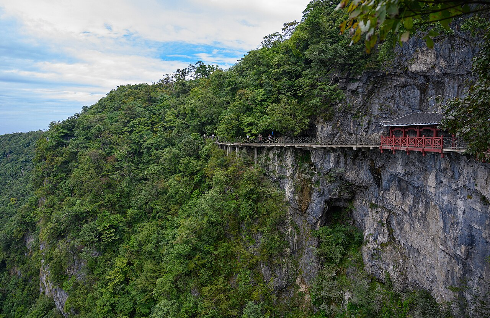
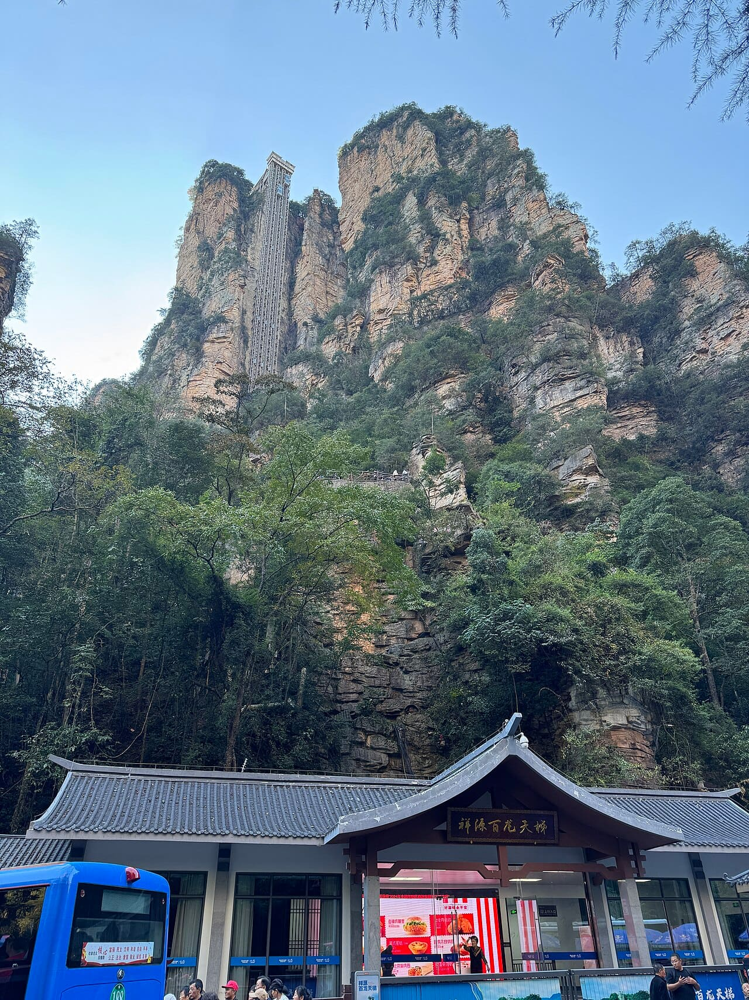
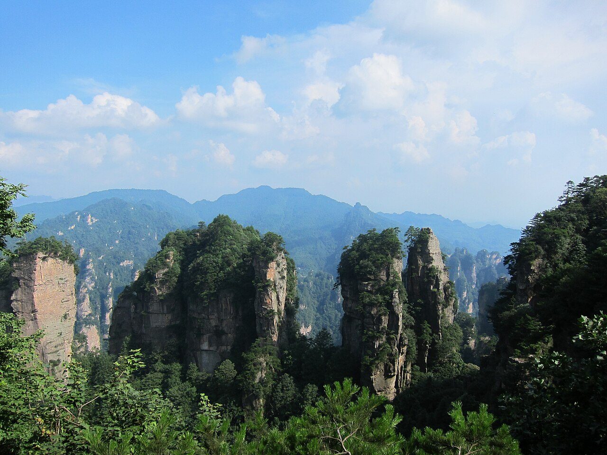
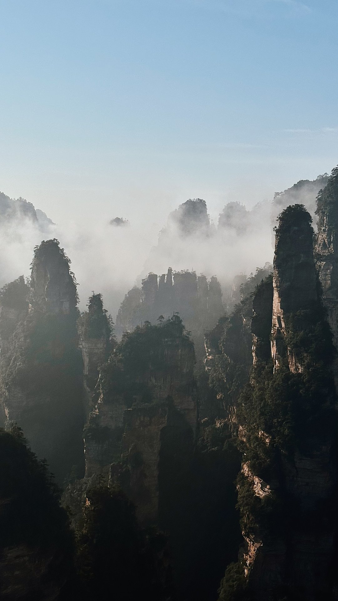

Самая дорогая ошибка в Чжанцзяцзе начинается до поездки: забронировать отель «рядом с горами», купить билет «в парк» и обнаружить, что нужные горы находятся в другом месте. Под одним названием в подборках смешивают национальный лесной парк, гору Тяньмэнь и стеклянный мост над Большим каньоном. У них разные входы, транспорт и билеты.

Для первого путешествия мы предлагаем два дня на лесной парк и отдельный день на Тяньмэнь. Большой каньон добавляйте, если нужен именно подвесной стеклянный мост, а не потому, что его автоматически включили в список обязательного. Ниже — как выбрать базу, собрать билет под маршрут и оставить место для погоды.

Если нужна помощь с навигацией и объяснения на русском, можно рассмотреть <a href="https://tripster.tpk.mx/cicJCuPT?erid=2VtzqxMZpjc&amp;sub_id=tt_zhangjiajie_park&amp;u=https%3A%2F%2Fexperience.tripster.ru%2Fexperience%2F112262%2F" target="_blank" rel="sponsored noopener">экскурсию по национальному парку</a>. Перед оплатой уточните, какие билеты и переезды включены; самостоятельный маршрут разобран ниже.

## Что здесь называют горами «Аватара»

Высокие узкие столбы среди леса находятся в ландшафтном районе Улинъюань, который входит в Список всемирного наследия ЮНЕСКО с 1992 года. Здесь более трёх тысяч песчаниковых пиков и столбов, многие поднимаются более чем на 200 метров. Ущелья и зелень между ними создают тот рисунок, ради которого сюда едут.

С «Аватаром» связывают прежде всего виды Юаньцзяцзе. Но поездка не требует знания фильма: с верхних площадок видны отдельные каменные башни, а снизу, из долин, тот же рельеф воспринимается совершенно иначе. Поэтому два разных дня полезнее, чем второй заход на соседнюю площадку ради почти одинаковой панорамы.

Слово «парк» тоже сбивает с толку. Это не компактная территория, которую можно обойти за утро. Посещение состоит из пеших участков, переездов на внутренних автобусах, подъёмов и спусков. Маршрут стоит строить как последовательность пересадок, а не как список названий на карте.

## Три разных места: что покупать и где ночевать

| Место | Главное впечатление | Удобная база | Что важно с билетом |
|---|---|---|---|
| Лесной парк / Улинъюань | Каменные столбы Юаньцзяцзе, Тяньцзышань, лесные долины | Улинъюань рядом с выбранным входом | Вход, автобусы и подъёмники нужно проверить отдельно |
| Гора Тяньмэнь | Арка «Небесные врата» и дорожки на склоне | Город Чжанцзяцзе | Отдельный билет и свой вариант маршрута |
| Большой каньон | Подвесной стеклянный мост над ущельем | База зависит от остального плана | Не входит автоматически в билет лесного парка |

Стеклянные участки дорожек на Тяньмэнь и стеклянный мост Большого каньона — разные объекты. Если выбираете поездку по фотографии, сначала найдите название именно того места, которое на ней изображено.

Для двух дней среди столбов логично поселиться в Улинъюане. Проверяйте путь от двери гостиницы до нужного входа пешком: слова «вид на национальный парк» не обещают близости к турникетам. Укажите на карте восточный вход **Wu Jiayu / 吴家峪**, если начинаете наш основной маршрут оттуда.

На Тяньмэнь удобнее ехать из городской части Чжанцзяцзе. Менять отель ради одной ночи необязательно: сравните время трансферов с упаковкой вещей и заселением. Но если приезжаете поздно и утром идёте на Тяньмэнь, городская ночь может быть разумнее немедленной поездки в Улинъюань.

## Как добраться и что сохранить в телефоне

Основные точки прибытия — аэропорт **Zhangjiajie Hehua**, обычный вокзал **Zhangjiajie** и скоростной вокзал **Zhangjiajie West / 张家界西站**. Это разные места. При заказе трансфера отправляйте водителю название станции из билета, а не только слово «Чжанцзяцзе».

От западного вокзала до Улинъюаня парк указывает около 30–40 минут на автомобиле или туристическом автобусе при нормальном движении. Это не время до первой смотровой: ещё нужны дорога до входа, проверка билета и внутренний транспорт. После перелёта или длинного железнодорожного переезда не рассчитывайте сразу пройти полный горный маршрут.

Сохраните китайское название гостиницы, адрес, нужный вход в парк и контакты продавца билетов. Сделайте офлайн-копии подтверждений. Это полезнее скриншота обзорной карты, где город, гора и парк подписаны одинаково крупно.

Для поездки из другого города Китая сначала сравните поезда и перелёты на свои даты, затем время прибытия относительно заселения. Дешёвый поздний билет может потребовать дополнительной ночи. Организация оплаты, связи и перемещений по стране разобрана в [путеводителе по Китаю](/blog/china-guide-2026/).

Если маршрут проходит через столицу, отдельно проверьте аэропорты и условия [пересадки в Пекине](/blog/peresadka-v-pekine/). Дорога между двумя пекинскими аэропортами не равна пересадке внутри одного терминала.

## Сколько стоят билеты и где можно сэкономить

Для взрослого посетителя без льгот ориентир такой: **вход с внутренними автобусами — 236 юаней, около 2920 ₽**. Сам по себе этот вариант не включает все канатные дороги и лифт Байлун. Отдельно оплачиваемые перемещения нужно добавить к маршруту до сравнения общей цены.

| Покупка | Юани | Ориентировочно в рублях |
|---|---:|---:|
| Вход и внутренние автобусы | 236 | 2920 ₽ |
| Байлун, одно направление | 65 | 810 ₽ |
| Канатная дорога Тяньцзышань, одно направление | 72 | 890 ₽ |
| Канатная дорога Хуаншичжай, одно направление | 65 | 810 ₽ |
| Пакет на любые четыре односторонние поездки по трём канатным дорогам и лифту, без входного билета | 238 | 2950 ₽ |
| Комплексный билет с безлимитными поездками на трёх канатных дорогах и лифте в период действия | 530 | 6570 ₽ |

Последний вариант включает вход и автобусы; его условия рассчитаны на четыре последовательных дня. Перед оплатой проверяйте точные даты, направления поездок и состав выбранного продукта. Одинаковое слово «комбо» у разных продавцов не гарантирует одинаковое наполнение. Рублёвые суммы округлены: это ориентиры, а не обещание списания по курсу ЦБ.

**Пример для одного горного дня.** Вход с автобусами, подъём на Байлун и спуск по канатной дороге Тяньцзышань дают 236 + 65 + 72 = **373 юаня, около 4620 ₽**. Если второй день вы гуляете по долине без дополнительных подъёмников по ещё действующему билету, большой транспортный пакет может не окупиться.

**Пример с ещё одним подъёмом.** Добавьте Хуаншичжай вверх и вниз: при покупке отдельных поездок получится 373 + 65 + 65 = 503 юаня. Но выгоднее проверить пакет на четыре односторонние поездки за 238 юаней: вместе со входом и автобусами это **236 + 238 = 474 юаня, около 5870 ₽**. Четыре поездки используются в течение четырёх последовательных дней; неиспользованные поездки не возвращают деньгами. Разница с безлимитным пакетом за 530 юаней — **56 юаней, около 690 ₽**. Решение зависит от дополнительных подъёмов, а не от привлекательного названия билета.

Это только расходы на указанные билеты. Жильё, еда, дорога к парку, Тяньмэнь, Большой каньон, экскурсии и дополнительные услуги в расчёт не входят. Сначала определите маршрут, затем собирайте общий бюджет — иначе цена «поездки в Чжанцзяцзе» будет выглядеть дешевле реальной.

## День первый: Юаньцзяцзе и Тяньцзышань

Практичный каркас дня: **восточный вход → внутренний автобус → Байлун вверх → Юаньцзяцзе → автобус к Тяньцзышань → канатная дорога вниз → внутренний автобус к восточному выходу**. Между пересадками остаются пешие участки и площадки. Лифт экономит набор высоты, но не превращает день в поездку без ходьбы.

С утра проверьте текущую работу транспорта и направление купленных билетов. Затем выберите несколько площадок, где действительно хочется задержаться. Не пытайтесь воспроизвести каждый ракурс из подборки: соотношение прогулки и очередей важнее числа поставленных отметок.

При плохой видимости вершины могут исчезнуть за облаками. Иногда просвет меняет картину за минуты, но гарантировать его нельзя. Заложите свободный промежуток на остановку, а не жёсткое расписание с переездом каждые двадцать минут.

Обратный порядок маршрута тоже возможен, однако решение нужно принять **до покупки направлений подъёма и спуска**. Совет «увидели очередь — сразу идите наоборот» может оказаться бесполезным, если у вас куплена другая комбинация. Уточните у сотрудников доступный вариант, прежде чем уходить к альтернативной станции.

## День второй: лесная долина вместо ещё одной гонки

После верхних панорам оставьте время на **Golden Whip Stream / Цзиньбяньси**. Здесь смысл прогулки в другом масштабе: деревья, вода и скалы, которые видны снизу. Необязательно проходить всю долину или добавлять каждый соседний участок.

Выберите один из двух планов. Первый — войти со стороны южных ворот, пройти комфортную для вас часть дорожки и вернуться. Второй — сделать сквозной маршрут с дальнейшим внутренним транспортом к другому выходу. Во втором случае заранее уточните конечную остановку и возвращение к гостинице. Выход «с другой стороны» после долгой прогулки может оказаться дополнительным переездом.

Хуаншичжай добавляйте, если хочется ещё одного верхнего вида и хватает сил. Если первый день был насыщенным, долина без нового подъёма — самостоятельная программа. Так остаётся время на отдых, а не только на перемещение между входами и станциями.

В парке встречаются макаки. Не кормите их, не показывайте еду ради фотографии и не приближайтесь к детёнышам. Удобнее убрать перекус в закрытую сумку и есть там, где это разрешено и нет животных рядом.

## День третий: Тяньмэнь или запас на погоду

Для Тяньмэнь нужен отдельный день и отдельная проверка билетов. При выборе смотрите, где начинается и заканчивается конкретная программа, какой транспорт включён и как устроены подъём и спуск. Не переносите автоматически сюда условия лесного парка.

Если главная мечта поездки — каменные столбы, разумно оставить третий день гибким. Когда один из первых дней испорчен плохой видимостью, дополнительная попытка в лесном парке может дать больше, чем ещё одна оплаченная достопримечательность. Для этого заранее проверяйте правила изменения брони Тяньмэнь: дождь не означает автоматический возврат.

Большой каньон со стеклянным мостом выбирайте отдельно, особенно если кто-то в компании боится высоты. Отказ от стеклянного аттракциона не лишает поездку главного: панорамы Юаньцзяцзе и прогулки по лесу не требуют собирать все экстремальные впечатления региона.

## Бронирование: пять ошибок перед оплатой

1. **Купить билет без нужного входа и времени.** В лесном парке действует предварительная запись по воротам и интервалу посещения. Проверяйте эти поля в подтверждении.
2. **Забыть о повторной записи.** Многодневная действительность билета не заменяет резервирование следующего входа.
3. **Перепутать направления.** Билеты на подъём и спуск используются по назначению. Названия станции недостаточно.
4. **Считать экскурсию билетом «всё включено».** Сопровождение, транспорт из отеля, вход и подъёмники могут оплачиваться отдельно.
5. **Оставить паспорт в гостинице.** Берите оригинал документа, по которому оформлен вход, и заранее сверяйте написание имени и номер.

В уведомлении парка указан мини-сервис WeChat **张家界旅游小助手**. Если нужный способ оплаты или оформление иностранного паспорта не получается, обратитесь к официальной кассе либо продавцу, который явно описывает работу с иностранными документами. Не вводите чужие данные и не покупайте вторую бронь, пока не выяснили статус первой.

Для русскоязычного сопровождения можно рассмотреть <a href="https://tripster.tpk.mx/cicJCuPT?erid=2VtzqxMZpjc&amp;sub_id=tt_zhangjiajie_park&amp;u=https%3A%2F%2Fexperience.tripster.ru%2Fexperience%2F112262%2F" target="_blank" rel="sponsored noopener">экскурсию по национальному парку</a>. В проверенной карточке — восьмичасовая программа за 406 долларов на группу из одного–пяти человек, ориентировочно 33 560 ₽ за всю группу. Предусмотрен трансфер от отеля рядом с восточным входом и обратно; входные билеты оплачиваются дополнительно. Программа организатора насыщеннее нашего самостоятельного дня: заранее согласуйте темп и точный состав подъёмников. В отзывах к этой экскурсии встречаются жалобы на уровень русского языка и краткость рассказа. Поэтому стоит уточнить, кто именно сопровождает группу и какой рассказ предусмотрен, а не выбирать только по перечню смотровых. Если помощь нужна лишь с билетами, сравните её с самостоятельным оформлением.

## Когда ехать и кому маршрут не подойдёт

В [материале о сезонах Китая](/blog/china-guide-2026/#чэнду-и-чжанцзяцзе-весна-и-осень-но-не-одним-прогнозом) Никита описывает свою зимнюю поездку: меньше людей, но холод, мокрые ступени и меняющаяся видимость. Его январская фотография показывает, почему туман может стать частью впечатления. Рассчитывать на такое сочетание света и облаков каждый день нельзя.

Чжанцзяцзе стоит выбирать ради горного ландшафта, принимая зависимость от видимости. Осень удобна для прогулок, но не гарантирует солнечного дня. Летняя поездка требует готовности к влажности, жаре и дождю; зимой возможны холод и скользкие участки. План на конкретную дату уточняйте по прогнозу и уведомлениям парка.

На китайские праздничные периоды увеличивается нагрузка на транспорт и входы. Ранний приезд помогает организовать день, но не даёт права проходить без записи или вне своего времени. Не стройте маршрут на обещаниях «лифта без очереди» от случайного посредника.

Если тяжело переносите высоту, долгое стояние или лестницы, заранее сокращайте программу. Семье с маленьким ребёнком полезнее один понятный маршрут с возможностью повернуть назад, чем сложная цепочка пересадок. Путешественникам с ограничениями подвижности нужно отдельно согласовать доступность выбранных участков: наличие лифта не доказывает безбарьерность всей прогулки.

Перед покупкой международной части поездки проверьте [актуальные условия въезда в Китай](/blog/china-guide-2026/). Условия посещения парка и условия пересечения границы — разные вопросы.

## Что пишут те, кто был

В одном подробном отчёте r/travelchina о поездке в июле 2026 года посетитель советует разделять насыщенные верхние маршруты и предупреждает о большом количестве лестниц. Это опыт одного человека, представительной считать такую выборку нельзя. Его оценки очередей и усталости нельзя переносить на любую дату.

Показательно, что в том же отчёте перепутаны стеклянный мост и Тяньмэнь, а связь с «Аватаром» описана как место съёмок. Поэтому впечатления помогают оценить нагрузку, но географию, билеты и правила мы проверяем отдельно. Полезное решение для своей поездки — заранее подписать три разные достопримечательности на карте и не копировать чужой маршрут целиком.

## Частые вопросы

**Хватит ли одного дня?** Для выбранных верхних площадок — возможно. Для верхних видов, долины и спокойных пересадок лучше выделить два дня. Тяньмэнь в эту программу не входит.

**Стеклянный мост входит в билет лесного парка?** Нет, Большой каньон — отдельный объект. Состав многодневного тура нужно читать отдельно.

**Нужен ли билет за 530 юаней всем?** Нет. Сравните вход и отдельные поездки по своей программе. Для одного подъёма и одного спуска меньший набор может быть выгоднее.

**Где бронировать гостиницу?** Для двух дней в лесном парке начинайте поиск в Улинъюане и проверяйте подход к выбранным воротам. Для Тяньмэнь смотрите город Чжанцзяцзе.

**С чего начать подготовку?** Поставьте на карту место прибытия, гостиницу и нужный вход. Затем выберите подъём и спуск, посчитайте билеты и только после этого добавляйте дополнительные достопримечательности.
