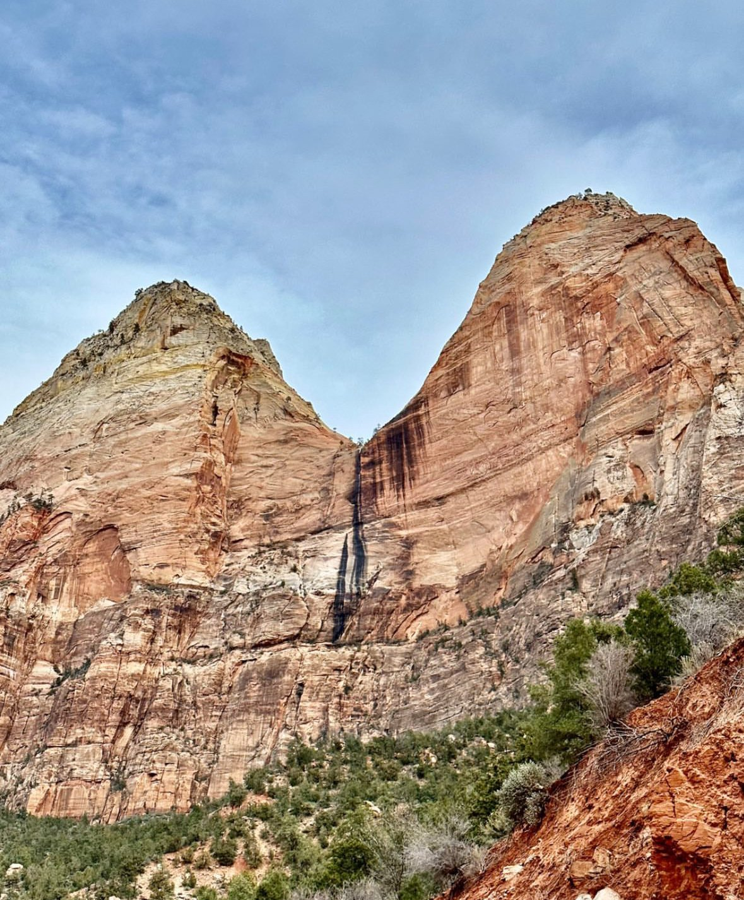
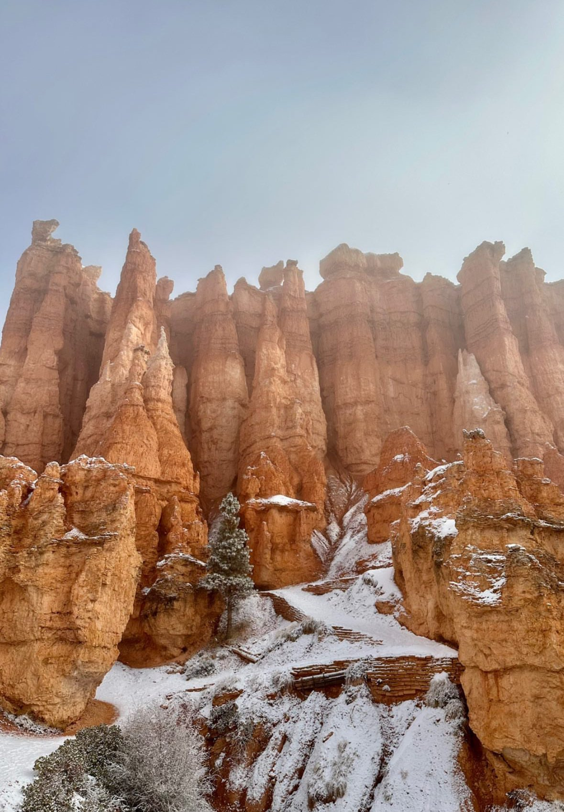

В моём архиве американского Юго-Запада есть стены Зайона и заснеженные каменные башни Брайса. Эти два парка дают разные впечатления и требуют разного плана прогулок. **Я бы объединил их в автомобильный маршрут по Юте, а при дополнительном времени продолжил дорогу к Пейджу в Аризоне и смотровой Хорсшу-Бенд.**

Зайон лучше раскрывается изнутри долины и на прогулках. Брайс позволяет увидеть большой амфитеатр со смотровых, а затем решить, спускаться ли между башнями. Хорсшу-Бенд — один конкретный вид после подхода по открытой местности. Для автомобильного круга из Лас-Вегаса я бы отвёл пять–семь дней, включая приезд и возвращение, и оставил резерв на погоду.

## Как выбрать места по времени и нагрузке

Если есть только один свободный день, выберите ближайший к вашей базе парк. Длинный переезд ради фотографий сразу во всех трёх местах оставит мало времени на саму прогулку. При трёх полных днях на месте придётся заранее определить, какой парк получает целый день, и отказаться от дальних троп. Пять–семь дней дают возможность разделить переезды и основные прогулки.

| Место | Ради чего ехать | Какой день закладывать | Главное ограничение |
|---|---|---|---|
| Зайон | Высокие стены каньона, прогулки по долине | Полный день без длинной тропы; больше для серьёзного похода | Шаттл, очереди, состояние выбранной тропы |
| Брайс-Каньон | Каменные башни и панорама амфитеатра | От неспешного посещения смотровых до полного дня с тропой | Высота, снег и обязательный обратный подъём |
| Хорсшу-Бенд | Изгиб Колорадо у Пейджа | Отдельная остановка с запасом на подход и отдых | Жара, мало тени, открытый край каньона |

Эти варианты предполагают самостоятельную поездку на машине. Экскурсия из большого города меняет логику: время на местах и остановки задаёт оператор. Сравнивайте не количество названий в программе, а продолжительность прогулки и время возвращения в гостиницу.

## Зайон: увидеть каньон изнутри

В Зайоне красные и светлые скалы поднимаются над долиной. На моих фотографиях видно, насколько различаются близкая стена и дальние уступы: это место стоит рассматривать с нескольких точек, а не ограничивать одной остановкой перед въездом. Для первого дня выберите доступную прогулку по долине и оставьте время на перемещения между остановками.

*Зайон: масштаб стен лучше читается, когда виден нижний уровень долины.*

**В сезон работы шаттла личные автомобили не допускаются на Zion Canyon Scenic Drive.** Это относится и к попытке проехать до первого автобуса или после последнего. Машину оставляют в разрешённом месте и пользуются парковым транспортом. Сам шаттл бесплатный, отдельная резервация для него не нужна; входной сбор в парк остаётся.

План дня стройте от обратного автобуса. На дальней остановке вы зависите от расписания, а очередь на посадку не обязана совпасть с вашим расчётом. Сохраните схему остановок, проверьте, какие тропы открыты, и не ставьте возвращение к машине вплотную к следующему мероприятию. Городской шаттл Спрингдейла и транспорт внутри парка — разные участки пути.

Для первого дня без сложного подъёма я бы выбрал **шаттл от Visitor Center → Temple of Sinawava, остановка 9 → мощёную Riverside Walk вдоль реки → возвращение тем же путём и автобусом**. На конце дорожки начинается речной маршрут Narrows; для обычной прогулки здесь можно развернуться, не заходя в воду. Перед выездом проверьте сообщения о закрытиях: доступность автобусной остановки не гарантирует открытие всей тропы.

### Angels Landing и Narrows — отдельные решения

**Для Angels Landing требуется разрешение.** Прогулка до Scout Lookout сама по себе такого разрешения не требует, но остаётся физически заметным подъёмом. Эти варианты лучше планировать отдельным днём, а не добавлять к первой прогулке по долине по остаточному принципу.

Если разрешения нет, не стройте день вокруг надежды договориться на месте. Выберите другую тропу заранее. Наличие permit также не подтверждает, что погода и ваше состояние подходят для продолжения. На узких и открытых участках возможность спокойно развернуться важнее фотографии с узнаваемой точки.

Narrows проходит по речному каньону и требует другого подхода к экипировке и условиям, чем сухая прогулка. Проверяйте действующие предупреждения NPS о воде, погоде и доступе. Не добавляйте этот маршрут к дневной программе как короткий заход «заодно»: неизвестная вода и сокращающийся световой день не становятся безопаснее от того, что вы уже доехали до парка.

## Брайс-Каньон: смотровые или спуск между башнями

Брайс узнаётся по худу — тонким каменным башням, которые заполняют амфитеатр. На моих снимках между оранжевыми уступами лежит снег. Он подчёркивает рисунок скал, но одновременно напоминает, что этот парк нельзя планировать по температуре в расположенных ниже городах.

*Брайс после снегопада: контраст белого снега и оранжевого камня меняет привычный пустынный пейзаж.*

Для первого знакомства выберите **Sunset Point → мощёный участок Rim Trail → Sunrise Point → возвращение к старту**. Вся прогулка туда и обратно — около 1,6 километра; NPS ориентирует примерно на час. Это возможность увидеть амфитеатр сверху без обязательного спуска между башнями. При льде или закрытии участка ограничьтесь доступной площадкой. Если компания хочет более длинную тропу, решение о спуске принимайте отдельно: возвращаться придётся наверх.

Главная особенность спуска — возвращение наверх. Оцените оставшиеся воду, силы и свет до того, как отойдёте от края. На снегу и льду привычная летняя обувь может оказаться неподходящей; при закрытой тропе смотровая остаётся полноценным вариантом посещения. Фотографии заснеженного Брайса не доказывают доступность всех его маршрутов зимой.

Шаттл в Брайсе рекомендован, но не обязателен. Это отличается от режима Zion Canyon Scenic Drive. Если автобусы работают в ваши даты, ими удобно пользоваться для посещения основных точек без поиска новой парковки у каждой. Перед поездкой проверьте карту обслуживания: не вся территория парка покрывается одним автобусным маршрутом.

Брайс стоит выбирать тем, кому важна панорама и возможность дозировать нагрузку. Зайон чаще требует продумывать день от остановок в долине; здесь многое видно сверху. Спуск меняет перспективу и даёт близкие виды башен, однако не является обязательным условием, чтобы поездка имела смысл.

## Дополнительно: Хорсшу-Бенд у Пейджа

У Хорсшу-Бенда Колорадо огибает высокий скальный выступ. Это **район Glen Canyon у города Пейдж, а не смотровая национального парка Гранд-Каньон**. Путаница в названиях приводит к неверному выбору ночёвки и слишком оптимистичным расстояниям в маршруте.

От парковки до смотровой и обратно — около 2,4 километра по описанию NPS. Покрытие обустроено, но маршрут проходит по открытой местности. По пути есть два навеса; у самой смотровой тени нет, воды на тропе тоже нет. В жаркий день это существеннее, чем небольшая длина маршрута.

Воду возьмите до выхода из машины. Для поездки с детьми или людьми, тяжело переносящими жару, выбирайте более прохладную часть дня и сокращайте программу при плохом самочувствии. Закрытая обувь, головной убор и защита от солнца нужны для подхода, а не только для большой прогулки по национальному парку.

На краю не стоит искать ракурс за пределами ограждённой площадки. Особенно опасно отступать спиной, глядя в экран. Удачный широкий кадр не требует стоять на незащищённом выступе. При сильном ветре возможность устойчиво идти и держаться на расстоянии от обрыва важнее запланированного времени съёмки.

Парковкой управляет город Пейдж, поэтому **America the Beautiful и пропуск Glen Canyon не заменяют её оплату**. Заложите эту статью расходов отдельно. Соседство с другими достопримечательностями Пейджа тоже не означает одинаковый режим доступа: не переносите правила самостоятельной прогулки у реки на экскурсионные каньоны.

## Как связать три места в поездке

Для первой поездки понятная основа — **Лас-Вегас → Спрингдейл/Зайон → Брайс → Пейдж/Хорсшу-Бенд → Лас-Вегас**. Так автомобиль возвращается в город получения, а два национальных парка и смотровая получают свои дни. Авиабилеты и возможность аренды на нужных условиях проверяйте до бронирования всего круга.

Я бы разделил программу так: день приезда и подготовки; полный день в Зайоне; переезд к Брайсу и смотровые; дополнительная прогулка в Брайсе или запас на погоду; переезд в Пейдж и Хорсшу-Бенд в подходящее по температуре время; день возвращения. Длинный поход в Зайоне потребует собственного дня.

При переезде из Зайона к Брайсу не путайте **Zion Canyon Scenic Drive**, где в сезон действуют ограничения для машин, и транзитное шоссе **Zion–Mount Carmel Highway/UT9**. На обычной машине к Брайсу едут через UT9, US89, UT12 и UT63; к Пейджу — возвращаются к US89 и движутся на юг. У тоннеля и на горных дорогах проверяйте ограничения для своего транспорта, особенно если вместо легкового автомобиля выбран большой кемпер.

Жильё в Спрингдейле удобно для Зайона, возле Брайса — для раннего начала у амфитеатра, в Пейдже — для Хорсшу-Бенда. Одна база на все три места сокращает число заселений, но увеличивает ежедневные переезды. Сравнивайте полный день от двери до двери, включая парковки и транспорт внутри парка.

Для группы с разными интересами оставьте хотя бы одно утро без обязательного общего похода. Один человек может выбрать тропу, другой — смотровые и отдых. Заранее назначенные место и время встречи работают лучше, чем надежда связаться по мобильной сети из любого участка каньона.

## Когда ехать и что бронировать

Весну и осень стоит рассматривать для прогулок по Юго-Западу, но единая «идеальная погода» на весь маршрут не гарантирована. Брайс расположен выше и может встретить холодом и снегом, когда у Пейджа тепло. Летом основное ограничение открытых маршрутов — жара; зимой к плану добавляются состояние дорог, лёд и короткий день.

Сначала выберите даты и проверьте доступ к главным прогулкам. Затем бронируйте жильё и машину, учитывая условия отмены. Если цель — Angels Landing, процедуру получения разрешения надо изучить до построения жёсткой программы. Снимок конкретного места из моего архива не заменяет текущие предупреждения парка.

### Сколько закладывать на входы в 2026 году

Для туристов, не являющихся резидентами США, изменился сам принцип расчёта. В каждом из двух парков обычный въезд легковой машины стоит **$35 — около 2 819 ₽**, а с каждого нерезидента от 16 лет дополнительно берут **$100 — около 8 054 ₽**, если вход не покрыт подходящим годовым пропуском.

**Non-Resident Annual Pass стоит $250 — около 20 135 ₽.** Действующий America the Beautiful покрывает стандартный вход и нерезидентный сбор для владельца и пассажиров одной частной машины. При пешем входе с оплатой за человека покрытие другое: владелец плюс ещё трое взрослых. Пропуск именной, нужен документ с фотографией; перед покупкой посмотрите [условия NPS для нерезидентов](https://www.nps.gov/aboutus/nonresident-fees.htm).

Пример для двоих взрослых нерезидентов на одной легковой машине: разовые входы в Зайон и Брайс — **$470, около 37 853 ₽**: два въезда по $35 и четыре сбора по $100. Один подходящий пропуск за $250 меняет эту часть бюджета заметнее, чем выбор платной парковки. Городская парковка Хорсшу-Бенда, кемпинги, специальные разрешения и экскурсии в этот расчёт не входят. Бесплатные дни NPS в 2026 году также не отменяют обычную плату для нерезидентов.

Банк или платёжный сервис может использовать другой курс и комиссию; перед оплатой сравнивайте долларовую цену.

## Что оставить в маршруте, если времени стало меньше

Для любителя походов я бы сохранил полноценный день в Зайоне и убрал необязательные переезды. Для спокойного знакомства с рельефом — смотровые Брайса без обязательного спуска. Для короткой остановки рядом с Пейджем — Хорсшу-Бенд с нормальным запасом воды и времени.

Три этих места дают разную перспективу: внутри каменных стен, над амфитеатром и над изгибом реки. Поэтому их интересно сочетать. Но поездка выигрывает от свободного часа на прогулку больше, чем от четвёртого названия, ради которого приходится возвращаться в темноте и без сил. Перед выбором другого региона сравните [сезоны и географию путешествия по США](/usa/): климат Юго-Запада не описывает всю страну.
